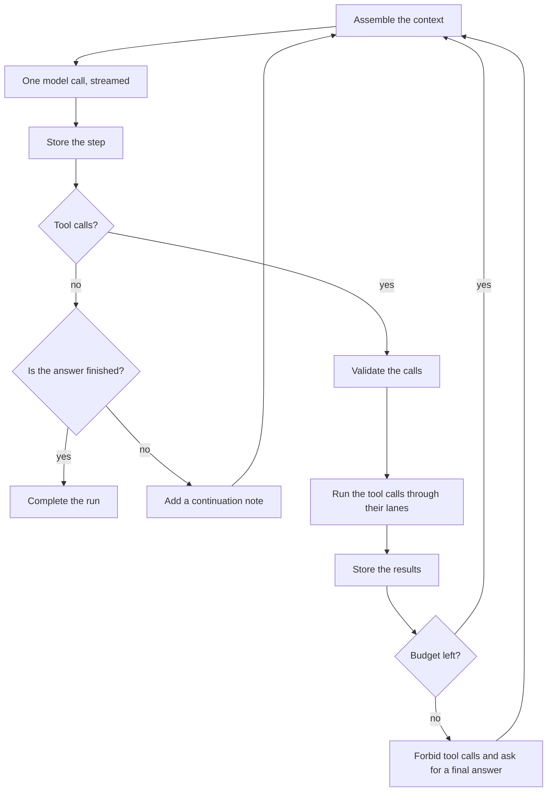

# Agent runtime

|              |                                                                                                                                                                                                                                                                          |
| ------------ | ------------------------------------------------------------------------------------------------------------------------------------------------------------------------------------------------------------------------------------------------------------------------ |
| Status       | Draft for review                                                                                                                                                                                                                                                         |
| Last updated | 2026-10-15                                                                                                                                                                                                                                                               |
| Related      | [ADR-0011](../adr/0011-own-the-provider-adapters.md), [ADR-0012](../adr/0012-run-agents-as-durable-actors.md), [ADR-0024](../adr/0024-run-child-agent-tasks-in-the-parent-run.md), [Tools](tools.md), [Orchestration](orchestration.md), [Domain model](domain-model.md) |

The agent runtime (`mannie-runtime`) executes agents. The same runtime runs in the desktop app and in every worker ([ADR-0015](../adr/0015-run-an-agent-runtime-on-every-machine.md)).

## 1. Responsibilities

The runtime owns the agent loop, budgets, retries, context management and compaction, and the handling of model quirks. It also runs tasks for child agents and records every change as an event. Provider adapters stream one model call each, tools perform operations, and the store persists data. None of them drives the loop.

## 2. Runs as actors

- Each active run is a tokio task with a mailbox. The mailbox accepts stop requests and the shutdown of the process, and later approval decisions and, for tasks, cancellation. Every wait of a run, for a model call's slot, a retry's delay, a stream or a compaction, also listens to the mailbox.
- A run continues whether or not anyone subscribes to it. Subscribers attach and detach at any time ([ADR-0012](../adr/0012-run-agents-as-durable-actors.md)).
- A run stores each event before publishing it, and it stores each step before running that step's tool calls.
- Each conversation has at most one active run, and different conversations run in parallel. A global limit of 8 concurrent model calls protects the provider and the machine; runs over the limit wait in order.
- A supervisor watches each run's task. A run whose task panics ends as failed with an internal error, and its conversation is free again.
- A child agent's run belongs to its parent's run, which starts it, reads its state from a board that the child writes, and writes that state into the parent's conversation as the conversation's only writer. The parent's run ends only after its children have ended ([ADR-0024](../adr/0024-run-child-agent-tasks-in-the-parent-run.md)).
- A worker task publishes its state on the same board, from the stream of states that the master follows through the runtime's delegation port. The parent's run does not wait for an offline worker when it stops, and quitting leaves worker tasks running ([ADR-0027](../adr/0027-delegate-tasks-to-workers-through-a-runtime-port.md)).
- On a worker, the runtime runs tasks that the master assigns, each in a task conversation without a parent, under the worker's agent definition and policy ceiling ([ADR-0028](../adr/0028-run-assigned-tasks-under-the-host-ceiling.md)).
- At shutdown, the runtime accepts no new runs, asks every run to stop, and waits up to 3 seconds; runs still active become interrupted.
- At startup, runs that were active become interrupted, with the text they had written, the runs of task conversations first. The owner retries them, or for tasks the assigning agent decides.

## 3. The loop

- Every step makes exactly one model call. The runtime never lets a provider or a library run tool calls on its own.
- Budgets come from the agent definition: the number of rounds with tool calls, the number of tool calls in a turn, and the number of tasks that a reply can give to child agents. When a budget runs out, the next request keeps the tools, so the model still reads its earlier calls, but sets the tool choice to `none` and tells the model to give its final answer. A call that a server returns anyway is not run.
- Tool calls in one step run through lanes. The calls start in their order, and calls without a lane of their own run one after another. A task for a child agent does not hold up the step: the next call starts while the child works, `wait_for_tasks` waits until its tasks end, and when the calls are done, the step waits for its tasks that do not run in the background ([tasks](../features/child-agents/tasks.md#lanes)). On one machine, operations that change files are always serialized, a child's too. The run gives up its model slot while its tools run and while it waits for tasks ([tool calls](../features/system-tools/tool-calls.md#the-loop)).

## 4. Model calls

- The runtime calls a provider adapter through the `Provider` trait and receives normalized events: text and reasoning deltas, tool calls, usage figures and the end of the step ([ADR-0011](../adr/0011-own-the-provider-adapters.md)).
- Transient errors are retried up to 6 attempts, with a full-jitter delay that starts at 1 second and doubles up to 60 seconds, or the provider's `Retry-After` when it asks for longer; a provider that asks for more than 10 minutes ends the run. The text a failed attempt streamed is dropped from the transcript, and the UI shows the retry with its countdown. A context overflow triggers one forced compaction before the call is retried. A permanent error ends the run with its cause.
- Stopping a run cancels the provider call at once. The partial text stays in the transcript, marked as stopped.

## 5. Model quirks and early stops

Some servers and models stop a step early or put tool calls in the wrong place. Quirk profiles in the provider layer detect these cases and report them as normalized events:

| Case                                                 | What the runtime does                                                                              |
| ---------------------------------------------------- | -------------------------------------------------------------------------------------------------- |
| A step with no text and no tool call                 | Sends a short continuation note to the model and calls it again                                    |
| A tool call written as text or left in the reasoning | Converts it when the quirk profile allows that, otherwise asks the model to use the tool interface |
| An answer that announces a next step and then stops  | Sends a continuation note                                                                          |
| A task report that may be unfinished                 | Asks the agent once to confirm that it is done before the report goes back                         |

The number of continuation notes per turn is limited, and a child's confirmation does not count against it. Continuation notes are recorded as parts that only the model sees, and the UI does not show them as messages.

## 6. Transcript and events

- The transcript is an append-only list of typed parts. Features add part types through an [extension point](extension-points.md#35-transcript-parts-and-run-events).
- Each change is an event with the conversation's next sequence number. Subscribers replay from a cursor ([desktop app](desktop-app.md#3-streaming-to-the-ui), [orchestration](orchestration.md#5-delegation)).
- Provider-private data, such as encrypted reasoning, is stored with a binding to the provider profile and replayed only to the same binding.
- The store writes deltas in batches every 50 ms and commits lifecycle changes, such as a run's start and end and a part's end, durably ([ADR-0009](../adr/0009-persist-state-in-sqlite.md)). When a part ends, its deltas become the part's text in the same transaction and their events are removed; the part's final event carries the whole text, so replaying from any cursor still rebuilds the transcript.
- A subscriber without a cursor, or with one too far back, starts from a snapshot of the latest turns, and earlier turns load in pages.

## 7. Context management

- The context budget is the model's context window minus the output reserve and a safety margin of 5%. The provider profile sets the window and the output limit. The owner can change both, and they have defaults for known models.
- The token counts that the provider reports after each call are the truth. Before a conversation's first response, the runtime estimates conservatively, at 2 tokens for every 5 bytes and 4 more for each message, and later it calibrates the estimate of new text on the counts it received.
- When the projected context passes 80% of the budget, the runtime compacts the oldest whole turns into a checkpoint and aims for 30%, keeping the two latest completed turns, then one, then none until it gets there. It never covers the latest turn, whose request is being answered. An automatic compaction that would free less than 10% is skipped, unless the request would not fit otherwise. The owner can also compact a conversation at any time.
- A checkpoint is a summary written by the same profile's model without tools. It records which turns it covers and a hash of their content, chained to the previous checkpoint's hash, and it becomes invalid if those turns change. It reaches the model as an instruction section after the stable ones.
- A tool result fits in the result limit, 64 KiB or a quarter of the budget. Longer command output is archived outside the transcript: the model sees a head and a tail with a reference, and `read_tool_output` returns the rest in pages. Inside the turn being answered, when a compacted context still needs more than 80% of the budget, older results become short notes that carry their reference.
- Each model call of a reply reaches the model as an assistant message of its own, followed by the results of its tool calls, so the model reads its steps in the order it made them.
- The system prompt is assembled from [instruction sections](extension-points.md#34-instruction-sections). Stable sections come first, so providers can cache the prefix, and context that changes every turn goes into the latest user message.

## 8. Stop, retry and recovery

| Action or event | Behavior                                                                                                                                                                                                                                                        |
| --------------- | --------------------------------------------------------------------------------------------------------------------------------------------------------------------------------------------------------------------------------------------------------------- |
| Stop            | Cancels the model call and pending approvals, stops running tool calls through the process supervisor, stops the run's child agents, cancels its worker tasks, and keeps the partial text. Stopping a child's run ends only its task, and its parent continues. |
| Retry           | Starts a new run for the latest turn, when its run failed, stopped or was interrupted. Completed operations keep their results; uncertain operations are shown to the model, not repeated.                                                                      |
| Process restart | Active runs become interrupted. Executing operations become uncertain. Approvals that were pending are canceled. Tasks that were running become interrupted, and nothing restarts them.                                                                         |

## 9. Testing

- A scripted fake provider plays fixed sequences of events, so tests of the loop are deterministic and need no network or API key. They run on paused time, so retries and timeouts take no real time.
- A property test interleaves random events with subscribers that come, fall behind and resubscribe, and checks that each one ends with the final transcript.
- The compaction tests run at the limits of every model that Mannie knows and at 4K, 8K, 32K and 128K tokens, and check that no request exceeds its budget and that the transcript stays whole.
- Recorded streams from each supported server test the adapters and their quirk profiles (V8).
- Crash tests stop the process at each point where the loop persists something and check the recovered state.
- Model evaluations check that prompts and tool descriptions still work with real models: `task tools:eval` and a weekly workflow run them, and a scripted oracle checks the harness and its checks without a model ([system tools](../features/system-tools/README.md#acceptance)).
