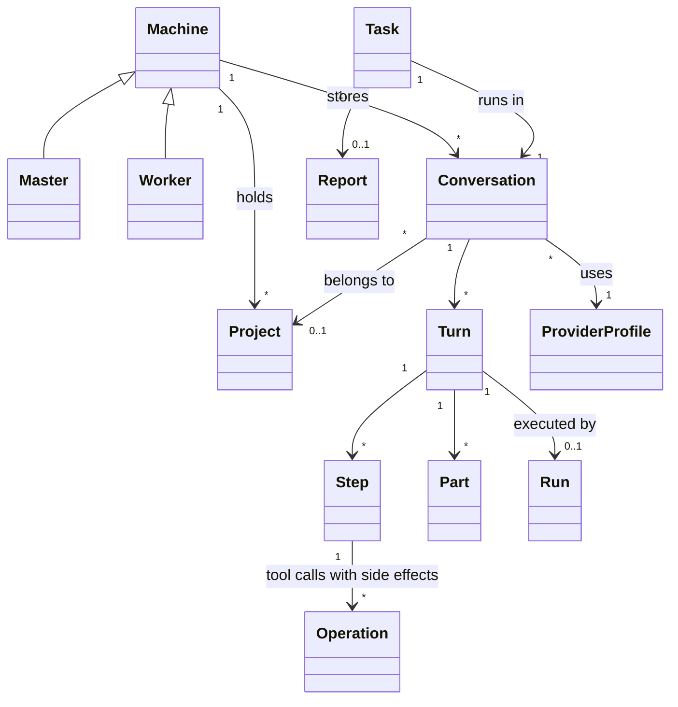
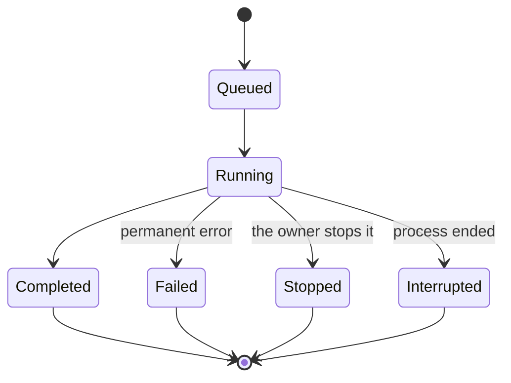
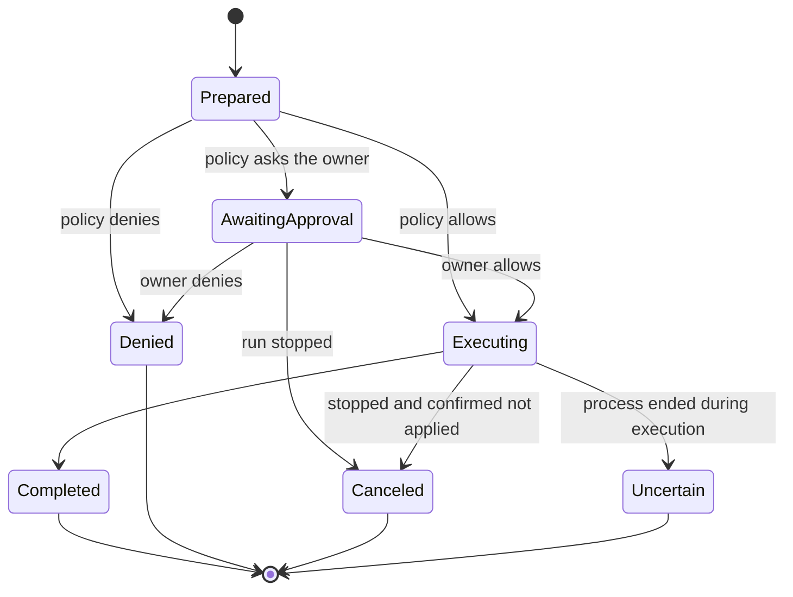
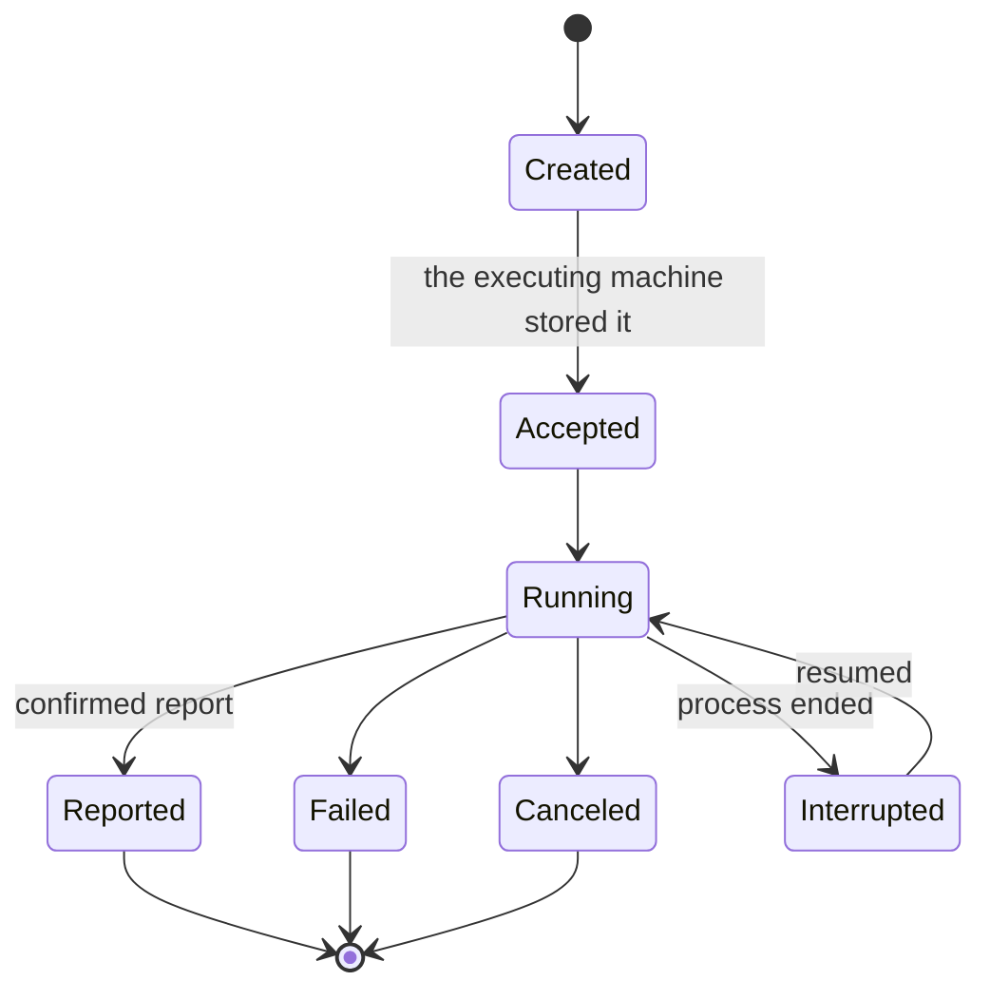
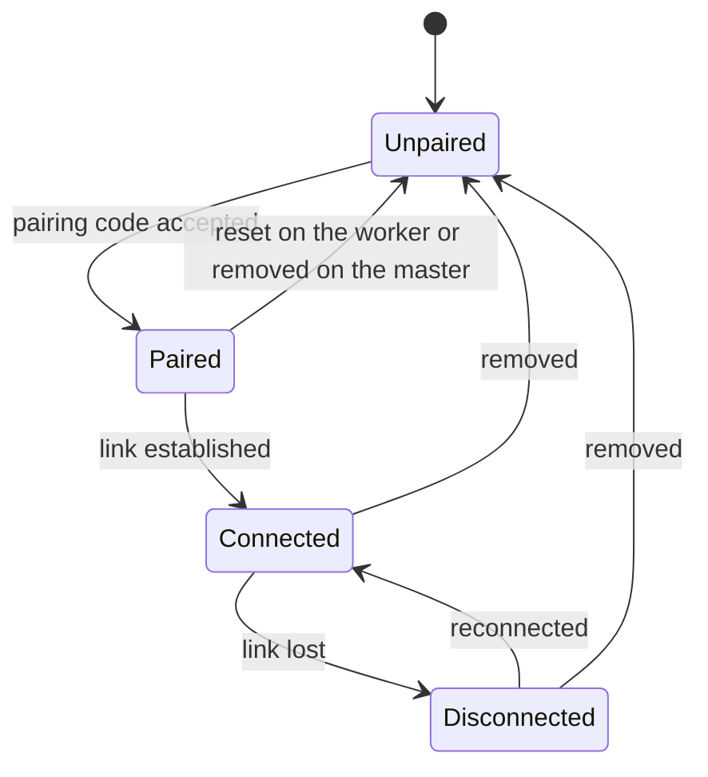

# Domain model

|              |                                                                                                                                              |
| ------------ | -------------------------------------------------------------------------------------------------------------------------------------------- |
| Status       | Draft for review                                                                                                                             |
| Last updated | 2026-10-15                                                                                                                                   |
| Related      | [Glossary](../glossary.md), [Agent runtime](agent-runtime.md), [Tools](tools.md), [Orchestration](orchestration.md), [Overview](overview.md) |

This document defines the core concepts, their lifecycles and the invariants every contract follows. The [glossary](../glossary.md) gives short definitions; this document shows how the concepts relate.

## 1. Concepts

## 2. Machines

- A machine is a computer Mannie acts on. There is one master, the desktop app, and any number of workers. Each worker runs on its own host.
- The master holds the owner's conversations, the provider profiles, the worker registry and the owner's approvals.
- A worker holds its host facts, its host instructions, its policy ceiling and the conversations of the tasks it runs.
- A worker is paired with exactly one master. The master records each worker's name, address, pinned key and last known host facts.

## 3. Conversations, turns, steps and parts

- A conversation is an ordered list of turns between a requester and an agent. The requester is the owner for conversations on the master, and an agent for task conversations.
- A turn is one request and the agent's complete response. A turn is made of parts, the typed elements of the transcript: text, reasoning, tool call, tool result, task events, errors and the part types that features add.
- A step is one model call within a turn, together with the tool calls it produced. A turn with tool use has several steps.
- Parts are appended. A part's text and document can change while it is open, as streamed text does or a tool call that waits for an approval, and they are final once it finishes. A correction or a retry adds parts; it does not rewrite finished ones.
- Every change to a conversation produces an event with a sequence number that is unique and increasing within that conversation.
- A project is a folder on the master that the owner added, with the conversations that work in it ([ADR-0023](../adr/0023-organize-conversations-into-projects.md)). A conversation belongs to at most one project, from its start or from the moment it moves into one, and its workspace is the project's folder. A general conversation belongs to none.

## 4. Runs

A run executes one turn ([ADR-0012](../adr/0012-run-agents-as-durable-actors.md)).

- A run that waits for the owner's approval of an operation stays running. Its activity says that it waits, and it holds no model slot meanwhile.
- A retry of a failed, stopped or interrupted run starts a new run for the same turn. It reuses the results of operations that completed and never repeats an operation that may have run. When the earlier run made tool calls, its parts stay in the turn and the new run continues after them.
- A run's state is stored before it is published, like every other event.

## 5. Operations

An operation is one side effect of a tool, recorded in the journal ([ADR-0013](../adr/0013-journal-every-side-effect.md)).

- An operation records its canonical accesses: each path with its access mode, and each command with its shell and working directory.
- The journal record of an operation is its tool call part, so each change of its state is an event of the conversation.
- Executing is committed durably before the side effect starts.
- An uncertain operation is reported to the model and to the owner. Nothing repeats it automatically.

## 6. Tasks and reports

A task is work that one agent assigns to another: a child agent on the same machine, or a worker agent ([orchestration](orchestration.md)).

- A task has an ID that the assigning side chooses. Submitting the same ID twice creates one task.
- A task carries an instruction, its constraints (budgets, deadline, a narrower policy) and a provider profile. It may continue an earlier task's conversation.
- A task runs in a conversation on the executing machine. The assigning agent receives only the report; the owner can open the whole task conversation.
- A report is confirmed: the executing agent checked that it finished before it answered.

## 7. Workers and the link

- Pairing pins each side's public key. A worker accepts connections only from its pinned master, and the master only from the pinned worker key.
- On connect, both sides agree on a feature level for every link service.
- Unpairing revokes every active credential lease of that worker.

## 8. Identifiers and time

- Entity IDs are UUIDv7 strings, created by the side that creates the entity.
- Event sequence numbers are integers, increasing within a conversation.
- Timestamps are UTC, stored as milliseconds since the Unix epoch. The UI shows local time.

## 9. Invariants

1. The transcript is append-only. Compaction changes what the model sees, never what is stored.
2. An event is stored before it is published.
3. An operation executes at most once. An uncertain operation is never repeated automatically.
4. A side effect needs an allow decision from policy or from the owner. Content that the model reads never grants a permission.
5. An agent's tools act only on the machine where the agent runs. The master never runs tools on a worker's host.
6. A worker's policy ceiling can be narrowed for a task and never widened.
7. Provider credentials are at rest only in the master's operating system credential store.
8. Contracts and stored data change only by addition, with deprecation before removal.
9. Every task ID identifies one task, however many times it is submitted.
10. A conversation in a project works in the project's folder and never leaves the project.
