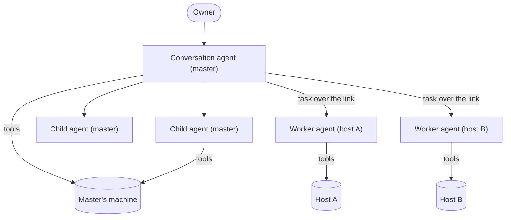
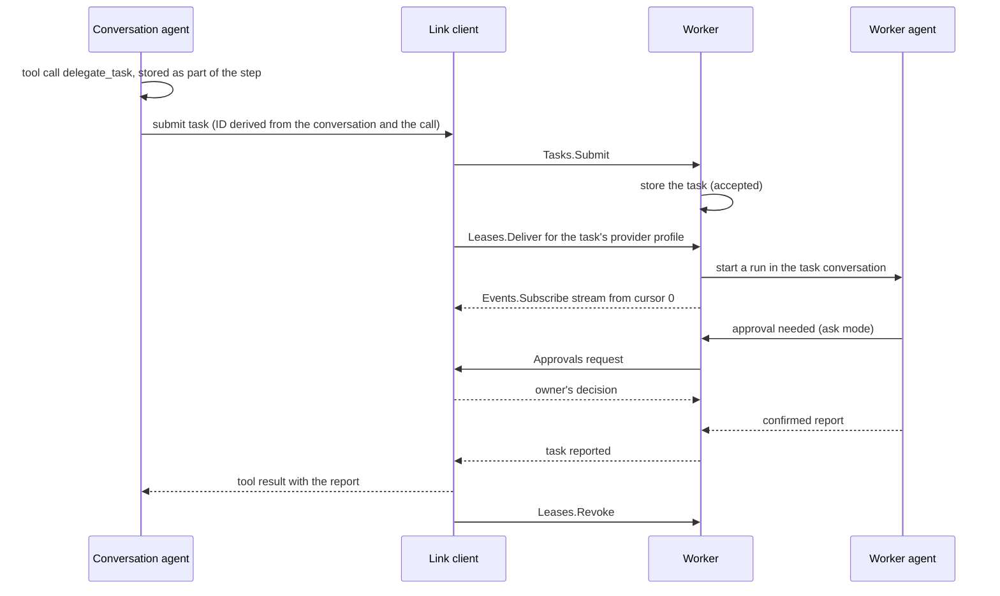
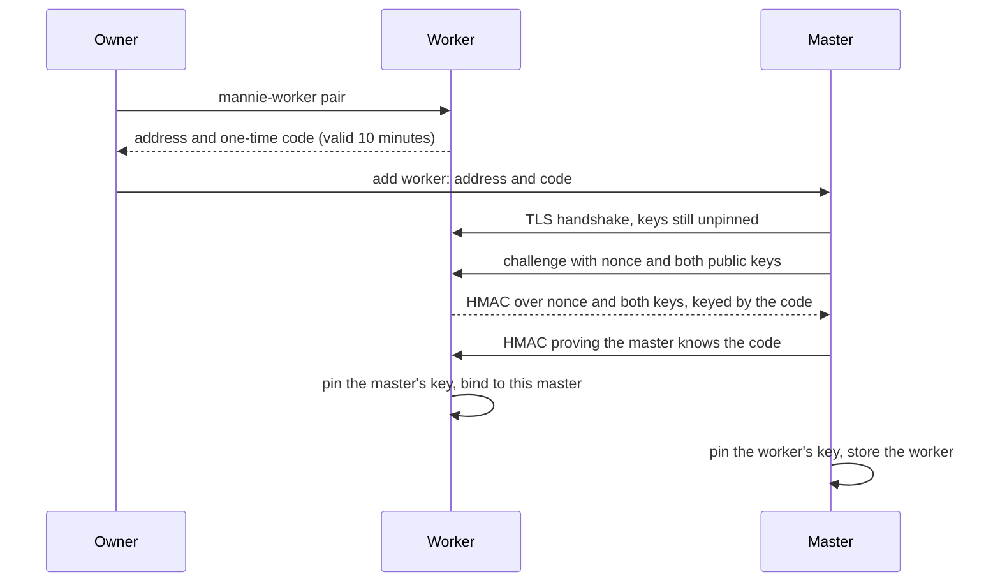

# Orchestration

|              |                                                                                                                                                                                                                                                                                                    |
| ------------ | -------------------------------------------------------------------------------------------------------------------------------------------------------------------------------------------------------------------------------------------------------------------------------------------------- |
| Status       | Draft for review                                                                                                                                                                                                                                                                                   |
| Last updated | 2026-10-15                                                                                                                                                                                                                                                                                         |
| Related      | [ADR-0015](../adr/0015-run-an-agent-runtime-on-every-machine.md), [ADR-0016](../adr/0016-link-machines-over-pinned-mtls-grpc.md), [ADR-0010](../adr/0010-keep-provider-credentials-on-the-master.md), [Child agents](../features/child-agents/README.md), [Workers](../features/workers/README.md) |

This document describes how agents divide work: child agents on the same machine, and workers that own their hosts.

## 1. The model

- The master's conversation agent takes care of the owner's request. It answers, uses tools on the master's machine, starts child agents there and delegates tasks to workers ([ADR-0015](../adr/0015-run-an-agent-runtime-on-every-machine.md)).
- A worker agent takes care of the master's request. It knows its host from the host facts and host instructions, and it decides how to do the task there. The master does not need to know how the host works.
- An agent's tools act only on its own machine. The master never runs tools on a worker's host.
- Workers do not delegate to other workers.

## 2. Tasks and reports

A task is the one contract for assigning work, whether the work goes to a child agent or to a worker.

| Field            | Meaning                                                                                                        |
| ---------------- | -------------------------------------------------------------------------------------------------------------- |
| Task ID          | Chosen by the assigning side. Submitting the same ID again does not create a second task.                      |
| Instruction      | Self-contained text: the goal, the context the executing agent needs, the constraints and what counts as done. |
| Agent definition | Which kind of agent runs the task, for example explore or general for a child agent.                           |
| Constraints      | Budgets, an optional deadline and, for a worker, an optional policy that narrows its ceiling.                  |
| Provider profile | The model the task uses. The master leases the credential to a worker ([§7](#7-model-access-on-workers)).      |
| Continuation     | Optionally, an earlier task's conversation to continue, so the executing agent keeps its context.              |
| Background       | Whether the assigning agent waits for the report or continues and collects it later.                           |

A report is the result of a task: a status (reported, failed, canceled or interrupted), the final answer, and references to the task conversation. The executing agent confirms that it finished before it reports. The assigning agent receives only the report. The owner can open the whole task conversation.

## 3. Child agents

- A child agent runs on the same machine as the agent that started it, in a task conversation of its own, with its own context window and the provider profile of the reply that started it. The parent's run starts it and ends only after it ended ([ADR-0024](../adr/0024-run-child-agent-tasks-in-the-parent-run.md)).
- The built-in agent definitions are explore, with read-only tools, and general, which adds file changes and commands. A feature can register more definitions.
- The conversation agent assigns tasks with the runtime's task tools, `start_task`, `follow_up_task` and `wait_for_tasks`. Each child of a conversation has a number, by which the model and the owner refer to it.
- A child agent works under its parent conversation's workspace, project, grants and rules. Its approval requests appear in the parent's conversation, inside the card of its task, labeled with the task's number and title, and a grant that the owner gives there is saved for the parent.
- A pool of slots on the machine limits how many child agents run at once (4 by default, configurable from 1 to 16). Tasks over the limit wait for a slot, in the order they started, and a child keeps its slot until it ends.
- A background task lets the parent continue while the child works. The parent reads the report later with `wait_for_tasks`, and the parent's reply does not finish while background tasks are still running.
- A follow-up task continues a finished child agent's conversation, with the same number and agent.
- The report is the child's last answer after it confirmed once that it finished, and it reaches the parent's model only as a tool result.
- Child agents do not start child agents of their own. Stopping the parent stops its children first, and the owner can also stop one child. After a restart, nothing starts a task again by itself.
- The owner can open a child's conversation, read-only, in a side panel beside the parent's ([ADR-0025](../adr/0025-add-side-panels-to-the-shell.md)).

## 4. Workers

A worker is the headless `mannie-worker` service on a host. It runs the same runtime as the master, with its own store and its own tools.

| Worker property    | Where it comes from                                                                                                                              |
| ------------------ | ------------------------------------------------------------------------------------------------------------------------------------------------ |
| Name and purpose   | The worker's configuration on its host, shown to the master and to the conversation agent                                                        |
| Host instructions  | A file on the host that the owner writes: conventions, constraints and what the host is for. The worker agent reads it with every task.          |
| Host facts         | Discovered by the worker: operating system and version, architecture, shells and installed tools. Reported to the master when the link connects. |
| Policy ceiling     | The worker's configuration on its host: read-only, ask, or autonomous within allowed folders and rules                                           |
| Task conversations | The worker's own database                                                                                                                        |

- The policy ceiling is the most the worker's tools may do. In read-only mode, only read-only tools run. In ask mode, every side effect that the ceiling does not already allow goes to the owner for approval through the master. In autonomous mode, side effects within the allowed folders and rules run without asking.
- A task can narrow the ceiling, for example to read-only, but it cannot widen it. A worker enforces its ceiling even against instructions from the master.
- The conversation agent sees each worker's name, purpose, status and host facts, and chooses where a task should go.

## 5. Delegation

- The task ID is derived from the conversation, the turn and the tool call, so a retry of the same step submits the same ID and the worker does not start a second task.
- The master stores its subscription cursor for every task. After a link drop it reconnects and subscribes again from that cursor, so the task's events arrive once each, in order.
- Calls to different workers in one step run in parallel. Each worker runs several tasks at once, up to its configured limit.
- A follow-up can continue an earlier task's conversation on the same worker, so the worker agent keeps what it learned.
- The owner sees every task conversation live in the master's UI, and afterwards as part of the conversation that delegated it.

## 6. Approvals across the link

- In ask mode, a worker sends each approval request to the master over the link, with the host, the canonical paths or the full command, and the task it belongs to.
- The master shows the request in the conversation that delegated the task. The owner's decision goes back to the worker, which continues the operation's lifecycle ([tools](tools.md#4-authorization)).
- While the master is offline or the link is down, the request waits on the worker, and the operation does not run. Mannie never treats a missing answer as approval.
- When a task is canceled, its pending approvals are canceled with it.

## 7. Model access on workers

- The master holds the provider profiles and their credentials ([ADR-0010](../adr/0010-keep-provider-credentials-on-the-master.md)). A worker never stores a provider credential.
- For each task, the master leases the credential of the task's provider profile over the link. The worker keeps it in memory until the task ends, is canceled or the worker is unpaired, and then drops it.
- With a lease in memory, a worker finishes its task even when the master goes offline. A worker that restarts during a task has lost the lease, so the task waits until the master delivers a new one.
- The worker calls the provider itself, so the provider's endpoint has to be reachable from the host.
- The documentation recommends provider keys with limited scope and spending limits for profiles that workers use.

## 8. Pairing

- The HMAC binds both public keys and the code, so an attacker in the middle without the code cannot complete pairing or swap a key.
- Pairing attempts are rate-limited, and a code works once.
- A worker accepts connections only from the master it paired with. `mannie-worker pair --reset` clears the binding.
- Both sides pin the hash of the other's public key, not a certificate, so certificates can be renewed without pairing again.

## 9. The link

- The master connects to the worker's configured TCP port. The worker never connects to the master.
- The link is gRPC over HTTP/2 with mutual TLS, built on tonic, prost and rustls with ring ([ADR-0016](../adr/0016-link-machines-over-pinned-mtls-grpc.md)).
- There is one persistent connection per worker, with HTTP/2 keepalive. The state of the connection is the worker's status in the UI.
- The contracts live in `proto/mannie/link/v1/`. `buf lint` and `buf breaking` check every change.

| Service   | Purpose                                                                          |
| --------- | -------------------------------------------------------------------------------- |
| Session   | Hello, feature levels and host facts                                             |
| Tasks     | Submit (idempotent), cancel and continue tasks                                   |
| Events    | Subscribe to a task conversation's events from a cursor                          |
| Approvals | The worker asks, and the master answers                                          |
| Leases    | Deliver and revoke credential leases                                             |
| Update    | Stage, verify, install and roll back a worker build. Its contract never changes. |

## 10. Compatibility and updates

- Each protobuf package has a feature level. On connect, the two sides agree on the highest level both support, and features check the agreed level before using a service.
- A master works with workers one minor version behind. Contracts only grow, and removing something takes a deprecation release.
- The master pushes worker updates through the Update service. The worker checks the Ed25519 signature against its embedded release key, runs the new binary's self-check, keeps the previous binary, switches to the new one and restarts. If the new build fails its self-check or does not come back, the worker rolls back to the previous binary.
- The Update service never changes, so the master can always update an older worker.

## 11. Failure behavior

| Failure                                         | Behavior                                                                                                                                                 |
| ----------------------------------------------- | -------------------------------------------------------------------------------------------------------------------------------------------------------- |
| The link drops during a task                    | The worker keeps working. The master reconnects, subscribes from its cursor and receives the missed events. Approval requests wait.                      |
| The master is offline                           | Tasks with a lease continue. Operations that need approval wait. A worker that restarted waits for a new lease before calling a provider.                |
| The worker crashes                              | Its active tasks become interrupted, and executing operations become uncertain. The conversation agent sees the interrupted task and decides what to do. |
| The master retries a step that delegated a task | The same task ID reaches the worker, which returns the existing task instead of starting a new one.                                                      |
| A worker runs an older version                  | Feature levels limit the master to the services the worker supports, and the UI suggests an update.                                                      |
| The owner unpairs a worker                      | The master revokes the worker's leases, and the worker refuses further connections from the old master.                                                  |
