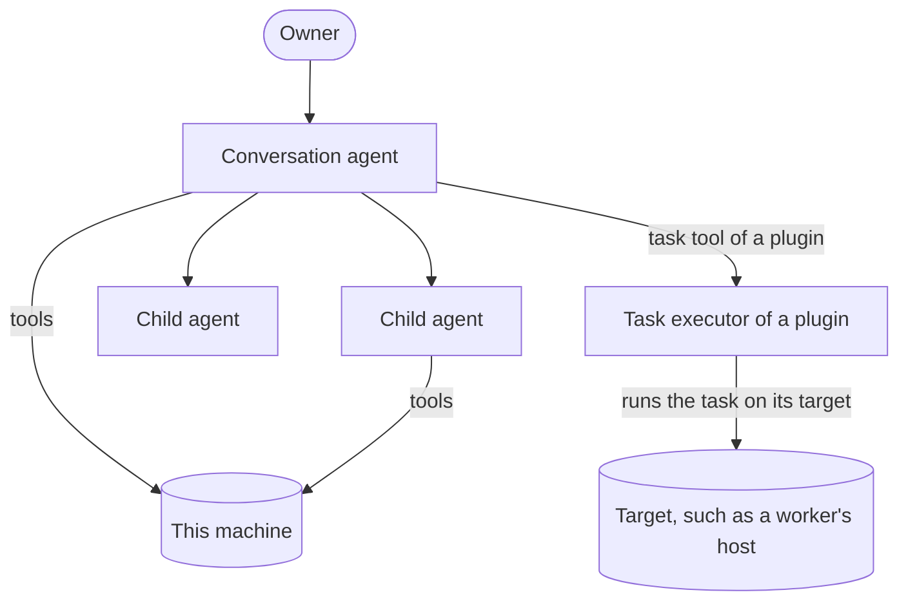

# Orchestration

|              |                                                                                                                                                                                                                                                                                                                                                                                                                                           |
| ------------ | ----------------------------------------------------------------------------------------------------------------------------------------------------------------------------------------------------------------------------------------------------------------------------------------------------------------------------------------------------------------------------------------------------------------------------------------- |
| Status       | Draft for review                                                                                                                                                                                                                                                                                                                                                                                                                          |
| Last updated | 2026-10-16                                                                                                                                                                                                                                                                                                                                                                                                                                |
| Related      | [ADR-0024](../adr/0024-run-child-agent-tasks-in-the-parent-run.md), [ADR-0028](../adr/0028-run-assigned-tasks-under-the-host-ceiling.md), [ADR-0030](../adr/0030-split-mannie-into-a-core-and-plugins.md), [ADR-0031](../adr/0031-move-workers-into-the-first-plugin.md), [ADR-0010](../adr/0010-keep-provider-credentials-on-the-master.md), [Child agents](../features/child-agents/README.md), [Extension points](extension-points.md) |

This document describes how agents divide work: child agents on the same machine, and tasks that a plugin's executor runs elsewhere. The Workers plugin is such an executor, and its own documents describe workers, delegation, pairing and the link ([workers architecture](../../plugins/workers/docs/architecture.md)).

## 1. The model

- The conversation agent takes care of the owner's request. It answers, uses tools on its machine, starts child agents there, and gives tasks to the executors of the plugins that are on.
- An agent's tools act only on its own machine. A plugin's executor runs a task wherever its target is, and the core never runs tools there.
- A task's agent never assigns tasks of its own.

## 2. Tasks and reports

A task is the one contract for assigning work, whatever runs it.

| Field            | Meaning                                                                                                                                 |
| ---------------- | --------------------------------------------------------------------------------------------------------------------------------------- |
| Task ID          | Chosen and stored by the runtime before anything runs. Submitting the same ID again does not create a second task.                      |
| Instruction      | Self-contained text: the goal, the context the executing agent needs, the constraints and what counts as done.                          |
| Agent definition | Which kind of agent runs the task, for example explore or general for a child agent.                                                    |
| Constraints      | Budgets, an optional deadline and what an executor adds, such as a narrower policy for a task on a worker.                              |
| Provider profile | The model the task uses. An executor that runs tasks on another machine borrows the credential from the core ([§4](#4-task-executors)). |
| Continuation     | Optionally, an earlier task's conversation to continue, so the executing agent keeps its context.                                       |
| Background       | Whether the assigning agent waits for the report or continues and collects it later.                                                    |
| Executor         | For a task of a plugin's executor, its kind, which is the plugin's ID, and its target, with an ID and the name the owner sees.          |

A report is the result of a task: a status (reported, failed, canceled or interrupted), the final answer, and references to the task conversation. The executing agent confirms that it finished before it reports. The assigning agent receives only the report. The owner can open the whole task conversation.

## 3. Child agents

- A child agent runs on the same machine as the agent that started it, in a task conversation of its own, with its own context window and the provider profile of the reply that started it. The parent's run starts it and ends only after it ended ([ADR-0024](../adr/0024-run-child-agent-tasks-in-the-parent-run.md)).
- The built-in agent definitions are explore, with read-only tools, and general, which adds file changes and commands. A feature can register more definitions.
- The conversation agent assigns tasks with the runtime's task tools, `start_task`, `follow_up_task` and `wait_for_tasks`. Each child of a conversation has a number, by which the model and the owner refer to it.
- A child agent works under its parent conversation's workspace, project, grants and rules. Its approval requests appear in the parent's conversation, inside the card of its task, labeled with the task's number and title, and a grant that the owner gives there is saved for the parent.
- A pool of slots on the machine limits how many child agents run at once (4 by default, configurable from 1 to 16). Tasks over the limit wait for a slot, in the order they started, and a child keeps its slot until it ends.
- A background task lets the parent continue while the child works. The parent reads the report later with `wait_for_tasks`, and the parent's reply does not finish while background tasks are still running.
- A follow-up task continues a finished child agent's conversation, with the same number and agent.
- The report is the child's last answer after it confirmed once that it finished, and it reaches the parent's model only as a tool result.
- Child agents do not start child agents of their own. Stopping the parent stops its children first, and the owner can also stop one child. After a restart, nothing starts a task again by itself.
- The owner can open a child's conversation, read-only, in a side panel beside the parent's ([ADR-0025](../adr/0025-add-side-panels-to-the-shell.md)).

## 4. Task executors

Child agents are the runtime's own executor. A plugin adds a kind of task by registering an executor while it is on ([ADR-0031](../adr/0031-move-workers-into-the-first-plugin.md), decision 4), and the runtime keeps the task contract for every kind: the `task` part, numbers, the board, lanes, background tasks, `follow_up_task`, `wait_for_tasks` and recovery.

- An executor gives its task tool, which a run reads once when it starts, with its name, description and strict schema, and the instruction section for the runs that are offered it. It plans a call of its tool or refuses it with a code and the text that the model reads, and it plans a follow-up on the target that ran the earlier task.
- The runtime stores the task, with its ID and a document of the executor's, before the executor submits it, so a retried step finds the same task. The executor publishes each state of a task with a version, and a state older than the stored one changes nothing. The core keeps the executor's document as it is and never reads it.
- An executor serves its tasks' conversations: the subscription, earlier turns, the checkpoint, archived outputs and the owner's approval decisions. The core forwards each read of such a conversation to its executor and keeps only its summary.
- An executor whose tasks outlive the reply that started them, as a worker's do, gets them back when the reply ends or stops: the runtime lets them go, the part ends with the result that the task may still run on its target, and `wait_for_tasks` follows the task again later.
- The executor reaches the core only through the services that its plugin's grant gives it: publishing states and endings, the executor's document and its outbox, whether a parent conversation has full access, and the lender of provider credentials, which reads a profile's credential for one task ([ADR-0010](../adr/0010-keep-provider-credentials-on-the-master.md), [ADR-0030](../adr/0030-split-mannie-into-a-core-and-plugins.md), decision 13).
- Deleting a conversation writes its task conversations that an executor serves into the core's outbox, in the same transaction. The executor takes them when it can deliver them: at once while its plugin is on, and when the plugin starts again otherwise.
- When a plugin stops, the runtime drops its executor and lets every followed task of that kind go, as when Mannie quits. Its tool stays in the runs that started with it, and a call of it, or of `follow_up_task` or `wait_for_tasks` for one of its tasks, does not run, with a result that says the plugin is off. Its parts stay readable from what the core stored.

## 5. Tasks from another machine

The runtime also runs tasks that another machine assigns to it, as a worker does for the Workers plugin ([ADR-0028](../adr/0028-run-assigned-tasks-under-the-host-ceiling.md)). These mechanisms belong to the core, so any composition root can use them:

- An assigned task arrives with its provider profile, and its credential can arrive after the task. A run that needs the credential waits with the activity `waiting_for_lease`, and a revoked credential ends the run with the failure `lease_revoked`. The vault keeps credentials in memory only.
- The composition root can give the runtime a ceiling for its tools, a description of its machine for the instruction sections, and the number of its task slots. The ceiling is the most that the tools may do, whatever the assigning side asks, and a task can narrow it but never widen it.
- Scoped redaction keeps a lent credential out of everything that the run stores or shows.

## 6. Failure behavior

| Failure                                           | Behavior                                                                                                                                                        |
| ------------------------------------------------- | --------------------------------------------------------------------------------------------------------------------------------------------------------------- |
| Mannie quits during a child agent's task          | The task becomes interrupted when Mannie starts again, and executing operations become uncertain. Nothing starts the task again by itself.                      |
| Mannie quits during a task of a plugin's executor | The runtime lets the task go. When the plugin starts again, its executor compares its tasks with their targets, and `wait_for_tasks` follows a task again.      |
| A retried step started a task                     | The same task ID reaches the executor, which returns the existing task instead of starting a new one.                                                           |
| The owner turns off the plugin of a running task  | The runtime lets the task go, its part says that the task may still run on its target, and later calls for the plugin's tasks get a result that says it is off. |
| An executor's target cannot be reached            | Reads of the task conversation fail with the error `task_target_unreachable`, which names the target, and the task keeps its last known state.                  |
