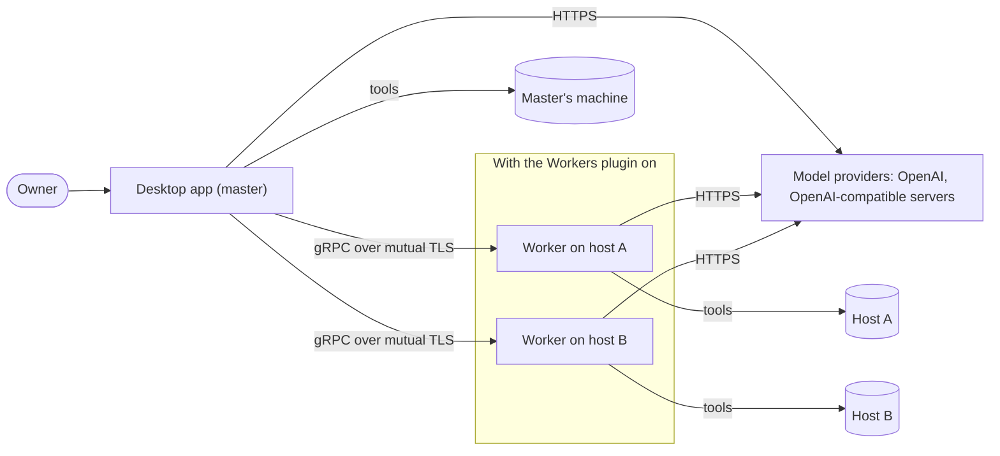
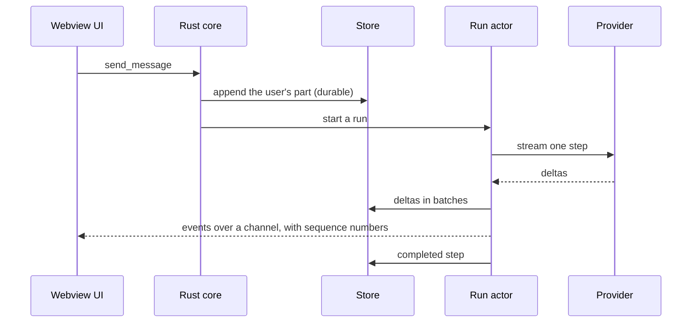
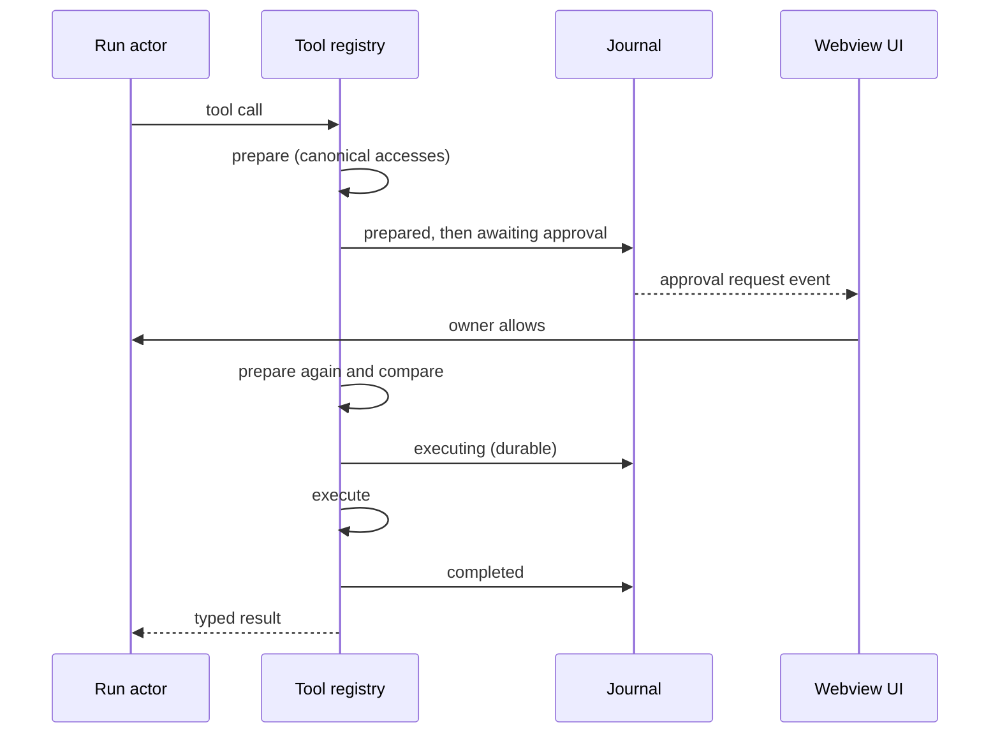
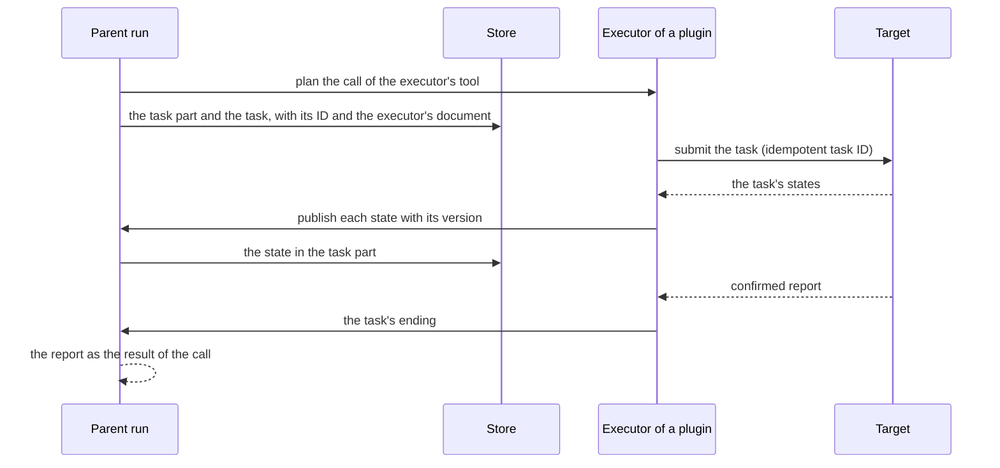

# Architecture overview

|              |                                                                                                                                                                                                                                                                                                          |
| ------------ | -------------------------------------------------------------------------------------------------------------------------------------------------------------------------------------------------------------------------------------------------------------------------------------------------------- |
| Status       | Draft for review                                                                                                                                                                                                                                                                                         |
| Last updated | 2026-10-17                                                                                                                                                                                                                                                                                               |
| Related      | [Domain model](domain-model.md), [Extension points](extension-points.md), [Orchestration](orchestration.md), [Security](security.md), [ADR index](../adr/README.md), [ADR-0030](../adr/0030-split-mannie-into-a-core-and-plugins.md), [Workers architecture](../../plugins/workers/docs/architecture.md) |

## 1. Reading guide

This document shows how Mannie's parts fit together: the core, which every owner gets, and the plugins that the owner turns on and off ([ADR-0030](../adr/0030-split-mannie-into-a-core-and-plugins.md)). Each topic has its own document:

| Topic                                                       | Document                                                           |
| ----------------------------------------------------------- | ------------------------------------------------------------------ |
| Concepts, lifecycles and invariants                         | [Domain model](domain-model.md)                                    |
| How features and plugins plug in                            | [Extension points](extension-points.md)                            |
| The desktop app's processes, IPC and webview rules          | [Desktop app](desktop-app.md)                                      |
| Runs, the agent loop, providers and context                 | [Agent runtime](agent-runtime.md)                                  |
| Tools, operations and approvals                             | [Tools](tools.md)                                                  |
| Child agents, task executors and tasks from another machine | [Orchestration](orchestration.md)                                  |
| Threats and controls                                        | [Security](security.md)                                            |
| Third-party components and their versions                   | [Technology stack](technology-stack.md)                            |
| Workers, delegation, pairing and the link, as a plugin      | [Workers architecture](../../plugins/workers/docs/architecture.md) |

## 2. System context

The owner works only with the desktop app. Its core calls model providers and runs tools on the owner's machine. Plugins add to it while they are on: with the Workers plugin, the master delegates tasks to workers on other hosts, each of which calls the providers itself, and tools act on the machine of the agent that calls them ([ADR-0015](../adr/0015-run-an-agent-runtime-on-every-machine.md), [ADR-0031](../adr/0031-move-workers-into-the-first-plugin.md)).

## 3. Components

| Component               | Runs on                                 | Responsibilities                                                                                                                                                                             |
| ----------------------- | --------------------------------------- | -------------------------------------------------------------------------------------------------------------------------------------------------------------------------------------------- |
| Desktop app, webview UI | Master's machine                        | Shows conversations, tool activity, approvals, settings and what the plugins that are on add. Holds no trusted state ([ADR-0004](../adr/0004-keep-system-access-in-the-rust-core.md)).       |
| Desktop app, Rust core  | Master's machine                        | Agent runtime, tools for the master's machine, store, credential store, the plugin host, IPC commands and channels.                                                                          |
| Plugins                 | Master's machine, in the core's process | Optional features that the owner turns on and off. A plugin contributes tools, agents, instruction sections, task executors, mention providers, image sources and UI entries while it is on. |
| Worker                  | Each host, with the Workers plugin      | Agent runtime, tools for its host, store, link server, host facts, policy ceiling, service integration.                                                                                      |
| Model providers         | External                                | The OpenAI Responses API and OpenAI-compatible Chat Completions servers.                                                                                                                     |

The Rust code is split into crates with enforced dependency rules ([ADR-0008](../adr/0008-one-workspace-two-binaries.md), [repository](../engineering/repository.md)). The core's crates are in `crates/` and the desktop app's library in `apps/desktop/core/`, in the root's Cargo workspace. Each plugin's crates are in `plugins/<id>/`, a Cargo workspace of its own, and the desktop binary builds in the launcher that `task gen` writes with the list of plugins ([ADR-0035](../adr/0035-find-plugins-at-build-time-in-folders-of-their-own.md)). No core crate depends on a plugin's crate, and no plugin depends on another plugin.

| Crate                   | Contents                                                                                                                                                       |
| ----------------------- | -------------------------------------------------------------------------------------------------------------------------------------------------------------- |
| `mannie-types`          | Shared domain, IPC and settings types, and the redacting secret type. No I/O.                                                                                  |
| `mannie-store`          | SQLite access, the migrations of each module and the core's repositories.                                                                                      |
| `mannie-provider`       | Provider adapters and quirk profiles.                                                                                                                          |
| `mannie-tools`          | The tool registry, built-in tools, operations and the process supervisor.                                                                                      |
| `mannie-runtime`        | Runs, the agent loop, context management, agent definitions, tasks, child agents, task executors, mention providers, image sources and plugins' contributions. |
| `mannie-plugin-sdk`     | What plugins build on: the plugin definition, the manifest, the start context, the services, the extension points and the specs of plugin commands.            |
| `mannie-plugins`        | The plugin host, which starts and stops plugins, binds their services and dispatches their commands.                                                           |
| `mannie-plugin-harness` | What plugins' tests use of the core: one plugin through the real host, and the check that a plugin keeps the SDK's rules.                                      |
| `mannie-host-kit`       | What a plugin's programs, such as the worker, use of the core.                                                                                                 |
| `mannie-secrets`        | Access to the operating system credential store. Used by the master only.                                                                                      |
| `mannie-desktop-core`   | The desktop app's library: composition root, IPC commands and the forwarders of the plugins' calls.                                                            |
| `mannie-desktop`        | The Tauri binary: its configuration, build script, capabilities and icons, built with the plugins that `task gen` lists.                                       |

The Workers plugin, in `plugins/workers/`, adds `mannie-link` with the link's contracts, TLS and pairing; `mannie-link-worker` with the worker's side of the link; `mannie-workers` with the master's side of workers and the plugin's definition; and the worker service `mannie-worker` with its composition root and service integration, which reaches the core through the host kit, `mannie-host-kit` ([workers architecture](../../plugins/workers/docs/architecture.md)). The Images plugin, in `plugins/images/`, adds `mannie-images`, which prepares the owner's images and gives them to the runtime ([images](../../plugins/images/docs/README.md)).

## 4. Process model

- The desktop app is one Rust process with a tokio runtime, plus a webview process managed by the operating system (WebView2 or WebKitGTK). The single-instance plugin keeps one app per user session, so one process owns the database. Depending on the owner's choice, closing the window either hides it in the system tray or quits the app ([window and tray](../features/window-and-tray.md)).
- Plugins run in the core's process with its rights. The plugin host starts the plugins that the owner turned on after the core's recovery, and starts or stops one at once when the owner switches it.
- Commands that tools run are child processes of the core, each contained by the process supervisor ([ADR-0014](../adr/0014-contain-process-trees.md)).
- A worker is the Workers plugin's service process on its host: a Windows service, a systemd unit or an rc.d service. It runs under the account the owner chooses, and its tools have that account's rights within the policy ceiling.
- The desktop app keeps its data in the platform's application data directory for `io.github.limbon2.mannie`. A worker keeps its data in a directory set in its configuration.

## 5. Key flows

### 5.1 Sending a message

The run belongs to the core. Closing or reloading the window does not stop it ([ADR-0012](../adr/0012-run-agents-as-durable-actors.md)).

### 5.2 A tool call that needs approval

[Tools](tools.md) describes the policy that decides when the owner is asked.

### 5.3 A task for a child agent

The conversation agent calls `start_task`. The parent's run stores a `task` part, creates a task conversation with the instruction, and starts the child's run on the same machine, which waits for a slot of the machine's pool. The parent's run writes the child's state, its activity and its approval requests into the task part, and the child's confirmed report returns as the result of the call, or of `wait_for_tasks` for a task in the background ([orchestration](orchestration.md#3-child-agents), [ADR-0024](../adr/0024-run-child-agent-tasks-in-the-parent-run.md)). The owner can open the child's conversation in a side panel beside the parent's.

### 5.4 A task of a plugin's executor

The executor runs the task on its target, and the core keeps the task's place in the conversation, its state and its report ([orchestration](orchestration.md#4-task-executors)). For the Workers plugin, the target is a worker and the executor talks to it over the link ([workers architecture](../../plugins/workers/docs/architecture.md#delegation)).

### 5.5 Reconnecting

A reloaded UI subscribes again with its last cursor and receives every event it missed. An executor whose target drops reconnects and catches up on its own, as the Workers plugin does after a link drop, and a state older than the stored one changes nothing.

### 5.6 Turning a plugin on or off

The owner switches a plugin on the Plugins page. The host stores the choice, then starts the plugin, which receives the services that its manifest declares and returns its contributions, or drops the plugin's contributions and then stops it. The runtime offers the change to the runs that start from then on, and a run keeps what it started with. The UI follows a channel of plugin states, and its slots show a plugin's entries only while the plugin is on, so the window changes without a reload ([plugins](../features/plugins.md)).

## 6. Data placement

| Data                                                              | Where                                                                                      |
| ----------------------------------------------------------------- | ------------------------------------------------------------------------------------------ |
| The owner's conversations, runs, events and the operation journal | The master's SQLite database                                                               |
| Provider profiles                                                 | The master's database, with credentials in the operating system credential store           |
| The owner's choices of plugins                                    | The master's database, in the core's settings                                              |
| A plugin's own data                                               | The master's database, in the plugin's tables, which stay while the plugin is off          |
| The executors' documents and the outbox of their deletions        | The master's database, in the core's tables                                                |
| A plugin's secrets, such as the master's private key for the link | The master's operating system credential store, in entries that only that plugin can reach |
| Task conversations, events and operations of a worker             | The worker's SQLite database                                                               |
| The worker's private key and the master's pinned key              | The worker's data directory, readable only by the service account                          |
| Host instructions and the policy ceiling                          | The worker's configuration on its host                                                     |
| Leased credentials                                                | The worker's memory, for the length of the task                                            |
| Logs                                                              | Each machine's log directory, rotated and free of secrets                                  |
| UI preferences                                                    | The webview's local storage                                                                |

## 7. Failure behavior

| Failure                                | Behavior                                                                                                                                                                                                                                                                         |
| -------------------------------------- | -------------------------------------------------------------------------------------------------------------------------------------------------------------------------------------------------------------------------------------------------------------------------------- |
| The webview reloads or crashes         | Runs continue. The UI subscribes again from its cursor.                                                                                                                                                                                                                          |
| The desktop app crashes or loses power | Committed data survives. Active runs become interrupted and can be retried, and executing operations become uncertain.                                                                                                                                                           |
| A provider returns an error            | Transient errors are retried with backoff, honoring `Retry-After`. A permanent error ends the step and shows its cause.                                                                                                                                                          |
| A plugin cannot start                  | The Plugins page shows it as failed, with what failed and "Try again". The rest of Mannie keeps working.                                                                                                                                                                         |
| The owner turns off a plugin           | Its contributions leave new runs and the UI at once. Its executor's tasks are let go, as when Mannie quits, and calls of its tools get a result that says it is off.                                                                                                             |
| An executor's target cannot be reached | The task keeps its last known state, and reads of its conversation fail with an error that names the target. The [workers architecture](../../plugins/workers/docs/architecture.md#failure-behavior) describes links that drop, a master that is offline and workers that crash. |
| The disk is full                       | Writes fail with a typed error, and runs stop and show the cause. Nothing partly written counts as committed.                                                                                                                                                                    |

## 8. Observability

Every process writes structured logs through `tracing` to rotating local files, with spans for each run, step, operation and task. Secrets are redacted, and Mannie sends no telemetry. [Engineering standards](../engineering/standards.md#7-observability) has the details.

## 9. How the system grows

Features plug into [extension points](extension-points.md) ([ADR-0002](../adr/0002-grow-through-extension-points.md)), and an optional feature becomes a plugin that the owner turns on and off ([ADR-0030](../adr/0030-split-mannie-into-a-core-and-plugins.md)). This document changes only when a component or an extension point changes, never because a feature or a plugin was added.
