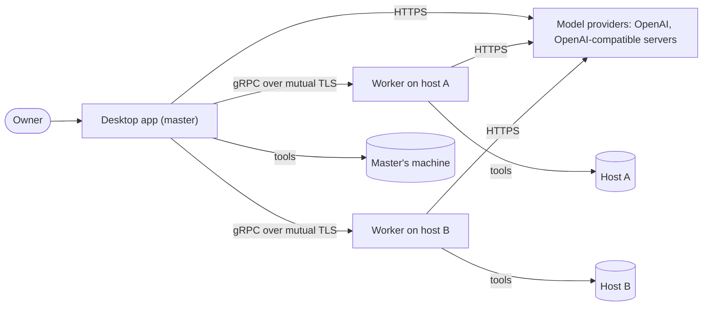
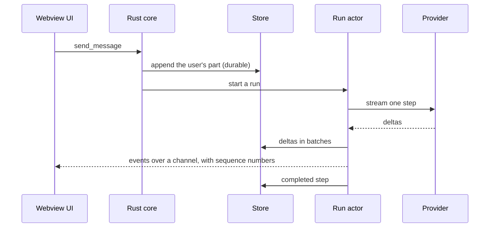
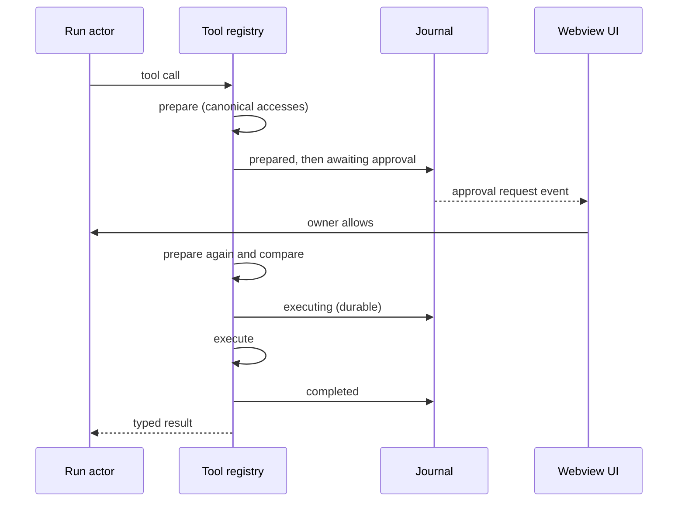
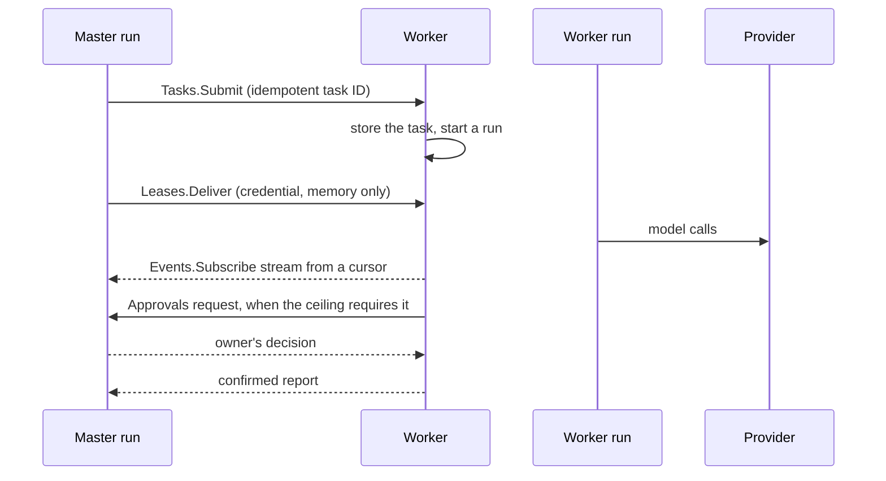

# Architecture overview

|              |                                                                                                                                                                     |
| ------------ | ------------------------------------------------------------------------------------------------------------------------------------------------------------------- |
| Status       | Draft for review                                                                                                                                                    |
| Last updated | 2026-10-15                                                                                                                                                          |
| Related      | [Domain model](domain-model.md), [Extension points](extension-points.md), [Orchestration](orchestration.md), [Security](security.md), [ADR index](../adr/README.md) |

## 1. Reading guide

This document shows how Mannie's parts fit together. Each topic has its own document:

| Topic                                              | Document                                |
| -------------------------------------------------- | --------------------------------------- |
| Concepts, lifecycles and invariants                | [Domain model](domain-model.md)         |
| How features plug in                               | [Extension points](extension-points.md) |
| The desktop app's processes, IPC and webview rules | [Desktop app](desktop-app.md)           |
| Runs, the agent loop, providers and context        | [Agent runtime](agent-runtime.md)       |
| Tools, operations and approvals                    | [Tools](tools.md)                       |
| Child agents, workers and the link                 | [Orchestration](orchestration.md)       |
| Threats and controls                               | [Security](security.md)                 |
| Third-party components and their versions          | [Technology stack](technology-stack.md) |

## 2. System context

The owner works only with the desktop app. The master and each worker call model providers themselves, and tools act on the machine of the agent that calls them ([ADR-0015](../adr/0015-run-an-agent-runtime-on-every-machine.md)).

## 3. Components

| Component               | Runs on          | Responsibilities                                                                                                                                              |
| ----------------------- | ---------------- | ------------------------------------------------------------------------------------------------------------------------------------------------------------- |
| Desktop app, webview UI | Master's machine | Shows conversations, tool activity, approvals, workers and settings. Holds no trusted state ([ADR-0004](../adr/0004-keep-system-access-in-the-rust-core.md)). |
| Desktop app, Rust core  | Master's machine | Agent runtime, tools for the master's machine, store, credential store, link client, IPC commands and channels.                                               |
| Worker                  | Each host        | Agent runtime, tools for its host, store, link server, host facts, policy ceiling, service integration.                                                       |
| Model providers         | External         | The OpenAI Responses API and OpenAI-compatible Chat Completions servers.                                                                                      |

The Rust code is split into crates with enforced dependency rules ([ADR-0008](../adr/0008-one-workspace-two-binaries.md), [repository](../engineering/repository.md)):

| Crate             | Contents                                                                             |
| ----------------- | ------------------------------------------------------------------------------------ |
| `mannie-types`    | Shared domain, IPC and settings types, and the redacting secret type. No I/O.        |
| `mannie-store`    | SQLite access, migrations and repositories.                                          |
| `mannie-provider` | Provider adapters and quirk profiles.                                                |
| `mannie-tools`    | The tool registry, built-in tools, operations and the process supervisor.            |
| `mannie-runtime`  | Runs, the agent loop, context management, agent definitions, tasks and child agents. |
| `mannie-link`     | Link contracts, client and server, pairing and key pinning.                          |
| `mannie-secrets`  | Access to the operating system credential store. Used by the master only.            |
| `mannie-desktop`  | The Tauri application: composition root, IPC commands and capabilities.              |
| `mannie-worker`   | The worker service: composition root and service integration.                        |

## 4. Process model

- The desktop app is one Rust process with a tokio runtime, plus a webview process managed by the operating system (WebView2 or WebKitGTK). The single-instance plugin keeps one app per user session, so one process owns the database. Depending on the owner's choice, closing the window either hides it in the system tray or quits the app ([window and tray](../features/window-and-tray.md)).
- Commands that tools run are child processes of the core, each contained by the process supervisor ([ADR-0014](../adr/0014-contain-process-trees.md)).
- A worker is one service process: a Windows service, a systemd unit or an rc.d service. It runs under the account the owner chooses, and its tools have that account's rights within the policy ceiling.
- The desktop app keeps its data in the platform's application data directory for `io.github.limbon2.mannie`. A worker keeps its data in a directory set in its configuration.

## 5. Key flows

### 5.1 Sending a message

The run belongs to the core. Closing or reloading the window does not stop it ([ADR-0012](../adr/0012-run-agents-as-durable-actors.md)).

### 5.2 A tool call that needs approval

[Tools](tools.md) describes the policy that decides when the owner is asked.

### 5.3 A task for a child agent

The conversation agent calls `start_task`. The parent's run stores a `task` part, creates a task conversation with the instruction, and starts the child's run on the same machine, which waits for a slot of the machine's pool. The parent's run writes the child's state, its activity and its approval requests into the task part, and the child's confirmed report returns as the result of the call, or of `wait_for_tasks` for a task in the background ([orchestration](orchestration.md#3-child-agents), [ADR-0024](../adr/0024-run-child-agent-tasks-in-the-parent-run.md)). The owner can open the child's conversation in a side panel beside the parent's.

### 5.4 Delegating a task to a worker

[Orchestration](orchestration.md#5-delegation) describes the flow in full, including what happens when the link drops.

### 5.5 Reconnecting

A reloaded UI subscribes again with its last cursor and receives every event it missed. When a link drops, the worker keeps working, and the master reconnects and replays the task events from its cursor.

## 6. Data placement

| Data                                                              | Where                                                                            |
| ----------------------------------------------------------------- | -------------------------------------------------------------------------------- |
| The owner's conversations, runs, events and the operation journal | The master's SQLite database                                                     |
| Provider profiles                                                 | The master's database, with credentials in the operating system credential store |
| The worker registry: names, addresses and pinned keys             | The master's database                                                            |
| The master's private key for the link                             | The master's operating system credential store                                   |
| Task conversations, events and operations of a worker             | The worker's SQLite database                                                     |
| The worker's private key and the master's pinned key              | The worker's data directory, readable only by the service account                |
| Host instructions and the policy ceiling                          | The worker's configuration on its host                                           |
| Leased credentials                                                | The worker's memory, for the length of the task                                  |
| Logs                                                              | Each machine's log directory, rotated and free of secrets                        |
| UI preferences                                                    | The webview's local storage                                                      |

## 7. Failure behavior

| Failure                                | Behavior                                                                                                                                                                                   |
| -------------------------------------- | ------------------------------------------------------------------------------------------------------------------------------------------------------------------------------------------ |
| The webview reloads or crashes         | Runs continue. The UI subscribes again from its cursor.                                                                                                                                    |
| The desktop app crashes or loses power | Committed data survives. Active runs become interrupted and can be retried, and executing operations become uncertain.                                                                     |
| A provider returns an error            | Transient errors are retried with backoff, honoring `Retry-After`. A permanent error ends the step and shows its cause.                                                                    |
| A link drops                           | The worker keeps working. The master reconnects and replays the task events. Approval requests wait.                                                                                       |
| The master is offline                  | Worker tasks continue with their leased credentials, and operations that need approval wait. A worker that restarts without a lease waits for the master before it calls a provider again. |
| A worker crashes                       | Its active tasks become interrupted and its executing operations uncertain. The master shows the task as interrupted, and the conversation agent decides what to do next.                  |
| The disk is full                       | Writes fail with a typed error, and runs stop and show the cause. Nothing partly written counts as committed.                                                                              |

## 8. Observability

Every process writes structured logs through `tracing` to rotating local files, with spans for each run, step, operation and task. Secrets are redacted, and Mannie sends no telemetry. [Engineering standards](../engineering/standards.md#7-observability) has the details.

## 9. How the system grows

Features plug into [extension points](extension-points.md) ([ADR-0002](../adr/0002-grow-through-extension-points.md)). This document changes only when a component or an extension point changes, never because a feature was added.
