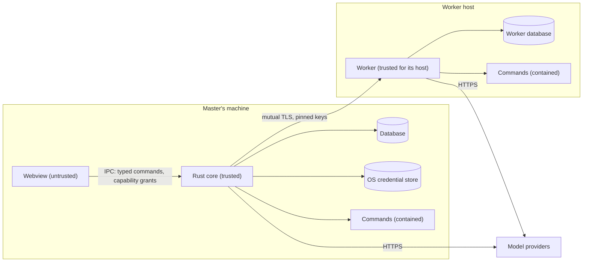

# Security architecture and threat model

|              |                                                                                                                                                                                                                                                                             |
| ------------ | --------------------------------------------------------------------------------------------------------------------------------------------------------------------------------------------------------------------------------------------------------------------------- |
| Status       | Draft for review                                                                                                                                                                                                                                                            |
| Last updated | 2026-10-13                                                                                                                                                                                                                                                                  |
| Related      | [ADR-0004](../adr/0004-keep-system-access-in-the-rust-core.md), [ADR-0010](../adr/0010-keep-provider-credentials-on-the-master.md), [ADR-0013](../adr/0013-journal-every-side-effect.md), [ADR-0016](../adr/0016-link-machines-over-pinned-mtls-grpc.md), [Tools](tools.md) |

Mannie lets language models change files and run commands on the owner's machines. This document states what Mannie protects, from whom, and how. A feature that touches a trust boundary adds threat notes to its feature document. A change that weakens a control listed here needs an ADR.

## 1. Security objectives

| ID   | Objective                                                                                                                |
| ---- | ------------------------------------------------------------------------------------------------------------------------ |
| SO-1 | Nothing changes on a machine unless policy or the owner allowed it.                                                      |
| SO-2 | Provider credentials do not leak: not to logs, files, other processes, the webview or the model.                         |
| SO-3 | Only the paired master can give tasks to a worker, and the master talks only to the workers it paired.                   |
| SO-4 | Hostile content (model output, files, web pages, command output, reports) cannot run code in the UI or gain permissions. |
| SO-5 | The owner can see what happened: every side effect has a journal record and every task a conversation.                   |

## 2. Assets

| Asset                                           | Where it lives                                                                 |
| ----------------------------------------------- | ------------------------------------------------------------------------------ |
| Provider credentials                            | The master's operating system credential store; leased copies in worker memory |
| The master's and the workers' private link keys | The master's credential store; each worker's data directory                    |
| Files and processes on each machine             | The machines themselves, reachable through tools                               |
| Conversations and task transcripts              | The SQLite databases of the master and the workers                             |
| Policy: workspaces, grants, rules and ceilings  | The master's database; each worker's configuration                             |

## 3. Actors and trust

| Actor                                  | Trust                | Notes                                                                                                     |
| -------------------------------------- | -------------------- | --------------------------------------------------------------------------------------------------------- |
| The owner                              | Full                 | Decides approvals, policy and pairing.                                                                    |
| The Rust core of the master            | Trusted              | Enforces policy and holds credentials.                                                                    |
| A paired worker                        | Trusted for its host | Enforces its own ceiling. Holds a leased credential during a task.                                        |
| The webview                            | Untrusted            | Renders content Mannie does not control ([ADR-0004](../adr/0004-keep-system-access-in-the-rust-core.md)). |
| Model output                           | Untrusted            | It may follow instructions hidden in content the model read.                                              |
| Content the model reads                | Untrusted            | Files, command output, web pages and reports from other agents may carry prompt injections.               |
| Model providers                        | Partly trusted       | They receive prompts and context and return output, which is treated as untrusted.                        |
| The network between master and workers | Untrusted            | Protected by mutual TLS with pinned keys.                                                                 |
| Other local users and processes        | Untrusted            | Kept out by file permissions and the operating system credential store.                                   |

## 4. Trust boundaries

## 5. Threats and mitigations

| #    | Threat                                                                        | Mitigation                                                                                                                                                                                     | Verified by                                    |
| ---- | ----------------------------------------------------------------------------- | ---------------------------------------------------------------------------------------------------------------------------------------------------------------------------------------------- | ---------------------------------------------- |
| T-1  | A prompt injection makes the model attempt a destructive command              | Journaled operations with authorization against canonical accesses; workspace limits; approvals; rules never cover shell metacharacters ([ADR-0013](../adr/0013-journal-every-side-effect.md)) | Injection corpus in M2                         |
| T-2  | A path changes between approval and execution (for example a swapped symlink) | Prepare again and compare before executing; mutations refuse links                                                                                                                             | Test in M2                                     |
| T-3  | Script runs in the webview through rendered Markdown or HTML                  | Markdown without raw HTML, strict CSP, no remote images, links only after confirmation                                                                                                         | Hostile-content corpus in M1, V1               |
| T-4  | Script in the webview reaches files, processes or the network                 | No fs, shell or http plugins; every command needs a capability grant and validates its input in the core                                                                                       | V1                                             |
| T-5  | Script in the webview approves a pending operation                            | T-3 and T-4 make running such script hard; approval requests are bound to the operation and its canonical accesses                                                                             | Residual risk, see §8                          |
| T-6  | A provider credential leaks through logs, errors, files or child processes    | Redacting secret type, no credentials in the database, child environments from an allow list, planted-secret tests                                                                             | Planted-secret tests in M0 and every milestone |
| T-7  | Someone on the network impersonates a worker or the master                    | Mutual TLS with pinned public keys; HMAC pairing that binds both keys ([ADR-0016](../adr/0016-link-machines-over-pinned-mtls-grpc.md))                                                         | V6                                             |
| T-8  | A stolen or guessed pairing code                                              | Ten-minute lifetime, single use, rate limits, binding to one master                                                                                                                            | V6                                             |
| T-9  | A malicious update is pushed to a worker                                      | Ed25519-signed artifacts checked against the embedded release key; self-check before switching; rollback                                                                                       | V6                                             |
| T-10 | A compromised worker host reads the leased credential                         | Leases are per task and memory-only; scoped keys recommended; leases revoked at task end and on unpairing                                                                                      | Residual risk, see §9                          |
| T-11 | A worker exceeds what the owner allowed on its host                           | The ceiling is configured on the host and enforced by the worker; tasks can only narrow it                                                                                                     | Test in M4                                     |
| T-12 | A crash makes an operation run twice                                          | Durable executing state; uncertain operations are never repeated automatically                                                                                                                 | Crash tests in M2                              |
| T-13 | A runaway command keeps running after stop or timeout                         | Process tree containment on each platform ([ADR-0014](../adr/0014-contain-process-trees.md))                                                                                                   | V4                                             |
| T-14 | A compromised dependency                                                      | Pinned versions, lockfiles, cargo-deny advisories and sources, license gates, small dependency set                                                                                             | CI on every change                             |

## 6. Prompt injection

Mannie assumes that any text the model reads may contain instructions written by someone else. It does not try to detect injections. It limits what any instruction can achieve:

- The model can only request operations. Policy and the owner decide whether they run.
- Approvals show exactly what will happen, with canonical paths and full commands.
- No content can create a grant or a rule. Only the owner's actions in the UI can.
- A child agent or a worker works within the permissions it was given, and its report is content like any other.

## 7. Rules for handling secrets

- Provider credentials are stored only in the master's operating system credential store. When the store is not available, Mannie refuses to save the credential.
- In memory, secrets use a type that redacts itself when formatted and clears its memory when dropped.
- Secrets never appear in logs, the database, crash files, URLs, command arguments, child process environments, transcripts, prompts or error messages.
- Workers hold leased credentials in memory only and never write them anywhere.
- Every milestone runs planted-secret tests: a known test secret is used throughout a scenario, and every log, database and crash file is searched for it.

## 8. If the webview is compromised

Script running in the webview can call the commands that the main window is granted. It cannot read files, start processes or open network connections directly. It could, in principle, answer pending approval requests. Strict CSP, Markdown without raw HTML, and no remote resources make it hard to get script running in the first place. Approving a destructive operation through the webview remains the main residual risk, and it is reviewed again before 1.0.

## 9. If a worker host is compromised

An attacker with control of a worker host can do anything the worker's account can do on that host, and can read the credential leased for a running task. The attacker cannot reach the master's files or the other workers, because the link only carries tasks, events, approvals and leases, and the master never runs tools for a worker. Owners limit the damage with scoped provider keys, a narrow ceiling on hosts that matter, and by unpairing the worker, which revokes its leases.

## 10. Local data

- The databases, logs and the worker's key files are readable only by the account that runs Mannie.
- Mannie does not encrypt its databases. Disk encryption is the operating system's job, and the owner is responsible for it.
- Deleting a conversation deletes its parts and events from the database. SQLite may keep freed pages until the database is vacuumed, and maintenance vacuums periodically.

## 11. Assumptions and residual risks

- The owner's account on each machine is not compromised. Mannie cannot protect against an attacker who already controls the owner's account.
- Model providers see the prompts and context that Mannie sends. Choosing a provider is the owner's trust decision.
- Approvals depend on the owner reading them. Clear, exact approval requests are a design goal for every feature that adds a tool.
