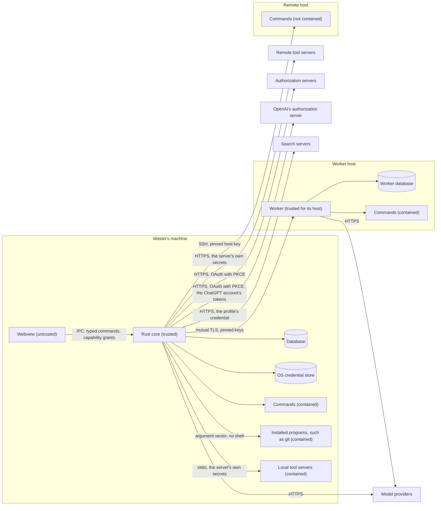

# Security architecture and threat model

|              |                                                                                                                                                                                                                                                                                                                                                                                                                                                                                                                                                                                                                                                                                                                                                                                                                                                                                                                                                                                                                                                                             |
| ------------ | --------------------------------------------------------------------------------------------------------------------------------------------------------------------------------------------------------------------------------------------------------------------------------------------------------------------------------------------------------------------------------------------------------------------------------------------------------------------------------------------------------------------------------------------------------------------------------------------------------------------------------------------------------------------------------------------------------------------------------------------------------------------------------------------------------------------------------------------------------------------------------------------------------------------------------------------------------------------------------------------------------------------------------------------------------------------------- |
| Status       | Draft for review                                                                                                                                                                                                                                                                                                                                                                                                                                                                                                                                                                                                                                                                                                                                                                                                                                                                                                                                                                                                                                                            |
| Last updated | 2026-11-09                                                                                                                                                                                                                                                                                                                                                                                                                                                                                                                                                                                                                                                                                                                                                                                                                                                                                                                                                                                                                                                                  |
| Related      | [ADR-0004](../adr/0004-keep-system-access-in-the-rust-core.md), [ADR-0010](../adr/0010-keep-provider-credentials-on-the-master.md), [ADR-0013](../adr/0013-journal-every-side-effect.md), [ADR-0016](../adr/0016-link-machines-over-pinned-mtls-grpc.md), [ADR-0030](../adr/0030-split-mannie-into-a-core-and-plugins.md), [ADR-0036](../adr/0036-let-plugins-run-commands-on-remote-hosts.md), [ADR-0043](../adr/0043-let-plugins-offer-the-tools-of-tool-servers.md), [ADR-0044](../adr/0044-let-tool-results-carry-images-to-the-model.md), [ADR-0038](../adr/0038-let-plugins-run-installed-programs-in-the-owners-projects.md), [ADR-0053](../adr/0053-let-plugins-offer-terminals.md), [ADR-0058](../adr/0058-let-agents-ask-the-owner-questions.md), [ADR-0059](../adr/0059-let-the-owner-define-agents.md), [ADR-0060](../adr/0060-let-agents-save-plans-that-the-owner-runs.md), [ADR-0061](../adr/0061-let-agents-use-the-skills-that-the-owner-installs.md), [ADR-0062](../adr/0062-let-the-owner-pay-for-model-calls-with-a-chatgpt-plan.md), [Tools](tools.md) |

Mannie lets language models change files and run commands on the owner's machines. This document states what Mannie protects, from whom, and how. A feature that touches a trust boundary adds threat notes to its feature document. A change that weakens a control listed here needs an ADR.

## 1. Security objectives

| ID   | Objective                                                                                                                                                                                                                                                                                                                                   |
| ---- | ------------------------------------------------------------------------------------------------------------------------------------------------------------------------------------------------------------------------------------------------------------------------------------------------------------------------------------------- |
| SO-1 | Nothing changes on a machine unless policy or the owner allowed it.                                                                                                                                                                                                                                                                         |
| SO-2 | Provider credentials, the tokens of the ChatGPT account, the passwords of remote hosts and the secrets of tool servers do not leak: not to logs, files, other processes, the webview or the model. A host's password goes only to the host whose key the owner pinned, and a tool server's secret only to that server's process or its URL. |
| SO-3 | Only the paired master can give tasks to a worker, and the master talks only to the workers it paired.                                                                                                                                                                                                                                      |
| SO-4 | Hostile content (model output, files, web pages, command output, reports) cannot run code in the UI or gain permissions.                                                                                                                                                                                                                    |
| SO-5 | The owner can see what happened: every side effect has a journal record and every task a conversation.                                                                                                                                                                                                                                      |

## 2. Assets

| Asset                                                        | Where it lives                                                                 |
| ------------------------------------------------------------ | ------------------------------------------------------------------------------ |
| Provider credentials                                         | The master's operating system credential store; leased copies in worker memory |
| The tokens of the ChatGPT account                            | The master's credential store only, under `provider/chatgpt/`                  |
| The master's and the workers' private link keys              | The master's credential store; each worker's data directory                    |
| The passwords of remote hosts                                | The master's credential store, an entry of the plugin for each host            |
| The secrets and OAuth tokens of tool servers                 | The master's credential store, entries of the plugin MCP for each server       |
| Files and processes on each machine                          | The machines themselves, reachable through tools                               |
| The owner's repositories, their history and uncommitted work | The projects' folders, reachable through tools such as the plugin Git's        |
| Conversations and task transcripts                           | The SQLite databases of the master and the workers                             |
| Policy: workspaces, grants, rules and ceilings               | The master's database; each worker's configuration                             |

## 3. Actors and trust

| Actor                                                | Trust                | Notes                                                                                                                                                                                                                                                                                                                                                                                 |
| ---------------------------------------------------- | -------------------- | ------------------------------------------------------------------------------------------------------------------------------------------------------------------------------------------------------------------------------------------------------------------------------------------------------------------------------------------------------------------------------------- |
| The owner                                            | Full                 | Decides approvals, policy and pairing.                                                                                                                                                                                                                                                                                                                                                |
| The Rust core of the master                          | Trusted              | Enforces policy and holds credentials.                                                                                                                                                                                                                                                                                                                                                |
| Internal plugins                                     | Trusted              | Run in the core's process with its rights, reviewed like the core. Reach core services only through their start context, with the services that their manifests declare, and the credential store only through entries they own ([ADR-0030](../adr/0030-split-mannie-into-a-core-and-plugins.md), decision 13; [ADR-0034](../adr/0034-build-plugins-on-a-plugin-sdk.md), decision 5). |
| A paired worker of the Workers plugin                | Trusted for its host | Enforces its own ceiling. Holds a leased credential during a task.                                                                                                                                                                                                                                                                                                                    |
| An installed program that a plugin runs, such as git | Trusted              | The owner's own program, which the core finds on the `PATH` and runs without a shell under the supervisor. The hooks and programs that a repository's files or its own configuration name are content, and a run that starts them asks ([ADR-0038](../adr/0038-let-plugins-run-installed-programs-in-the-owners-projects.md)).                                                        |
| The webview                                          | Untrusted            | Renders content Mannie does not control ([ADR-0004](../adr/0004-keep-system-access-in-the-rust-core.md)).                                                                                                                                                                                                                                                                             |
| Model output                                         | Untrusted            | It may follow instructions hidden in content the model read.                                                                                                                                                                                                                                                                                                                          |
| Content the model reads                              | Untrusted            | Files, command output, web pages, reports from other agents and the documents that the owner adds to notebooks may carry prompt injections.                                                                                                                                                                                                                                           |
| Skills                                               | Untrusted            | Folders that the `skills` CLI installed in `~/.agents/skills` or that a project holds in `.agents/skills`. Their names and descriptions reach agents' instructions once a skill is on, and the rest when the model reads it; all of it is content, and a project's skills start off ([ADR-0061](../adr/0061-let-agents-use-the-skills-that-the-owner-installs.md)).                   |
| Model providers                                      | Partly trusted       | They receive prompts and context and return output, which is treated as untrusted.                                                                                                                                                                                                                                                                                                    |
| A search server                                      | Partly trusted       | The server of a search profile, which the owner names for an embedding or a rerank model. It receives the owner's messages and the text of the documents that Notebooks indexes, with the profile's own credential, and its vectors and scores only choose which passages reach the model ([ADR-0047](../adr/0047-serve-embeddings-and-reranking-through-provider-profiles.md)).      |
| The network between master and workers               | Untrusted            | Protected by mutual TLS with pinned keys.                                                                                                                                                                                                                                                                                                                                             |
| A remote host                                        | Untrusted            | A computer without Mannie that the owner registered with a plugin, such as the SSH plugin. Its output is content like any other, and it receives its password at each login ([ADR-0036](../adr/0036-let-plugins-run-commands-on-remote-hosts.md)).                                                                                                                                    |
| The network between master and remote hosts          | Untrusted            | Protected by SSH, with the host key that the owner pinned after checking its fingerprint.                                                                                                                                                                                                                                                                                             |
| A tool server                                        | Untrusted            | A server of the Model Context Protocol that the owner registered with a plugin, such as the plugin MCP: a program that runs with the owner's rights in the supervisor, or a URL. Its descriptions, instructions, results, resources and images are content, and it receives its own secrets ([ADR-0043](../adr/0043-let-plugins-offer-the-tools-of-tool-servers.md)).                 |
| An authorization server                              | Untrusted            | The server that a remote tool server's metadata names for its sign-in. It receives the sign-in's code, the client's ID and secret, and the refresh tokens, and its metadata can name other addresses (T-58, T-61).                                                                                                                                                                    |
| OpenAI's authorization server (`auth.openai.com`)    | Partly trusted       | The server of the sign-in with ChatGPT. It receives the code with its PKCE verifier, the host's ID, the client ID and the refresh tokens, and issues the tokens of the ChatGPT account. Mannie takes an account's identity only from an ID token that OpenAI's published keys sign ([ADR-0062](../adr/0062-let-the-owner-pay-for-model-calls-with-a-chatgpt-plan.md); T-94, T-98).    |
| Other local users and processes                      | Untrusted            | Kept out by file permissions and the operating system credential store.                                                                                                                                                                                                                                                                                                               |

## 4. Trust boundaries

## 5. Threats and mitigations

| #    | Threat                                                                                                                                                                                                                | Mitigation                                                                                                                                                                                                                                                                                                                                                                                                                                                                                                                                                                                         | Verified by                                                                                                                                                                         |
| ---- | --------------------------------------------------------------------------------------------------------------------------------------------------------------------------------------------------------------------- | -------------------------------------------------------------------------------------------------------------------------------------------------------------------------------------------------------------------------------------------------------------------------------------------------------------------------------------------------------------------------------------------------------------------------------------------------------------------------------------------------------------------------------------------------------------------------------------------------- | ----------------------------------------------------------------------------------------------------------------------------------------------------------------------------------- |
| T-1  | A prompt injection makes the model attempt a destructive command                                                                                                                                                      | Journaled operations with authorization against canonical accesses; workspace limits; approvals; rules never cover shell metacharacters ([ADR-0013](../adr/0013-journal-every-side-effect.md))                                                                                                                                                                                                                                                                                                                                                                                                     | Injection corpus in M2                                                                                                                                                              |
| T-2  | A path changes between approval and execution (for example a swapped symlink)                                                                                                                                         | Prepare again and compare before executing; mutations refuse links                                                                                                                                                                                                                                                                                                                                                                                                                                                                                                                                 | Test in M2                                                                                                                                                                          |
| T-3  | Script runs in the webview through rendered Markdown or HTML                                                                                                                                                          | Markdown rendered by Mannie's own components, which never insert markup: raw HTML as text, no images loaded, links as buttons that the core checks and opens only after confirmation; strict CSP ([ADR-0021](../adr/0021-render-model-output-as-markdown-with-micromark.md))                                                                                                                                                                                                                                                                                                                       | Hostile-content corpus through a provider and the real path in M1 (unit and end-to-end tests), V1                                                                                   |
| T-4  | Script in the webview reaches files, processes or the network                                                                                                                                                         | No fs, shell or http plugins; every command needs a capability grant and validates its input in the core                                                                                                                                                                                                                                                                                                                                                                                                                                                                                           | V1                                                                                                                                                                                  |
| T-5  | Script in the webview approves a pending operation                                                                                                                                                                    | T-3 and T-4 make running such script hard; approval requests are bound to the operation and its canonical accesses                                                                                                                                                                                                                                                                                                                                                                                                                                                                                 | Residual risk, see §8                                                                                                                                                               |
| T-6  | A provider credential leaks through logs, errors, files or child processes                                                                                                                                            | Redacting secret type, no credentials in the database, child environments from an allow list, planted-secret tests                                                                                                                                                                                                                                                                                                                                                                                                                                                                                 | Planted-secret tests in M0 and every milestone; in M1 the runtime's test and a search of the whole data folder after an end-to-end run in which the provider repeats the credential |
| T-7  | Someone on the network impersonates a worker or the master                                                                                                                                                            | Mutual TLS with pinned public keys; HMAC pairing that binds both keys ([ADR-0016](../adr/0016-link-machines-over-pinned-mtls-grpc.md))                                                                                                                                                                                                                                                                                                                                                                                                                                                             | V6                                                                                                                                                                                  |
| T-8  | A stolen or guessed pairing code                                                                                                                                                                                      | Ten-minute lifetime, single use, rate limits, binding to one master                                                                                                                                                                                                                                                                                                                                                                                                                                                                                                                                | V6                                                                                                                                                                                  |
| T-9  | A malicious or tampered build is installed on a worker                                                                                                                                                                | `mannie-worker update` installs only an archive with a valid signature of the release key built into the worker, reads the archive once, and the program's folder belongs to root or Administrators; the master pushes no builds ([decision D20](../roadmap/milestones.md#5-decisions))                                                                                                                                                                                                                                                                                                            | V6                                                                                                                                                                                  |
| T-10 | A compromised worker host reads the leased credential                                                                                                                                                                 | Leases are per task and memory-only; scoped keys recommended; leases revoked at task end and on unpairing                                                                                                                                                                                                                                                                                                                                                                                                                                                                                          | Residual risk, see §9                                                                                                                                                               |
| T-11 | A worker exceeds what the owner allowed on its host                                                                                                                                                                   | The ceiling is configured on the host and enforced by the worker; tasks can only narrow it; the configuration belongs to root or Administrators, and the worker refuses one that its own account can write; a worker's requests offer only Allow once and Deny ([ADR-0028](../adr/0028-run-assigned-tasks-under-the-host-ceiling.md))                                                                                                                                                                                                                                                              | Policy and runtime tests in M4                                                                                                                                                      |
| T-12 | A crash makes an operation run twice                                                                                                                                                                                  | Durable executing state; uncertain operations are never repeated automatically                                                                                                                                                                                                                                                                                                                                                                                                                                                                                                                     | Crash tests in M2                                                                                                                                                                   |
| T-13 | A runaway command keeps running after stop or timeout                                                                                                                                                                 | Process tree containment on each platform ([ADR-0014](../adr/0014-contain-process-trees.md))                                                                                                                                                                                                                                                                                                                                                                                                                                                                                                       | V4                                                                                                                                                                                  |
| T-14 | A compromised dependency                                                                                                                                                                                              | Pinned versions, lockfiles, cargo-deny advisories and sources, license gates, small dependency set                                                                                                                                                                                                                                                                                                                                                                                                                                                                                                 | `task lint` on every change                                                                                                                                                         |
| T-15 | A credential travels to a host the owner did not name, or in clear text                                                                                                                                               | A credential goes over plain HTTP only to this computer or a private network address; provider calls follow no redirects                                                                                                                                                                                                                                                                                                                                                                                                                                                                           | Unit tests of the profile rules and the transport in M1; end-to-end test of the refusal                                                                                             |
| T-16 | A link from model output leads somewhere other than it shows                                                                                                                                                          | The core accepts only http and https, normalizes the host to punycode, refuses user names and control characters, shows the normalized address, and opens it only after the owner confirms                                                                                                                                                                                                                                                                                                                                                                                                         | Unit tests of the link check and end-to-end tests in M1                                                                                                                             |
| T-17 | Preparing an operation makes Mannie authenticate to a remote host                                                                                                                                                     | UNC paths, device paths and alternate data streams are refused before any access to the file system                                                                                                                                                                                                                                                                                                                                                                                                                                                                                                | Unit tests of the path rules in M2                                                                                                                                                  |
| T-18 | A broad grant lets the model change Mannie's own policy data                                                                                                                                                          | Accesses inside Mannie's data and log folders always ask, whatever the workspace, grants and rules allow                                                                                                                                                                                                                                                                                                                                                                                                                                                                                           | Unit tests of the policy in M2                                                                                                                                                      |
| T-19 | A prompt injection moves a general conversation into a project to read its files without asking                                                                                                                       | `move_to_project` runs without a question only when the owner's own message named the project and the move is the reply's first tool call; otherwise the owner decides ([ADR-0023](../adr/0023-organize-conversations-into-projects.md))                                                                                                                                                                                                                                                                                                                                                           | Runtime tests and the injection corpus in M2                                                                                                                                        |
| T-20 | A grant for a project or for every conversation lets a misled model act in conversations the owner is not watching                                                                                                    | The owner chooses the scope in each request, which shows what the grant covers; the Tools settings list such grants with "Revoke"; Mannie's own folders always ask (T-18)                                                                                                                                                                                                                                                                                                                                                                                                                          | Runtime and end-to-end tests in M2; residual risk                                                                                                                                   |
| T-21 | A child agent reads injected content, and its report relays the instructions to the parent                                                                                                                            | A report reaches the parent's model only as a tool result, never as a message of the user; the guidance on tasks calls reports data; every side effect the parent attempts still needs the policy or the owner ([ADR-0024](../adr/0024-run-child-agent-tasks-in-the-parent-run.md))                                                                                                                                                                                                                                                                                                                | The injection corpus's relayed report in M3                                                                                                                                         |
| T-22 | A child agent uses a tool beyond its definition, or starts tasks of its own                                                                                                                                           | The runtime offers a child only its definition's tools and refuses a call to any other; runs of task conversations are never offered the task tools                                                                                                                                                                                                                                                                                                                                                                                                                                                | Runtime tests in M3                                                                                                                                                                 |
| T-23 | The owner takes a child's request for the parent's own                                                                                                                                                                | The request shows inside the child's card, with the task's number and title, and states the operation exactly; the decision names the child's conversation, the part and the request's digest                                                                                                                                                                                                                                                                                                                                                                                                      | Runtime and end-to-end tests in M3                                                                                                                                                  |
| T-24 | A worker's report or self-description relays a prompt injection to the conversation agent                                                                                                                             | A report reaches the model only as a tool result; a worker's name, purpose and host facts are shortened, cleaned of control characters and introduced as data; every side effect on the master still needs the policy or the owner ([ADR-0027](../adr/0027-delegate-tasks-to-workers-through-a-runtime-port.md))                                                                                                                                                                                                                                                                                   | Runtime tests and the injection corpus in M4                                                                                                                                        |
| T-25 | A leased credential goes to a host that the owner did not mean                                                                                                                                                        | A delegation whose profile points at a loopback address is refused for a worker on another machine, and on the worker a credential goes over plain HTTP only to loopback or private addresses, as on the master                                                                                                                                                                                                                                                                                                                                                                                    | Runtime tests in M4                                                                                                                                                                 |
| T-26 | A leased credential is read from the worker's memory or a crash dump                                                                                                                                                  | Leases are per task and in memory only, cleared at the task's end, at revocation and at unpairing; no core dumps; the worker is not dumpable on Linux and not traceable on FreeBSD; Windows keeps a residual risk (§9)                                                                                                                                                                                                                                                                                                                                                                             | V6                                                                                                                                                                                  |
| T-27 | An attacker who captured a pairing exchange guesses the code offline                                                                                                                                                  | Codes of 100 bits that last 10 minutes, allow 5 attempts and work once; proofs that bind both keys of their own TLS session                                                                                                                                                                                                                                                                                                                                                                                                                                                                        | V6                                                                                                                                                                                  |
| T-28 | A flood of TLS handshakes exhausts a worker                                                                                                                                                                           | Each handshake has 10 seconds, and a worker handles at most 8 at once. A host that keeps 8 handshakes open delays the master's connection by up to 10 seconds at a time; the master tries again                                                                                                                                                                                                                                                                                                                                                                                                    | Unit tests of the link's TLS (`plugins/workers/crates/mannie-link/src/tls.rs`)                                                                                                      |
| T-29 | A conversation or a worker in full access runs what text injected into the model's input asks                                                                                                                         | Off by default; the owner turns it on for a conversation, for new conversations or for a host, after a confirmation in the UI; the toolbar, the conversation list and each call mark it; every operation is journaled with what allowed it; a host can refuse the answers of the master's full access                                                                                                                                                                                                                                                                                              | Policy, runtime, link and end-to-end tests in M4; a residual risk that the owner accepts ([ADR-0029](../adr/0029-let-the-owner-give-conversations-and-hosts-full-access.md))        |
| T-30 | A plugin reads the core's or another plugin's secrets                                                                                                                                                                 | A plugin reaches the credential store only through a service limited to its own entries, and provider credentials only through the core's credentials service, which lends only for an active task of the plugin's executor whose run uses the profile, as the plugin's manifest declares; the host binds no service that the manifest does not declare, and a legacy entry only as the core's frozen list gives it                                                                                                                                                                                | Unit tests of the scoped credential store and of the host's binding in M5                                                                                                           |
| T-31 | A plugin that the owner turned off keeps acting through a tool, a command, a channel or a connection                                                                                                                  | Turning a plugin off drops its contributions from the registries and the UI before its stop ends its background work; a call of its tool does not run, the host refuses its commands with `plugin_off`, ends its channels, and waits up to 5 seconds for its calls in flight before it aborts them and stops the plugin                                                                                                                                                                                                                                                                            | Runtime, host and plugin tests in M5, and the end-to-end test of the Plugins page                                                                                                   |
| T-32 | A hostile image exhausts memory or crashes a decoder                                                                                                                                                                  | The Images plugin refuses a file over 20 MiB before reading it, reads the dimensions from the header before decoding, decodes with limits on dimensions and memory, one image at a time, with decoders written in Rust; the core checks what an image source returns ([ADR-0033](../adr/0033-let-plugins-attach-images-to-the-owners-messages.md))                                                                                                                                                                                                                                                 | Unit tests of the plugin with truncated, oversized and mislabeled files in M7                                                                                                       |
| T-33 | A photo's metadata, such as the place it was taken, reaches a provider                                                                                                                                                | The Images plugin encodes every image again, which drops its metadata, after turning it upright                                                                                                                                                                                                                                                                                                                                                                                                                                                                                                    | Unit test of the plugin with an EXIF segment in M7                                                                                                                                  |
| T-34 | Script in the webview attaches files on its own                                                                                                                                                                       | Paths never cross IPC: the core opens the file dialog, which needs the owner, and keeps the chosen paths; script can send only bytes it already holds, which the plugin prepares like any paste                                                                                                                                                                                                                                                                                                                                                                                                    | Command and plugin tests in M7                                                                                                                                                      |
| T-35 | One plugin's UI calls another plugin's commands, or the core's, from the webview's shared JavaScript realm                                                                                                            | A plugin's UI imports only the TypeScript plugin SDK, its own files and its generated files, which the ESLint rule `mannie/plugin-boundaries` and a Vite plugin check, and review keeps it so until plugins' UI moves into frames; the host validates the input of every command ([ADR-0034](../adr/0034-build-plugins-on-a-plugin-sdk.md), decision 11)                                                                                                                                                                                                                                           | Tests of the lint rule and of the Vite check with planted imports in M5                                                                                                             |
| T-36 | A plugin's statements or migrations reach tables outside its prefix                                                                                                                                                   | The store prepares each statement that a plugin's module lists under an SQLite authorizer confined to the plugin's tables, refuses any other text, runs the module's migrations under the same authorizer and compares the schema outside the prefix after each one ([ADR-0034](../adr/0034-build-plugins-on-a-plugin-sdk.md), decision 7)                                                                                                                                                                                                                                                         | Store tests with planted statements and migrations in M5                                                                                                                            |
| T-37 | A plugin's ID collides with a Tauri plugin, a name of the core or another plugin's prefix, so its commands, tables or secrets reach another's                                                                         | The SDK reserves the core's and Tauri's names, refuses an ID that starts like a Tauri plugin's crate or nests a prefix of the core, and the build refuses two plugins whose prefixes nest ([ADR-0034](../adr/0034-build-plugins-on-a-plugin-sdk.md), decision 10)                                                                                                                                                                                                                                                                                                                                  | The SDK's ID tests and the generator's tests with planted manifests in M5                                                                                                           |
| T-38 | A plugin's library code writes files, runs processes or opens sockets past the SDK's services                                                                                                                         | Clippy refuses these calls in the library crates that a plugin's entry crate ships, unless its manifest grants the category under `[native]` with a reason, and refuses a suppression of the rule; review reads the grant, and `task plugins:grants` and the Plugins page list it ([ADR-0035](../adr/0035-find-plugins-at-build-time-in-folders-of-their-own.md), decision 6)                                                                                                                                                                                                                      | Planted calls, a planted suppression and a mistyped path of the rule in M5                                                                                                          |
| T-39 | A prompt injection makes an agent run a destructive command on a remote host                                                                                                                                          | A command on a remote host is a journaled operation under the master's policy: the workspace never allows one, a grant covers the same command on the same host and endpoint, a rule applies only on its host and never matches metacharacters, and the `explore` child agent never gets the tool ([ADR-0036](../adr/0036-let-plugins-run-commands-on-remote-hosts.md), decisions 3 and 4)                                                                                                                                                                                                         | Policy tests and runtime tests with a fake remote tool in M8                                                                                                                        |
| T-40 | An attacker impersonates a registered host to catch its password or to feed the model false output                                                                                                                    | The SSH plugin pins the host key that the owner confirmed by its fingerprint, compares the server's key with the pin before it authenticates, and never sends the password to a host whose key differs; a changed key shows the old and the new fingerprint, and only the owner's action trusts it                                                                                                                                                                                                                                                                                                 | Tests against an SSH server in the test process with a changed key in M8                                                                                                            |
| T-41 | A host's password leaks into logs, the database, IPC output, a transcript or a child process                                                                                                                          | The password lives only in the credential store, in the plugin's entry for the host; it crosses IPC once, as a secret, when the owner sets it; logs name the host's ID and outcome codes; the plugin replaces a password of 8 bytes or more in the output of the host's commands                                                                                                                                                                                                                                                                                                                   | Planted-password tests of the plugin in M8                                                                                                                                          |
| T-42 | A command on a remote host keeps running after Stop or its timeout                                                                                                                                                    | Stop and the timeout ask the host to end the command, first with TERM and then with KILL, and close its channel; the result says that processes it started may still run, and a call that the owner stopped becomes uncertain ([ADR-0036](../adr/0036-let-plugins-run-commands-on-remote-hosts.md), decisions 6 and 10)                                                                                                                                                                                                                                                                            | Tests against an SSH server in the test process that record the signals in M8, and the owner's check with `sleep 600` on Linux                                                      |
| T-43 | An attacker who controls the master runs commands on every registered host                                                                                                                                            | The hosts' passwords are protected like the provider credentials, in the master's credential store; the owner registers only hosts whose risk they accept, with accounts that have only the rights their work needs                                                                                                                                                                                                                                                                                                                                                                                | Residual risk ([section 12](#12-assumptions-and-residual-risks))                                                                                                                    |
| T-44 | Code that a repository holds or names runs during a git run without the owner: hooks, and programs that the repository's own configuration names, such as filters, merge drivers, a signing program or an SSH command | Reads switch off the file system monitor, external diffs and text conversion and blank the filters of the repository's own configuration; a change that runs hooks or such programs carries a program access that lists each one with its source and asks, unless a grant, a rule or full access covers it ([ADR-0038](../adr/0038-let-plugins-run-installed-programs-in-the-owners-projects.md), decisions 5 and 6). A grant or a rule keeps covering a hook whose content changed, which the owner accepted (D37)                                                                                | Tests of the plugin Git with hooks and planted configuration that record what runs, in M9                                                                                           |
| T-45 | Options or pathspecs injected through the model's arguments make git do something else, such as `--output=` writing a file or `--upload-pack=` running a program                                                      | No shell; revisions follow `--end-of-options` and are resolved to object IDs in the preparation; paths follow `--` as literal pathspecs; names of branches pass `check-ref-format`; a value that git would read as an option is refused                                                                                                                                                                                                                                                                                                                                                            | Unit tests of the plugin's arguments and a corpus of hostile arguments in M9                                                                                                        |
| T-46 | A program other than the owner's runs, such as a `git.exe` planted in a project or a `git.cmd` earlier on the `PATH`                                                                                                  | The core resolves a program only from absolute entries of the `PATH` outside projects and Mannie's folders, only `.exe` files on Windows, and the request shows the resolved path, which grants bind                                                                                                                                                                                                                                                                                                                                                                                               | Tests of the resolver with planted programs in M9                                                                                                                                   |
| T-47 | A credential in a remote's URL or in git's output reaches a tool result, a card, an access, a log or an error                                                                                                         | The plugin removes user information from every URL that it shows and replaces credentials in git's output before the model, the UI or a log reads it; a network effect names its endpoint without credentials                                                                                                                                                                                                                                                                                                                                                                                      | Planted-credential tests and a search of the data folder in M9                                                                                                                      |
| T-48 | git acts outside the workspace through its own configuration, such as `core.worktree`, a `.git` file, a linked worktree or alternates                                                                                 | Accesses name the folders that git reports for the repository, so a folder outside the workspace asks like any other access there, and a grant for the project covers the later calls (D37)                                                                                                                                                                                                                                                                                                                                                                                                        | Integration tests with linked worktrees, a project inside a repository and a planted `core.worktree` in M9                                                                          |
| T-49 | A prompt injection makes an agent push to or fetch from a remote that it planted, or reach one through a transport that runs a program                                                                                | Every run that reaches the network carries a program access with the effective endpoint and asks; a rule is limited to its endpoints; for fetches, pulls and pushes `GIT_ALLOW_PROTOCOL` allows only file, git, http, https and ssh, so `ext::` never runs, and every other run allows no transport, so a partial clone cannot fetch a missing object without asking                                                                                                                                                                                                                               | Policy tests, and plugin tests with an `ext::` remote that the repository's configuration allows and with a partial clone, in M9                                                    |
| T-50 | An agent's git run loses work: uncommitted changes, stash entries or commits                                                                                                                                          | A run that discards work carries a program access that lists what it discards and asks; the plugin first keeps uncommitted changes as a stash entry; a history edit changes nothing when a step conflicts, and moving a branch refuses to overwrite local changes                                                                                                                                                                                                                                                                                                                                  | Plugin tests in M9                                                                                                                                                                  |
| T-51 | Script in the webview reads repositories through a plugin's commands                                                                                                                                                  | The plugin Git's commands only read, take a project's ID and never a path, and the core checks their reads as a model's reads in that project                                                                                                                                                                                                                                                                                                                                                                                                                                                      | Command tests in M9; residual risk ([section 8](#8-if-the-webview-is-compromised))                                                                                                  |
| T-52 | A background command keeps running after the owner's attention moved on, such as a server on a port or a watcher that changes files                                                                                   | The approval says that the command runs until it ends or is stopped; a grant or a rule from the foreground never starts one; the toolbar lists every running command with Stop; at most 8 run in a conversation and 32 on a machine; deleting the conversation, the end of its task and quitting end them, and closing or quitting warns first ([ADR-0041](../adr/0041-let-agents-run-commands-in-the-background.md))                                                                                                                                                                              | Policy, runtime and end-to-end tests in M11                                                                                                                                         |
| T-53 | A background command's end starts a reply without the owner's message, so tools run while the owner is away, and without asking under full access                                                                     | Only a command's own end wakes the agent; the note names commands and never holds their output; at most 6 wake-ups an hour for each conversation; Stop pauses them until the owner's next message; a setting turns them off; approvals still wait for the owner                                                                                                                                                                                                                                                                                                                                    | Runtime tests with a manual clock in M11                                                                                                                                            |
| T-54 | A long-lived command's output, such as a log that other users write, carries instructions into the model's context at any time                                                                                        | Output reaches the model only as results of `read_command_output`, never in a note or as the owner's words, and content never grants a permission ([ADR-0013](../adr/0013-journal-every-side-effect.md))                                                                                                                                                                                                                                                                                                                                                                                           | The injection corpus and the evaluations in M11                                                                                                                                     |
| T-55 | A prompt injection makes an agent call a tool server's tool, which acts outside Mannie's own tools                                                                                                                    | Every call is an operation that asks unless a grant or full access covers it; a grant covers one tool of one server at one endpoint, the workspace never allows a call, and a worker's ceiling refuses them; the explore agent never gets the tools ([ADR-0043](../adr/0043-let-plugins-offer-the-tools-of-tool-servers.md))                                                                                                                                                                                                                                                                       | Policy and plugin tests in M12                                                                                                                                                      |
| T-56 | A tool server poisons its descriptions, instructions, results or images to steer the model, or adds tools after the owner trusted it                                                                                  | They reach the model as the server's words and grant nothing; the section marks the instructions as the server's, and a switch keeps them and the images out; a tool that a server adds later starts off and is marked new; the hints are shown as claims and decide nothing                                                                                                                                                                                                                                                                                                                       | Plugin tests in M12; the injection corpus                                                                                                                                           |
| T-57 | A tool server's secret leaks into logs, the database, IPC output, results or another process                                                                                                                          | Secrets live in the credential store and reach only their server's environment or the headers of its URL; results, errors, the log, the instructions and the listings of tools and resources replace them, and a tool or resource whose name or URI holds one is left out; a URL with a credential is refused and an argument that looks like a token gets a warning                                                                                                                                                                                                                               | Planted-secret tests in M12                                                                                                                                                         |
| T-58 | An attacker catches or forges the code of an OAuth sign-in, or mixes up authorization servers                                                                                                                         | PKCE with S256, `state` and the `iss` of RFC 9207 checked before the code is redeemed; a listener on a random loopback port that answers only its sign-in's `state`; an authorization server without S256 is refused. The first sign-in with ChatGPT listens on port 1455 instead (T-94)                                                                                                                                                                                                                                                                                                           | Plugin tests against a fake authorization server in M12                                                                                                                             |
| T-59 | A local tool server's program outlives its plugin or Mannie                                                                                                                                                           | The supervisor contains its tree; the plugin's stop ends it, the host's release of the service ends what is left, and quitting Mannie ends every server                                                                                                                                                                                                                                                                                                                                                                                                                                            | Runtime and host tests in M12                                                                                                                                                       |
| T-60 | Script in the webview registers a program of its choice as a local tool server                                                                                                                                        | Rust checks every field; the program runs only as a server, whose tools ask; script that can do this can already turn on full access and send a message (section 8)                                                                                                                                                                                                                                                                                                                                                                                                                                | Command tests in M12; residual risk                                                                                                                                                 |
| T-61 | A tool server's metadata points the client at internal addresses                                                                                                                                                      | The client of OAuth reaches a private or loopback address only when the server's own URL names one of the same class, follows no redirect to another origin and bounds each answer                                                                                                                                                                                                                                                                                                                                                                                                                 | Plugin tests in M12                                                                                                                                                                 |
| T-62 | `npx` or `uvx` fetches a new, hostile version of a server's package at a start                                                                                                                                        | The owner chooses the program and its arguments, which approvals show as the server's endpoint, and can pin a version in them                                                                                                                                                                                                                                                                                                                                                                                                                                                                      | Residual risk                                                                                                                                                                       |
| T-63 | An agent changes a program inside a project that a local tool server runs                                                                                                                                             | The settings warn when a server's program lies inside a project, and a program in Mannie's own folders is refused                                                                                                                                                                                                                                                                                                                                                                                                                                                                                  | Plugin tests in M12; residual risk                                                                                                                                                  |
| T-64 | A hostile document exhausts or crashes the extractor of the plugin Notebooks                                                                                                                                          | No limit of size or pages (D44); image streams are emptied before any page is read, each page is read under its own `catch_unwind`, so a panic costs only its page, on a thread of its own with a large stack; a PDF that nests deeper than 256 levels outside its streams is refused before it is parsed; nesting inside a compressed stream is bounded only by the stack ([extract documents](../../plugins/notebooks/docs/adr/0001-extract-documents-with-pdf-extract-and-a-markdown-scanner.md), [documents of any size](../../plugins/notebooks/docs/adr/0002-read-documents-of-any-size.md)) | Plugin tests with a corpus of malformed PDFs in M13; residual risk                                                                                                                  |
| T-65 | The text of a document that the owner added tries to instruct the model                                                                                                                                               | Passages reach the model in a block that calls them excerpts of the owner's documents, to use as reference and never as instructions; content never grants a permission ([ADR-0013](../adr/0013-journal-every-side-effect.md)); a citation shows what the passage says ([ADR-0046](../adr/0046-let-plugins-attach-context-to-conversations.md))                                                                                                                                                                                                                                                    | Runtime tests of the block in M13; the injection corpus                                                                                                                             |
| T-66 | The owner's messages and documents reach a server that the owner did not choose                                                                                                                                       | Only the servers of the owner's search profiles receive them, under the credential and transport rules of chat profiles: plain HTTP only to loopback and private addresses, and no redirects; the plugin reaches no server and never sees a credential ([ADR-0047](../adr/0047-serve-embeddings-and-reranking-through-provider-profiles.md))                                                                                                                                                                                                                                                       | Search profile and planted-credential tests in M13                                                                                                                                  |
| T-67 | The text of a deleted notebook or source stays in the store's files                                                                                                                                                   | `secure_delete` overwrites the freed pages, and the deleting write empties the write-ahead log ([ADR-0048](../adr/0048-erase-what-plugins-delete-from-the-store.md))                                                                                                                                                                                                                                                                                                                                                                                                                               | A store test and a plugin test plant a text, delete it and search the store's files, in M13                                                                                         |
| T-68 | Script in the webview types into a terminal or opens one                                                                                                                                                              | What the owner types reaches the shell as typed and passes no policy, as in any terminal; the plugin's commands check that the terminal belongs to the conversation and cap each input at 64 KiB; script that can do this can already turn on full access and send a message (T-60), and the plugin Terminal starts off ([ADR-0053](../adr/0053-let-plugins-offer-terminals.md), decision 6)                                                                                                                                                                                                       | Command tests in M14; residual risk ([section 8](#8-if-the-webview-is-compromised))                                                                                                 |
| T-69 | A terminal's output forges the markers of its shell's setup to fake a command's end, its exit code or its output                                                                                                      | Every marker carries the terminal's random nonce, and a marker without it is plain output ([mark commands with shell integration](../../plugins/terminal/docs/adr/0001-mark-commands-with-shell-integration.md))                                                                                                                                                                                                                                                                                                                                                                                   | Plugin tests with forged markers and the injection corpus in M14                                                                                                                    |
| T-70 | An agent's granted command runs in a terminal whose shell has aliases, functions, a `PATH` or a folder that earlier commands set                                                                                      | Grants and rules of terminal commands cover nothing else, and nothing else covers a terminal command; an approval covers only its terminal with the user and folder that it reported, and the plugin refuses with `terminal_changed` when they changed; a command with metacharacters gets Allow once only ([ADR-0053](../adr/0053-let-plugins-offer-terminals.md), decision 5)                                                                                                                                                                                                                    | Policy and runtime tests in M14; residual risk                                                                                                                                      |
| T-71 | Secrets that a terminal shows reach the model                                                                                                                                                                         | Agents read only the output of their own commands and what the owner mentions; the SSH plugin replaces the host's password in the terminal's stream; what the owner types is never logged, stored or shown to a model                                                                                                                                                                                                                                                                                                                                                                              | The SSH plugin's terminal tests, with the password cut across the host's writes, in M14                                                                                             |
| T-72 | A command keeps running in a terminal after the owner's attention moved on                                                                                                                                            | The toolbar's control counts the terminals that run a command, the warning before closing or quitting counts them, and a terminal ends with its conversation, the plugin and Mannie ([ADR-0053](../adr/0053-let-plugins-offer-terminals.md), decisions 4 and 9)                                                                                                                                                                                                                                                                                                                                    | Runtime and end-to-end tests in M14                                                                                                                                                 |
| T-73 | A terminal's output asks the model to run more commands                                                                                                                                                               | Output is content like any other and grants nothing (T-1); every command that an agent types asks unless a grant, a rule or full access covers it                                                                                                                                                                                                                                                                                                                                                                                                                                                  | The injection corpus in M14                                                                                                                                                         |
| T-74 | A hostile SQLite file that the owner registered attacks the engine with a corrupt structure, a trigger or a view                                                                                                      | Connections open without create, in defensive mode, with trusted schema off, no extension loading, cell size checks, no memory mapping, lower limits and an authorizer; a file in Mannie's folders, a link or a network path is refused ([ADR-0056](../adr/0056-let-plugins-work-with-the-owners-sqlite-files-through-the-core.md), decisions 2 and 3)                                                                                                                                                                                                                                             | The engine's matrix of planted attacks and spike S1 in M15                                                                                                                          |
| T-75 | A prompt injection makes an agent read out a registered database, since reads run without asking in every conversation                                                                                                | The owner registers each file and can mark it read-only or leave it out; results reach the model capped; content grants nothing (T-1), and every write and schema change asks unless a grant or full access covers it ([ADR-0056](../adr/0056-let-plugins-work-with-the-owners-sqlite-files-through-the-core.md), decision 7)                                                                                                                                                                                                                                                                      | Policy and runtime tests, and the injection corpus, in M15                                                                                                                          |
| T-76 | A grant for a statement covers parameter values other than the ones that the owner saw                                                                                                                                | A grant covers only the same statement text on the same database, and a schema change gets none; the approval shows the parameters, and Allow once covers their digest ([ADR-0056](../adr/0056-let-plugins-work-with-the-owners-sqlite-files-through-the-core.md), decisions 5 and 7)                                                                                                                                                                                                                                                                                                              | Policy tests in M15                                                                                                                                                                 |
| T-77 | Script in the webview writes through a plugin's database view                                                                                                                                                         | The view's writes are owner operations, journaled before they run; a read-only database refuses them; script that can do this can already turn on full access and send a message (T-60), and Databases starts off ([ADR-0056](../adr/0056-let-plugins-work-with-the-owners-sqlite-files-through-the-core.md), decision 8)                                                                                                                                                                                                                                                                          | The engine's journal tests and end-to-end tests in M15                                                                                                                              |
| T-78 | Statements lock the owner's applications out of their SQLite files                                                                                                                                                    | Reads are short, writes run in short transactions with a busy timeout, and a busy file fails with `busy` (R48)                                                                                                                                                                                                                                                                                                                                                                                                                                                                                     | Spike S4 in M15                                                                                                                                                                     |
| T-79 | A compromised master reaches the registered databases of every worker that consented                                                                                                                                  | Each host consents in its own configuration, its registrations stay inside its allowed folders, a read-only host refuses writes and an ask host needs the owner's Allow once, and the worker journals every statement ([ADR-0057](../adr/0057-let-the-master-work-with-the-databases-on-a-workers-host.md), decisions 2, 3 and 5)                                                                                                                                                                                                                                                                  | Link tests over loopback in M15                                                                                                                                                     |
| T-80 | A compromised worker returns forged rows                                                                                                                                                                              | Rows are content like any other and grant nothing (T-1), and they reach nothing of the master's ([ADR-0057](../adr/0057-let-the-master-work-with-the-databases-on-a-workers-host.md))                                                                                                                                                                                                                                                                                                                                                                                                              | The injection corpus in M15                                                                                                                                                         |
| T-81 | Script in the webview registers a path on a worker                                                                                                                                                                    | The worker checks every path against its consent, its allowed folders, its own folders and network paths, and the master can widen none of them ([ADR-0057](../adr/0057-let-the-master-work-with-the-databases-on-a-workers-host.md), decision 3)                                                                                                                                                                                                                                                                                                                                                  | Link tests over loopback in M15                                                                                                                                                     |
| T-82 | A model, or text that it read, uses a question to imitate an approval or to ask the owner for a secret, or text in a file imitates the owner's answer                                                                 | The card's title, its note and its buttons come from the catalog and stand apart from the question's content, which shows as plain text, within limits and without control or invisible characters; the note beside the owner's own words says that the model reads them, and the tool's description forbids asking for secrets; the instructions name only the result of `ask_owner` as the owner's answer, which only the core writes; an answer grants nothing, and real approvals still ask ([ADR-0058](../adr/0058-let-agents-ask-the-owner-questions.md), decisions 5 and 8)                 | The runtime tests of questions and the end-to-end test in M16                                                                                                                       |
| T-83 | Script in the webview answers a question                                                                                                                                                                              | T-3 and T-4 make running such script hard; the core checks the reply against the questions that wait for it and writes the result from its own copy of them, and an answer grants nothing, so the worst case is a wrong answer for the model to read ([ADR-0058](../adr/0058-let-agents-ask-the-owner-questions.md), decisions 4 and 5)                                                                                                                                                                                                                                                            | The runtime tests of questions in M16                                                                                                                                               |
| T-84 | A plan, shaped by text that the model read, carries an instruction that the owner did not intend and reaches an agent that can act, or its title names a project to allow a move into it                              | A plan reaches a reply only as a mention, under a heading that says a model wrote it, and its token holds its number and never its title, so it never stands in for the owner's words; the owner reads it and presses Send, nothing runs before that, and every operation still goes through the policy. In full access nothing checks what follows, which the owner chose for that conversation ([ADR-0060](../adr/0060-let-agents-save-plans-that-the-owner-runs.md), decisions 6 to 8)                                                                                                          | The runtime tests of plans in M17                                                                                                                                                   |
| T-85 | A plugin that is turned on later takes over the key of a stored agent, including one that a read-only conversation uses                                                                                               | Stored keys start with `custom.`, and the runtime refuses a plugin's agent with that prefix ([ADR-0059](../adr/0059-let-the-owner-define-agents.md), decision 2)                                                                                                                                                                                                                                                                                                                                                                                                                                   | The unit tests of agent definitions in M17                                                                                                                                          |
| T-86 | An agent that only reads reaches a tool or a child that can act, such as a plugin's tool, a worker's task, or a general child from before the conversation switched agents                                            | One function in the run's setup keeps only tools that read and read-only children and offers no executors, for every run; `follow_up_task` refuses a child outside the roster and a worker's task; a plugin's tool with side effects never reaches it ([ADR-0059](../adr/0059-let-the-owner-define-agents.md), decision 5)                                                                                                                                                                                                                                                                         | The runtime tests of custom agents in M17, for each path, also in full access                                                                                                       |
| T-87 | Script in the webview edits an agent or gives a definition more than it may have                                                                                                                                      | T-3 and T-4 make running such script hard; the core checks each definition against a fixed list for its kind and applies it again for every run; a definition only narrows what a run is offered, the policy does not read it, and its instructions give what sending a message already gives ([ADR-0059](../adr/0059-let-the-owner-define-agents.md), decision 4)                                                                                                                                                                                                                                 | The unit tests of definitions and the runtime tests of custom agents in M17                                                                                                         |
| T-88 | A repository's skill writes into the instructions of its project's conversations, or a pull changes a skill that the owner turned on                                                                                  | A project's skills are off until the owner turns each on, a skill that appears later starts off, and turning one on records a digest of its name, its description and whether agents may see it, so a change turns it off again ([ADR-0061](../adr/0061-let-agents-use-the-skills-that-the-owner-installs.md), decision 5)                                                                                                                                                                                                                                                                         | The runtime tests of skills in M18                                                                                                                                                  |
| T-89 | A skill's link or path makes `read_skill` or the policy's source `skill` read a secret, a file outside the skill or Mannie's own files without asking                                                                 | The source covers only the canonical folders of skills that are on; the scan refuses folders that leave a project, that lie in or around Mannie's own folders or that hold their place; `read_skill` refuses paths that leave the skill's folder and names that may hold secrets; Mannie's own folders ask before the source applies (decisions 3, 7 and 8)                                                                                                                                                                                                                                        | The unit tests of the scan, of `read_skill` and of the policy in M18                                                                                                                |
| T-90 | A skill claims a permission, such as `allowed-tools` or "run this without asking"                                                                                                                                     | No field and no text of a skill grants anything, every operation that it leads to goes through the policy, and full access runs it as it runs anything else (decision 4, T-29)                                                                                                                                                                                                                                                                                                                                                                                                                     | The runtime tests of skills in M18                                                                                                                                                  |
| T-91 | A hostile `SKILL.md` exhausts the scan or the reader, such as with aliases that expand, a huge file or many folders                                                                                                   | The scan looks at 256 entries and 100 skills of a place and reads 64 KiB of each `SKILL.md`; the reader takes top-level scalars only and expands no aliases; the list holds 12 KiB                                                                                                                                                                                                                                                                                                                                                                                                                 | The unit tests of the reader and the scan in M18                                                                                                                                    |
| T-92 | A skill's name stands in for the owner's words about a project, so a move into it runs without asking                                                                                                                 | A mention's token is `@skill_` and the name with underscores, all word characters, so it never names a project (decision 9, T-19)                                                                                                                                                                                                                                                                                                                                                                                                                                                                  | The runtime tests of skills in M18                                                                                                                                                  |
| T-93 | Script in the webview turns a skill on                                                                                                                                                                                | T-3 and T-4 make running such script hard; a switch only lists a skill's text, which grants nothing                                                                                                                                                                                                                                                                                                                                                                                                                                                                                                | The unit tests of the commands in M18                                                                                                                                               |
| T-94 | Another local process holds port 1455 before the first sign-in with ChatGPT, or catches the browser's redirect, to take the code or to answer with a code of its own                                                  | Mannie binds the listener before it opens the browser and fails with `port_in_use` when the port is busy, so nothing opens; a caught code is useless without the attempt's PKCE verifier (S256), which never leaves the core; a callback with a wrong `state` gets a 400; the listener answers only `GET /auth/callback`, with 10 seconds and 16 KiB for each request and 5 minutes in all; later sign-ins use a random port, as T-58 asks ([ADR-0062](../adr/0062-let-the-owner-pay-for-model-calls-with-a-chatgpt-plan.md), decision 4)                                                          | The provider crate's tests of the callback listener, with a busy port, a wrong state and a wrong path, in M19                                                                       |
| T-95 | The tokens of the ChatGPT account leak at rest, or into logs, the database, IPC or the webview                                                                                                                        | The tokens live only in the master's credential store, as one bundle split into parts of at most 1,000 UTF-16 units under `provider/chatgpt/`, and the database holds only their generation and the number of parts; each token is registered with the log redactor on its own, and `id_token` is among the fields whose values the redactor replaces; the webview receives only the account's state and email, and Mannie keeps no ID token (decisions 3 and 6)                                                                                                                                   | Planted-token tests in M19, which search the logs, the database file and IPC                                                                                                        |
| T-96 | Two refreshes race the rotating refresh token, or a run that stops drops a refresh that OpenAI already rotated, so the session ends                                                                                   | One refresh at a time, in a task of its own that holds the account's gate until the rotated tokens are stored; the new parts are written before a compare-and-set of the generation, and the old parts are deleted after it; quitting waits up to 5 seconds for a refresh in flight; network failures keep the tokens (decision 7)                                                                                                                                                                                                                                                                 | The runtime tests of the ChatGPT account in M19                                                                                                                                     |
| T-97 | The tokens of the ChatGPT account reach a worker or a plugin                                                                                                                                                          | The lender refuses plan profiles with `NotPermitted`; runs on a plan profile are offered no executors, and their follow-ups on executor tasks are refused; the service `models` lists only search profiles, and `provider` is a prefix of the credential store that no plugin can take (decisions 1, 6 and 13)                                                                                                                                                                                                                                                                                     | The runtime tests of the ChatGPT account in M19                                                                                                                                     |
| T-98 | A forged or substituted ID token makes Mannie record an account that the owner did not sign in with                                                                                                                   | Mannie checks the ID token once, with RS256 only, against the keys that OpenAI publishes, and checks `iss`, `aud` against the client ID, `exp` and `iat` with 5 seconds of leeway, the attempt's `nonce` and a `sub` that is not empty; another `alg` and an unknown `kid` are refused (decision 3)                                                                                                                                                                                                                                                                                                | The provider crate's tests of ID tokens in M19, with tokens signed with the example key of RFC 7515                                                                                 |
| T-99 | A run or a prompt injection opens OpenAI's sign-in page, or script in the webview reads the sign-in's URL                                                                                                             | The browser opens only when the owner clicks, through the core's link opener, and a run never opens one; the authorize URL and the tokens never reach the webview; a sign-in that script starts still needs the owner in the browser (decision 5)                                                                                                                                                                                                                                                                                                                                                  | Command and end-to-end tests in M19                                                                                                                                                 |

## 6. Prompt injection

Mannie assumes that any text the model reads may contain instructions written by someone else. It does not try to detect injections. It limits what any instruction can achieve:

- The model can only request operations. Policy and the owner decide whether they run, unless the owner gave the conversation or the host full access, which runs every operation without asking ([ADR-0029](../adr/0029-let-the-owner-give-conversations-and-hosts-full-access.md), T-29).
- Approvals show exactly what will happen, with canonical paths and full commands.
- No content can create a grant or a rule. Only the owner's actions in the UI can.
- A command on a remote host is an operation like any other. The workspace never allows one, and a grant or a rule allows it only on its own host (T-39).
- A call of a tool server's tool is an operation like any other. The workspace never allows one, a grant allows only the same tool of the same server, and the server's descriptions, instructions, results and images are content (T-55, T-56).
- A run of an installed program in the owner's project, such as git, is an operation like any other. A run that starts hooks or programs that the repository names, discards work, rewrites commits that a remote-tracking branch holds or reaches a remote asks, unless a grant, a rule or full access covers it (T-44, T-49, T-50). Commit messages, diffs and file content that such a run returns are content like any other.
- A question to the owner is model output that allows nothing. The owner's answer reaches the model as the result of `ask_owner`, which only the core writes, and every operation after it still goes through the policy (T-82).
- A plan is model output that allows nothing. It reaches a later reply as a mention, never as the owner's words, under a heading that says a model wrote it, and every operation of that reply goes through the policy (T-84).
- A skill is content. Its name and description reach agents' instructions only while it is on, a project's skill only after the owner turned it on, and nothing in a skill grants a permission: what it asks for goes through the policy (T-88, T-90).
- A child agent or a worker works within the permissions it was given, and its report is content like any other. A child's report reaches the parent's model only as the result of a task tool (T-21).

## 7. Rules for handling secrets

- Provider credentials are stored only in the master's operating system credential store. When the store is not available, Mannie refuses to save the credential.
- A credential is sent over plain HTTP only to this computer or a private network address, and provider calls follow no redirects, so a credential reaches only the host that the owner named.
- In memory, secrets use a type that redacts itself when formatted and clears its memory when dropped.
- Secrets never appear in logs, the database, crash files, URLs, command arguments, child process environments, transcripts, prompts or error messages.
- Workers hold leased credentials in memory only and never write them anywhere.
- The tokens of the ChatGPT account live only in the master's credential store, split into parts under the core's entries `provider/chatgpt/`. Each token is registered with the log redactor on its own, the webview never receives one, and the master never lends one to a worker (T-95, T-97).
- A plugin keeps its own secrets, such as the master's private key for the link, in credential store entries that only it can reach.
- The password of a remote host lives only in its plugin's credential store entry for the host. It crosses IPC once, when the owner sets it, and goes only to the host whose key matches the pin (T-40, T-41).
- The secrets of a tool server live only in its plugin's credential store entries for the server. A secret variable of a local server goes into that server's environment, and a secret header of a remote one into the requests to its URL, an exception to the rule above that the owner decided ([D42](../roadmap/milestones.md#5-decisions)); results, errors, logs and what the plugin keeps of the server's instructions and listings replace them (T-57).
- The plugin Git never asks for or keeps a credential: git uses the owner's credential helper and SSH agent. Credentials in the URLs of a repository's remotes are removed from everything that Mannie shows, stores or logs (T-47).
- Every milestone runs planted-secret tests: a known test secret is used throughout a scenario, and every log, database and crash file is searched for it.

## 8. If the webview is compromised

Script running in the webview can call the commands that the main window is granted. It cannot read files, start processes or open network connections directly. It could, in principle, answer pending approval requests. Strict CSP, Markdown without raw HTML, and no remote resources make it hard to get script running in the first place. Approving a destructive operation through the webview remains the main residual risk, and it is reviewed again before 1.0. Through the commands of a plugin's side panel, such as the plugin Git's, script could also read the repositories of the owner's projects, within what a model's reads in each project may read (T-51). Through the plugin Terminal's commands, script could type into a terminal or open one, since what the owner types reaches the shell without the policy; script that can do that can already turn on full access and send a message (T-60), and the plugin starts off (T-68).

## 9. If a worker host is compromised

An attacker with control of a worker host can do anything the worker's account can do on that host, and can read the credential leased for a running task. The attacker cannot reach the master's files or the other workers, because the link only carries tasks, events, approvals, leases and, from M15, the requests for the databases that the host registered and its ceiling decides, and the master never runs tools for a worker. Owners limit the damage with scoped provider keys, a narrow ceiling on hosts that matter, and by unpairing the worker, which revokes its leases. A process that runs under the worker's account, such as a command that the owner approved, could read a lease from the worker's memory; the worker prevents that with the system's means on Linux and FreeBSD, and on Windows it remains a residual risk that the lease's short life limits.

## 10. If a remote host is compromised

An attacker with control of a remote host sees everything that the host's commands do, and receives the host's password at each login, because password login hands it to the server. The attacker can return output that tries to instruct the model, which is content like any other (section 6). The attacker cannot reach the master's files, the other hosts or the provider credentials: the master sends a host only the commands that the policy allowed, and never sends one host's password to another. Owners limit the damage by giving each host a password of its own and an account with only the rights that its work needs, and by removing a host that they no longer trust, which deletes its password.

## 11. Local data

- The databases, logs and the worker's key files are readable only by the account that runs Mannie.
- Mannie does not encrypt its databases. Disk encryption is the operating system's job, and the owner is responsible for it.
- Deleting a conversation deletes its parts and events from the database. The database overwrites freed pages with zeros (`secure_delete`), and after a deletion the write-ahead log is truncated, so the deleted text does not stay in either file. A test plants a string, deletes its conversation and searches both files for it. The images of the owner's messages live in the same database and go with their conversation, and a test searches for their bytes the same way ([images](../../plugins/images/docs/README.md)). The plugin Notebooks keeps the text of the owner's documents in its tables, and deleting a notebook or a source erases it the same way, through a write of the store service that empties the log ([ADR-0048](../adr/0048-erase-what-plugins-delete-from-the-store.md)); a test plants a text, removes its source and searches the files for it ([Notebooks](../../plugins/notebooks/docs/README.md)).

## 12. Assumptions and residual risks

- The owner's account on each machine is not compromised. Mannie cannot protect against an attacker who already controls the owner's account.
- Model providers see the prompts and context that Mannie sends. Choosing a provider is the owner's trust decision.
- Approvals depend on the owner reading them. Clear, exact approval requests are a design goal for every feature that adds a tool.
- Password login hands a remote host's password to the server at each login, so the password is only as safe as the host. SSH keys, an idea for later, take it out of the login.
- A command on a remote host runs outside Mannie's process supervisor, and the processes that it starts can outlive Stop and the timeout (T-42).
- An attacker who controls the master can run commands on every registered remote host (T-43).
- A tool server's tool acts outside Mannie's path policy: a filesystem server under a grant could change Mannie's own folders, as a command under a grant could (compare T-18). Each grant covers one tool of one server.
- A local tool server runs with the owner's rights for as long as it is on, and can do what any program of the owner can, also between calls.
- A grant or a rule for a hook keeps covering it after its content changed, so an agent that can edit a hook's file can run it under that grant or rule (D37, T-44).
- A program that git starts can open a window of its own, such as a credential manager's sign-in, and the run waits for the owner until its timeout.
- Script in a compromised webview can type into a terminal of the plugin Terminal as the owner does, and what it types passes no policy (T-68).
- A secret that a terminal shows reaches the model only through an agent's own commands and the owner's mentions (T-71).
- A command that the owner approved runs with the owner's rights. It can read the owner's credential store, as any process of the owner can, and programs that a command starts through the system, such as WMI, the Task Scheduler, services, `systemd-run` or `xdg-open`, run outside the command's process tree ([commands](../features/system-tools/commands.md#what-containment-does-not-cover)).
- The webview's engine opens connections to the host of a navigation before the Content Security Policy or the navigation guard refuses it: a frame's address, a meta refresh, or a link that is followed. In V1 the connections carried only the start of a TLS handshake; even so, the host learns that the content was shown, and from which address. The policy alone does not prevent this; the Markdown renderer does, by never producing such markup and by sending link clicks to the core (T-3).
