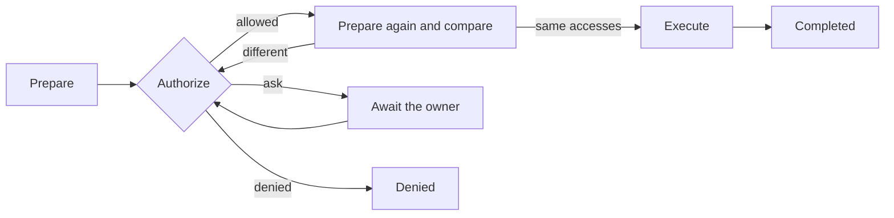

# Tools

|              |                                                                                                                                                                                                                                                                                                                                                                                                                                                                                                     |
| ------------ | --------------------------------------------------------------------------------------------------------------------------------------------------------------------------------------------------------------------------------------------------------------------------------------------------------------------------------------------------------------------------------------------------------------------------------------------------------------------------------------------------- |
| Status       | Draft for review                                                                                                                                                                                                                                                                                                                                                                                                                                                                                    |
| Last updated | 2026-10-24                                                                                                                                                                                                                                                                                                                                                                                                                                                                                          |
| Related      | [ADR-0013](../adr/0013-journal-every-side-effect.md), [ADR-0014](../adr/0014-contain-process-trees.md), [ADR-0036](../adr/0036-let-plugins-run-commands-on-remote-hosts.md), [ADR-0038](../adr/0038-let-plugins-run-installed-programs-in-the-owners-projects.md), [ADR-0043](../adr/0043-let-plugins-offer-the-tools-of-tool-servers.md), [ADR-0044](../adr/0044-let-tool-results-carry-images-to-the-model.md), [Extension points](extension-points.md#31-tool-registry), [Security](security.md) |

This document describes the rules that every tool follows. It does not list the tools: each feature's document lists the tools it adds.

## 1. Principles

- A tool acts on the machine where its agent runs ([ADR-0015](../adr/0015-run-an-agent-runtime-on-every-machine.md)). A plugin's tool may also run commands on a remote host that the owner registered with the plugin, through a remote-command access that the master's policy authorizes ([ADR-0036](../adr/0036-let-plugins-run-commands-on-remote-hosts.md)). A plugin's tool reads and changes the owner's files, and runs a program that its manifest declares, such as git, only through path and program accesses that the policy decides ([ADR-0038](../adr/0038-let-plugins-run-installed-programs-in-the-owners-projects.md)). A plugin's tool may call a tool of a tool server that the owner registered with the plugin, such as an MCP server, through an external-tool access that the master's policy authorizes; the server acts where it runs, under its own rules ([ADR-0043](../adr/0043-let-plugins-offer-the-tools-of-tool-servers.md)).
- Every side effect is an operation with a journal record ([ADR-0013](../adr/0013-journal-every-side-effect.md)).
- Results are typed and bounded in size. The model sees a rendering of them, and the transcript stores them once.
- Content that a tool returns never grants a permission.

## 2. The tool contract

A tool implements the `Tool` trait in `mannie-tools` and registers with the [tool registry](extension-points.md#31-tool-registry). It declares:

| Item             | Rule                                                                                                                                                                                                                                                                                                                                                 |
| ---------------- | ---------------------------------------------------------------------------------------------------------------------------------------------------------------------------------------------------------------------------------------------------------------------------------------------------------------------------------------------------- |
| Name             | `snake_case`, unique in the registry, never reused for a different meaning. A tool that a plugin's source publishes starts with the plugin's ID and gives way to every other tool of the same name.                                                                                                                                                  |
| Description      | Written for the model and reviewed like code, because prompts and tool descriptions are a contract with the model. A published tool's description is the tool server's, which is content.                                                                                                                                                            |
| Input schema     | JSON Schema generated with schemars from a Rust type. Arguments are validated against the type before anything else happens. A tool whose schema it did not write, such as a tool server's, marks it as loose, and the adapters send it without `strict`.                                                                                            |
| Availability     | The agent definitions and machine roles that may use the tool, and whether a model call is offered it: a tool can ask for the conversation's project and the owner's projects, as `move_to_project` does. A plugin's tool is offered always, only with a workspace, or only where the workspace or a folder above it holds a marker, such as `.git`. |
| Permission class | Read-only, or with side effects. Only tools with side effects create operations. A plugin's tool declares its effect: one that reads the owner's files returns its reads from prepare, and one with side effects returns at least one access.                                                                                                        |
| Prepare          | Computes the canonical accesses without side effects.                                                                                                                                                                                                                                                                                                |
| Execute          | Performs the work after authorization and returns a typed result.                                                                                                                                                                                                                                                                                    |

A call's surroundings, which the runtime reads again for every call, hold the conversation, its workspace, the store, the limits, the environment of commands, the conversation's project and the owner's projects, and the capability to move a general conversation into a project, which the runtime provides because a move changes the conversation ([ADR-0023](../adr/0023-organize-conversations-into-projects.md)). For a child agent, the runtime reads the workspace, the project and the grants from the parent conversation, and the conversation stays the child's own, where its archives live.

The task tools of child agents are not in the registry. They act on runs rather than on the machine: they start, continue and wait for the runs of child agents, they have no operations of their own, and every side effect of a child is an operation of the child's own run. The runtime defines them, offers them only to runs that are not tasks themselves, and renders their results ([ADR-0024](../adr/0024-run-child-agent-tasks-in-the-parent-run.md)).

Every call also carries an activity: a few words in which the model says what the call does, for the owner to read. The runtime adds the argument `activity` to each schema that a model receives and takes it out of the arguments before the tool reads them, so a tool cannot have an argument of that name. The activity is the model's claim, and nothing that authorizes a call reads it ([tool calls](../features/system-tools/tool-calls.md#the-activity-of-a-call)).

## 3. Operations

- Prepare resolves each path to its canonical absolute form and records it with its access mode: read, write, create or delete. For a command it records the command line, the shell and the working directory. For a command on a remote host, the plugin records the command, its key and name for the host, the endpoint and the host's identity, such as the fingerprint of its pinned key, and the core adds the plugin. Prepare never connects to the host. For a plugin's path, the plugin may record a state that it read of the place, such as a repository's HEAD. For a run of an installed program, the plugin records the program's name in its manifest, the arguments, the working directory and the run's effects, and the core adds the plugin, the program's resolved path and the arguments that the manifest fixes. A plugin's prepare may run a declared program to read, such as asking for a repository's HEAD. For a call of a tool server's tool, the plugin records its key and name for the server, the server's endpoint, a program with its arguments or a URL, the tool as the server names it, its title, the arguments as JSON with sorted keys and the server's hints, and the core adds the plugin. Prepare reads only what the plugin stored and never reaches the server.
- Authorization happens against those canonical accesses, never against the raw arguments.
- Right before executing, the tool prepares again. If any access changed, for example because a symlink now points elsewhere, the operation goes back to authorization.
- The journal commits the executing state durably before the side effect starts. After a crash, an executing operation becomes uncertain, and the model and the owner are told. Nothing repeats it automatically.
- The journal record is the tool call's part in the transcript, so a change of state and its event are stored in one transaction ([ADR-0013](../adr/0013-journal-every-side-effect.md)).

## 4. Authorization

Policy decides first, and the owner decides what policy leaves open.

| Source         | Effect                                                                                                                                                                                                                                                                                                                                                                                                                                                                                                          |
| -------------- | --------------------------------------------------------------------------------------------------------------------------------------------------------------------------------------------------------------------------------------------------------------------------------------------------------------------------------------------------------------------------------------------------------------------------------------------------------------------------------------------------------------- |
| Workspace      | Reads inside the conversation's workspace are allowed. Whether writes inside it are allowed without asking is a setting. A command on a remote host, a run of an installed program and a call of a tool server's tool are never allowed by the workspace.                                                                                                                                                                                                                                                       |
| Grant          | An approval "for" this conversation, its project or every conversation allows the same kind of access there, for example writes in one folder, the same command on the same remote host and endpoint, the same run of an installed program with the same effects, or the same tool of the same tool server at the same endpoint with any arguments. A grant from a command in the background covers both modes, and one from a command in the foreground only the foreground.                                   |
| Rule           | A saved pattern, such as a command prefix, allows matching operations in every conversation it covers. A rule for commands on a remote host applies only on that host, and a rule of this machine never matches a command on a remote host. A rule for an installed program matches the leading words of its arguments, and a rule of commands never matches a program's run, nor the reverse. No rule matches a call of a tool server's tool, whose grant for every conversation already covers any arguments. |
| Policy ceiling | On a machine whose composition root gives the runtime a ceiling, such as a worker, where it is set on the host, the ceiling limits everything above and can refuse an operation outright, as a worker's refuses every call of a tool server's tool. A task can narrow it further ([host and ceiling](../../plugins/workers/docs/host-and-ceiling.md#the-ceiling)).                                                                                                                                              |

- An approval request shows the operation exactly: the canonical paths, or the full command with its shell and working directory, and on a worker also the host. A command on a remote host shows with the host's name, its endpoint and its identity, and a run of an installed program with the program's path, its arguments, its working directory and each effect: an endpoint that it reaches, programs that the folder names and the run starts, work that it discards, and commits that a remote-tracking branch holds and the run rewrites. A call of a tool server's tool shows with the server's name, its endpoint, the tool, the arguments and the server's hints, which are marked as the server's claims. A worker's request offers only Allow once and Deny.
- The owner can allow the operation once, allow it for the conversation, its project or every conversation, save a rule where one applies, or deny it. A denial goes back to the model as the tool result.
- A child agent's request shows in its parent's conversation, inside the card of its task, with the task's number and title. The decision names the child's conversation, and a grant "for this conversation" is saved for the parent, so it covers the parent and all its children.
- A move into a project runs without a question only when the owner's message of the turn names the project and no other tool call of the turn came before it, so nothing that the model read can stand in for the owner's words; no grant or rule covers a move.
- A command rule never matches a command that contains shell metacharacters (`;`, `&`, `|`, `$`, backticks, parentheses, braces or redirections). Such commands always ask. On a remote host, whose shell Mannie does not know, a backslash counts as one too.
- Text that the model read can never create a grant or a rule, and neither can a report from another agent.

## 5. File safety

- Paths are resolved to canonical form, with case-insensitive comparison on Windows. Operations that change files refuse to follow symlinks and junctions at any level of the path.
- Paths that could reach the network or a device, such as UNC paths, device paths and alternate data streams, are refused before any access to the file system.
- Every read returns a revision, the SHA-256 of the content. Writes and edits to an existing file must name the revision they expect, so a file that changed in the meantime is never overwritten by accident.
- An edit replaces exact text. Each replaced span must match exactly once, and an edit with several replacements applies all of them or none.
- Writes are atomic: the new content goes to a temporary file in the same folder, is flushed to disk, and replaces the original by rename. Creating a file never overwrites an existing one.
- On one machine, operations that change files run one at a time.
- Text is read and written as UTF-8, or as UTF-16 when the file starts with a byte order mark. Byte order marks and line endings are preserved.

## 6. Running commands

- Commands run through one process supervisor that contains the whole process tree on every platform ([ADR-0014](../adr/0014-contain-process-trees.md)).
- The shell is Windows PowerShell on Windows and `/bin/sh` on Linux and FreeBSD. On Windows, the command text reaches PowerShell through standard input, never as an encoded command.
- When a command ends, every process it started ends with it.
- A command has a timeout of 60 seconds by default and 600 seconds at most. Stop and timeout end the whole tree.
- A command started in the background has no timeout and runs past its call until it ends or is stopped, with its two streams in one log of lines that the model reads later. Its record outlives its call's part, and each machine's runtime keeps a registry of them with limits. When it ends, every process it started ends with it ([ADR-0041](../adr/0041-let-agents-run-commands-in-the-background.md)).
- Standard output and standard error are captured separately, each capped in size, and a cut is marked as truncated.
- A child process gets an environment built from an allow list. Credentials never reach it.
- A plugin runs an installed program that its manifest declares through the same supervisor, without a shell ([ADR-0038](../adr/0038-let-plugins-run-installed-programs-in-the-owners-projects.md)). The core finds the program on the `PATH`, outside projects and Mannie's folders, the program receives its arguments exactly, its environment comes from the same allow list with the names that the manifest inherits and the variables that the plugin sets, its output is captured as bytes, and Stop, the timeout and the end of the run end its whole tree.
- A plugin's local tool server is a program that the owner named in the plugin's settings, which the core finds as it finds an installed program, on Windows also as a `.cmd` or `.bat` file whose arguments must not read as code to `cmd.exe` ([ADR-0043](../adr/0043-let-plugins-offer-the-tools-of-tool-servers.md), decision 5). It runs through the same supervisor without a timeout while the server is on, with its standard streams piped to the plugin, and its tree ends when its program exits, when the plugin stops or drops it, and when the plugin stops. Its environment comes from the same allow list with the server's own variables, and a secret that the owner gave the server reaches it there, an exception to the rule above that the owner decided ([D42](../roadmap/milestones.md#5-decisions)).
- A command on a remote host runs outside the supervisor ([ADR-0036](../adr/0036-let-plugins-run-commands-on-remote-hosts.md)). Stop and timeout ask the host to end it and close its channel, and the result tells the model that the processes it started may still run. A plugin's remote command in the background hands the core's registry a stream of its lines and a stop, through a service of the SDK.

## 7. Bounded results

- Every result has a size limit. Listings and searches return pages with an offset for the next page. File reads return line ranges and say where the next range starts.
- A result that is too large for the transcript is archived. The model gets an excerpt and a reference that a read-back tool follows ([agent runtime](agent-runtime.md#7-context-management)). A plugin's tool with side effects archives what does not fit under up to 4 IDs that the core reserves for each call.
- A result may carry up to 4 images, PNG or JPEG of at most 5 MiB, 4096 pixels on a side and 16.8 million pixels, which the core checks from their headers and stores without their metadata. A request sends the images of the 3 newest results that hold images, at most 8 in all, and the model reads a line with the format and the size of each older one ([ADR-0044](../adr/0044-let-tool-results-carry-images-to-the-model.md)).

## 8. Testing tools

- A conformance suite runs every tool on each supported platform: Windows and Linux on the master, plus FreeBSD on workers.
- Crash tests end the process in every journal state and check that nothing repeats.
- A prompt-injection corpus feeds hostile instructions through files, command output, reports and the descriptions and results of a plugin's published tools, and must cause no side effect the owner did not allow.
- A test changes a path between the approval and the execution and expects the operation to return to authorization.
