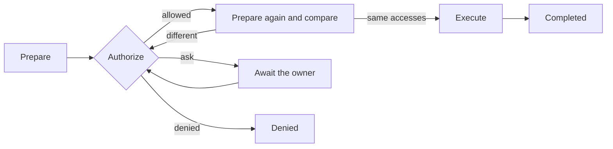

# Tools

|              |                                                                                                                                                                                           |
| ------------ | ----------------------------------------------------------------------------------------------------------------------------------------------------------------------------------------- |
| Status       | Draft for review                                                                                                                                                                          |
| Last updated | 2026-10-13                                                                                                                                                                                |
| Related      | [ADR-0013](../adr/0013-journal-every-side-effect.md), [ADR-0014](../adr/0014-contain-process-trees.md), [Extension points](extension-points.md#31-tool-registry), [Security](security.md) |

This document describes the rules that every tool follows. It does not list the tools: each feature's document lists the tools it adds.

## 1. Principles

- A tool acts only on the machine where its agent runs ([ADR-0015](../adr/0015-run-an-agent-runtime-on-every-machine.md)).
- Every side effect is an operation with a journal record ([ADR-0013](../adr/0013-journal-every-side-effect.md)).
- Results are typed and bounded in size. The model sees a rendering of them, and the transcript stores them once.
- Content that a tool returns never grants a permission.

## 2. The tool contract

A tool implements the `Tool` trait in `mannie-tools` and registers with the [tool registry](extension-points.md#31-tool-registry). It declares:

| Item             | Rule                                                                                                                         |
| ---------------- | ---------------------------------------------------------------------------------------------------------------------------- |
| Name             | `snake_case`, unique in the registry, never reused for a different meaning.                                                  |
| Description      | Written for the model and reviewed like code, because prompts and tool descriptions are a contract with the model.           |
| Input schema     | JSON Schema generated with schemars from a Rust type. Arguments are validated against the type before anything else happens. |
| Availability     | The agent definitions and machine roles that may use the tool.                                                               |
| Permission class | Read-only, or with side effects. Only tools with side effects create operations.                                             |
| Prepare          | Computes the canonical accesses without side effects.                                                                        |
| Execute          | Performs the work after authorization and returns a typed result.                                                            |

## 3. Operations

- Prepare resolves each path to its canonical absolute form and records it with its access mode: read, write, create or delete. For a command it records the command line, the shell and the working directory.
- Authorization happens against those canonical accesses, never against the raw arguments.
- Right before executing, the tool prepares again. If any access changed, for example because a symlink now points elsewhere, the operation goes back to authorization.
- The journal commits the executing state durably before the side effect starts. After a crash, an executing operation becomes uncertain, and the model and the owner are told. Nothing repeats it automatically.

## 4. Authorization

Policy decides first, and the owner decides what policy leaves open.

| Source         | Effect                                                                                                                                        |
| -------------- | --------------------------------------------------------------------------------------------------------------------------------------------- |
| Workspace      | Reads inside the conversation's workspace are allowed. Whether writes inside it are allowed without asking is a setting.                      |
| Grant          | An approval "for this conversation" allows the same kind of access for the rest of the conversation, for example writes in one folder.        |
| Rule           | A saved pattern, such as a command prefix, allows matching operations in every conversation it covers.                                        |
| Policy ceiling | On a worker, the ceiling set on the host limits everything above. A task can narrow it further ([orchestration](orchestration.md#4-workers)). |

- An approval request shows the operation exactly: the canonical paths, or the full command with its shell and working directory, and on a worker also the host.
- The owner can allow the operation once, allow it for the conversation, save a rule, or deny it. A denial goes back to the model as the tool result.
- A command rule never matches a command that contains shell metacharacters (`;`, `&`, `|`, `$`, backticks, parentheses, braces or redirections). Such commands always ask.
- Text that the model read can never create a grant or a rule, and neither can a report from another agent.

## 5. File safety

- Paths are resolved to canonical form, with case-insensitive comparison on Windows. Operations that change files refuse to follow symlinks and junctions at any level of the path.
- Every read returns a revision, the SHA-256 of the content. Writes and edits to an existing file must name the revision they expect, so a file that changed in the meantime is never overwritten by accident.
- An edit replaces exact text. Each replaced span must match exactly once, and an edit with several replacements applies all of them or none.
- Writes are atomic: the new content goes to a temporary file in the same folder, is flushed to disk, and replaces the original by rename. Creating a file never overwrites an existing one.
- On one machine, operations that change files run one at a time.
- Text is read and written as UTF-8. Byte order marks and line endings are preserved.

## 6. Running commands

- Commands run through one process supervisor that contains the whole process tree on every platform ([ADR-0014](../adr/0014-contain-process-trees.md)).
- The shell is PowerShell on Windows and `/bin/sh` on Linux and FreeBSD. On Windows, the command text reaches PowerShell through standard input or a temporary script file, never as an encoded command.
- A command has a timeout of 60 seconds by default and 600 seconds at most. Stop and timeout end the whole tree.
- Standard output and standard error are captured separately, each capped in size, and a cut is marked as truncated.
- A child process gets an environment built from an allow list. Credentials never reach it.

## 7. Bounded results

- Every result has a size limit. Listings and searches return pages with an offset for the next page. File reads return line ranges and say where the next range starts.
- A result that is too large for the transcript is archived. The model gets an excerpt and a reference that a read-back tool follows ([agent runtime](agent-runtime.md#7-context-management)).

## 8. Testing tools

- A conformance suite runs every tool on each supported platform: Windows and Linux on the master, plus FreeBSD on workers.
- Crash tests end the process in every journal state and check that nothing repeats.
- A prompt-injection corpus feeds hostile instructions through files, command output and reports, and must cause no side effect the owner did not allow.
- A test changes a path between the approval and the execution and expects the operation to return to authorization.
