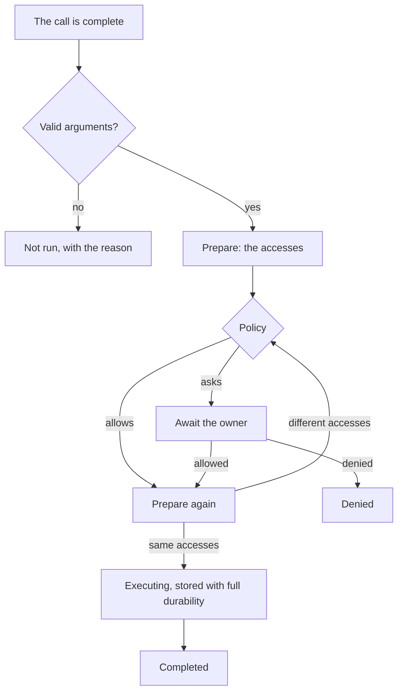

# Operations and approvals

|              |                                                                                                                                                                                                                                                                                                                                                                                                                                         |
| ------------ | --------------------------------------------------------------------------------------------------------------------------------------------------------------------------------------------------------------------------------------------------------------------------------------------------------------------------------------------------------------------------------------------------------------------------------------- |
| Status       | Building                                                                                                                                                                                                                                                                                                                                                                                                                                |
| Milestone    | M2                                                                                                                                                                                                                                                                                                                                                                                                                                      |
| Last updated | 2026-10-21                                                                                                                                                                                                                                                                                                                                                                                                                              |
| Part of      | [System tools](README.md)                                                                                                                                                                                                                                                                                                                                                                                                               |
| Related      | [ADR-0013](../../adr/0013-journal-every-side-effect.md), [ADR-0012](../../adr/0012-run-agents-as-durable-actors.md), [ADR-0036](../../adr/0036-let-plugins-run-commands-on-remote-hosts.md), [ADR-0038](../../adr/0038-let-plugins-run-installed-programs-in-the-owners-projects.md), [Tools](../../architecture/tools.md), [Security](../../architecture/security.md), [Domain model](../../architecture/domain-model.md#5-operations) |

## Design

### The lifecycle

The runtime runs each tool call through the same steps ([ADR-0013](../../adr/0013-journal-every-side-effect.md)):

- Preparing has no side effects. It resolves paths, reads metadata and counts the entries a delete would remove, and it runs on a blocking thread.
- Right before the execution, the tool prepares again. When the accesses differ, the operation goes back to the policy, and an earlier approval no longer counts. When the second preparation fails, for example because a folder of the path became a link, the call completes with that error and nothing runs.
- A file change compares its accesses once more under the machine's file lock, right before it writes, and fails with `path_changed` when they moved again ([tools and results](tools-and-results.md#file-safety)).
- Read-only tools go through the same policy, but they are not operations: their status while they run is `running`, and they never become uncertain.
- A plugin's tool with side effects follows the same steps ([ADR-0036](../../adr/0036-let-plugins-run-commands-on-remote-hosts.md)). When the owner stops the reply while it executes, the core lets it go, and the call becomes uncertain, with the reason that the owner stopped it. Turning its plugin off waits up to 5 seconds for it, and then the call becomes uncertain, with the reason that the plugin went off; a read-only call of a plugin's tool ends as not run instead.
- A plugin's tool that reads the owner's files returns its reads from prepare, and the policy decides them as it decides the reads of `read_file`; its calls are read-only and never operations ([ADR-0038](../../adr/0038-let-plugins-run-installed-programs-in-the-owners-projects.md)). A plugin's tool with side effects checks the state that its accesses name, such as a repository's HEAD, right before it acts, and fails without acting when it moved.

### Accesses

- A path access names the canonical path, its mode (read, write, create or delete), whether the target exists, and the identity of the target or of its nearest existing folder: the volume serial number and file index on Windows, the device and inode on Linux. A recursive delete adds the number of files and folders it removes.
- A command access names the command's text, the shell's path, the canonical working directory, and whether the command runs in the background ([background commands](background-commands.md)), false for every access that existed.
- A remote command access names the plugin, the plugin's key for the host, the host's name, the endpoint, the host's identity, such as the fingerprint of its pinned key, the command's text, and whether the command runs in the background, false for every access that existed.
- A plugin's path access is a path access with an optional state that the plugin read of the place, such as a repository's HEAD and the stamp of its index.
- A program access names the plugin, the program's name in its manifest and its resolved path, the arguments that the manifest fixes and the plugin's own, the canonical working directory, the run's effects and an optional state. The effects are an endpoint that the run reaches, programs that the folder's files or configuration name and the run starts, such as hooks, work that it discards, and commits that a remote-tracking branch holds and the run rewrites.
- The digest of an operation is the SHA-256 of its accesses in canonical JSON, without `background` while it is false, so a command in the foreground keeps the digest that it had before commands ran in the background. A replaced file, a swapped folder or a changed folder content therefore changes the digest.

### The journal

The journal record of an operation is its tool call part ([tool calls](tool-calls.md#the-transcript-part)). Each change of its status is stored in the same transaction as its event, with full durability, and the `executing` status is stored before the side effect starts. The record keeps the accesses, the decision with its source (the workspace, a grant of the conversation, of its project or of every conversation, a rule, full access or the owner), the result, and for a command the shell's process ID and start time.

### Policy

The policy is a function of the accesses, the conversation's workspace and project, the `tools` settings, the grants that apply to the conversation, the rules, the conversation's full access and, for a move into a project, the owner's message of the turn. It is read again for every call, so a change applies from the next call.

A conversation in [full access](#full-access) allows every operation before the table applies: commands, commands with shell operators, changes anywhere, accesses inside Mannie's data and log folders, and a move into a project that the owner's message did not name.

| Order | Source                        | Effect                                                                                                                            |
| ----- | ----------------------------- | --------------------------------------------------------------------------------------------------------------------------------- |
| 1     | Mannie's data and log folders | Every access inside them asks, whatever the workspace, grants and rules say                                                       |
| 2     | Workspace, reads              | Reads inside the workspace are allowed                                                                                            |
| 3     | Workspace, changes            | Creating, writing and deleting inside the workspace are allowed only when the settings allow it                                   |
| 4     | Grants                        | A grant of the conversation, of its project or of every conversation allows what it covers                                        |
| 5     | Rules                         | A rule allows a command it matches, a rule of a remote host a command on that host, and a rule of a program a run of that program |
| 6     | The owner's message           | A move into a project that the owner's message names is allowed, while no other tool call of the turn came before it              |
| 7     | The owner                     | Everything else asks                                                                                                              |

An operation with several accesses is allowed only when every access is. Commands, on this machine or on a remote host, and runs of installed programs are never allowed by the workspace, and no grant or rule moves a conversation ([projects](../chat/projects.md#moving-a-conversation-into-a-project)). The decision names the source that reaches furthest: a rule, then a grant for every conversation, of the project and of the conversation, then the owner's message and the workspace.

### Full access

Full access is the owner's standing decision that a conversation's operations run without asking ([ADR-0029](../../adr/0029-let-the-owner-give-conversations-and-hosts-full-access.md), [decision D22](../../roadmap/milestones.md#5-decisions)).

- Every conversation has a switch. A new conversation takes the value of `full_access_for_new_conversations` in the settings, and the owner switches it afterwards through `set_full_access`. A child agent's conversation follows its parent's switch and refuses its own with `full_access_follows_parent`.
- The policy reads the switch for every call, so turning it off applies from the next call. A call that already waits for the owner keeps waiting.
- An operation that runs under it is journaled with the decision `full_access`, and its recovery after a crash stays the same.
- The guidance on tools tells the model that nobody checks its operations in the conversation.
- When a worker task of a conversation in full access asks the owner, the master answers it at once with Allow once, marked as automatic, unless the worker's configuration refuses that ([host and ceiling](../../../plugins/workers/docs/host-and-ceiling.md#approvals)).

### The workspace

- A conversation's workspace is the folder of its project ([projects](../chat/projects.md)), stored on the conversation with its links resolved. A general conversation has none, and so do conversations from before system tools that used no folder.
- A conversation gets its workspace when it starts in a project or moves into one. The move is an event of the conversation, so every window shows it, and it applies from the next tool call. A conversation never leaves its project, so its workspace never changes again.
- Without a workspace, a relative path and a command without a working directory are refused with `no_workspace`.

### Grants

- "Allow for…" offers three scopes. "This conversation" creates grants that last until the conversation is deleted or the owner revokes them. "This project", offered in a project's conversation, creates grants that every conversation of the project uses until the project is removed or the owner revokes them. "Every conversation" creates grants that every conversation uses until the owner revokes them.
- A path grant covers one mode in one folder and everything below it: the folder of a file, or the folder itself for a folder.
- A command grant covers the same command text in the same working directory. A grant given from the approval of a command in the background covers the command in both modes, and one given from a command in the foreground covers it only in the foreground (D40).
- A remote command grant covers the same command text on the same plugin's host, reached at the same endpoint. The host's name is shown and not compared, so renaming the host keeps the grant. Its mode counts as a command grant's does.
- A program grant covers runs of the same plugin and program path with the same arguments in the same working directory, whose effects the run that it was given for had. An effect counts by its key: an endpoint by itself, a program that the folder names, such as a hook, by its name and its source and not by its content, so a hook whose content changed keeps its grant ([decision D37](../../roadmap/milestones.md#5-decisions)), and discarded or rewritten work by its kind.
- The core computes a grant from the operation's accesses, and the approval shows what it would cover. When one operation's accesses would give several grants and one covers another, the request offers only the wider one. The owner sees and revokes the grants that apply to a conversation in a dialog, and the grants for projects and for every conversation in the Tools settings.
- An approval that touches Mannie's data or log folders offers no grant, so those folders keep asking.

### Rules

- A rule allows commands that start with its words, in every conversation. It may be limited to a folder, which the working directory must be in. A rule saved from the approval of a command in the background covers both modes, and one saved from a command in the foreground covers only the foreground, also on a remote host (D40).
- Words are split at unquoted spaces. A command that contains `;`, `&`, `|`, `$`, a backtick, parentheses, braces, `<`, `>`, a line break or an unbalanced quote never matches a rule or a grant, and its approval offers only "Allow once" and "Deny".
- The owner saves a rule from an approval. The dialog shows the command's words, the owner chooses how many of the leading words the rule keeps and whether it is limited to the working directory, and the core builds the rule from the command it holds. The settings list the rules, and the owner deletes them there.
- A rule from a command on a remote host always applies only on that host and endpoint, and the dialog names the host in place of the folder. These rules are stored apart, so a rule of this machine never matches a command on a remote host, and the reverse. On a remote host, whose shell Mannie does not know, a backslash also keeps a command from matching a rule or a grant.
- A rule from a run of an installed program keeps leading words of the program's name and its arguments, which reach the program exactly, so no character keeps a run from matching. It may be limited to the working directory, and it covers only the effects, by their keys, of the run that it was saved from: a run that reaches another endpoint, starts a hook that the saved run did not, or discards or rewrites another kind of work asks. A rule covers the run only: the call's other accesses, such as the plugin's change in the workspace, are decided by their own sources, so the dialog says that such changes still follow the setting for changes. These rules are stored apart as well, so a rule of commands never matches a program's run, and the reverse.

### Approvals

- An approval request shows the tool, the accesses exactly (each canonical path with its mode and, for a delete, the number of files and folders; the command with its shell and working directory; or the command on a remote host with the host's name, endpoint and identity; or the run of an installed program with its path, arguments, working directory and effects), why Mannie asks, and what "Allow for…" would cover.
- The options are "Allow once", "Allow for…" with "This conversation", "This project" in a project's conversation and "Every conversation", "Save rule" for commands that a rule can cover, and "Deny". The request names the conversation's project, and the core refuses a scope that the request does not offer: "This project" outside a project (`not_in_a_project`), and any "Allow for…" for an operation that can only be allowed once (`grant_not_possible`).
- The request carries the operation's digest. `decide_approval` names the conversation, the tool call and the digest, and the core refuses a decision for a request that no longer waits (`approval_not_pending`) or whose accesses changed (`approval_changed`).
- The run waits through a pending approval, a one-shot answer that the runtime registers for the request. Stop and Shutdown still reach the run through its mailbox. A pending approval holds no model slot.
- A denial goes back to the model, and the other calls of the same step are not run.
- Nothing that the model reads can answer an approval, create a grant or save a rule. Only the owner's actions in the UI can.

### Recovery

At startup, before any command is accepted, the runtime finishes every tool call that was open:

| Status when Mannie ended                    | Status after the start | What the model sees on a retry |
| ------------------------------------------- | ---------------------- | ------------------------------ |
| `receiving`, `pending`, `awaiting_approval` | `canceled`             | Not run                        |
| `running`                                   | `canceled`             | Not run                        |
| `executing`                                 | `uncertain`            | It may have taken effect       |

The statuses are stored before the runs end as interrupted, so a crash during the recovery never leads to an operation running again. An uncertain operation is reported to the model and to the owner and never repeated automatically. An operation of a plugin's tool that the owner stopped, or whose plugin went off, is uncertain as well, and its part says which of the two happened. On Linux, the recovery then ends what is left of an uncertain command's process tree ([commands](commands.md#crash-recovery)). Background commands recover from their own records, also when no run was active ([background commands](background-commands.md#recovery)).

### Contracts

- Commands (`apps/desktop/core/src/commands/tools.rs`): `decide_approval`, `set_full_access`, `get_tools_settings`, `update_tools_settings`, `list_command_rules`, `delete_command_rule`, `list_remote_command_rules`, `delete_remote_command_rule`, `list_program_rules`, `delete_program_rule`, `list_conversation_grants`, `revoke_conversation_grant`, `list_shared_grants`, `revoke_shared_grant` and `read_tool_output`. `list_conversation_grants` returns the grants of one conversation, and `list_shared_grants` the grants for a project, which name it, and those for every conversation.
- Errors use `ToolsError`: `conversation_not_found`, `approval_not_pending`, `approval_changed`, `rule_not_possible`, `rule_prefix_invalid`, `not_in_a_project`, `grant_not_possible`, `rule_not_found`, `grant_not_found`, `output_not_found`, `environment_name_invalid`, `environment_name_secret`, `too_many_environment_names`, `written_by_newer_version`, `storage_failed`, `store_unavailable`, `shutting_down`, `full_access_follows_parent` and `full_access_refused`.
- The conversation summary carries the workspace, the project, whether the conversation is in full access and whether it waits for an approval. The conversation list receives a new summary when a reply starts or stops waiting, so the list marks it at once.

### Settings

The settings section `tools` holds:

| Field                               | Rule                                                                                                                                                    |
| ----------------------------------- | ------------------------------------------------------------------------------------------------------------------------------------------------------- |
| `allow_changes_in_workspace`        | False by default                                                                                                                                        |
| `command_environment`               | At most 50 variable names passed to commands besides the built-in ones. Names that look like secrets are refused ([commands](commands.md#environment)). |
| `full_access_for_new_conversations` | False by default. A new conversation starts in full access when it is true                                                                              |
| `wake_on_command_end`               | True by default, also for settings stored before it existed. A background command's own end wakes an idle agent ([wake-ups](wake-ups.md))               |

### Data

- Migration `0008` adds `workspace` to `runtime_conversations`.
- Migration `0010` creates `tools_grants`: the conversation, the kind (path or command), the mode and folder of a path grant, the command and working directory of a command grant, and the time. The conversation is a foreign key to `runtime_conversations` with `ON DELETE CASCADE`, the store's first foreign key across modules, so deleting a conversation deletes its grants with `secure_delete`.
- Migration `0011` creates `tools_rules`: the words, the optional folder, and the time.
- Migration `0021` adds `full_access` to `runtime_conversations`, off for every conversation that existed.
- Migration `0014` creates `tools_shared_grants`: the project, or none for every conversation, the scope and the time. The project is a foreign key to `runtime_projects` with `ON DELETE CASCADE`, so removing a project deletes its grants.
- Migration `0030` creates `tools_remote_rules`: the plugin, its key for the host, the endpoint, the host's name, the words and the time, with one rule for the same words on the same host and endpoint.
- A command grant's scope keeps `background` in its JSON, absent for every grant that existed, and migration `0033` adds `background` to `tools_rules` and `tools_remote_rules`, false for every row that existed, so grants and rules from before keep asking before a command runs in the background.
- Migration `0031` creates `tools_program_rules`: the plugin, the program's name and path, the words, the optional folder, the keys of the effects that the rule covers and the time, with one rule for the same words, folder and effects of the same plugin's program.

### Threat notes

- T-1 and T-2: operations are authorized against their canonical accesses, the second preparation catches changes, and commands with metacharacters always ask.
- A broad grant could let the model change Mannie's database and with it the rules. Accesses inside Mannie's data and log folders therefore always ask, except in full access.
- T-29: full access removes the owner's check, so text that the model reads can run commands and change files, Mannie's own included. It is off by default, the owner turns it on for a conversation or for new conversations after a confirmation, the UI marks it, and the journal records it.
- A grant for a project or for every conversation reaches conversations that the owner is not looking at. The owner chooses the scope in each request, the request shows what the grant covers, and the Tools settings list every such grant with "Revoke".
- T-5: a decision must name the digest of the request it answers, so a stale or forged decision changes nothing. A compromised webview could still answer a pending request, which stays a residual risk ([security](../../architecture/security.md#8-if-the-webview-is-compromised)).
- Paths, commands and approvals are content. Logs at `info` level record operations with their IDs, tools, statuses and codes, and paths and commands only at `debug`.

## Acceptance

- Ending the process in every journal state never makes an operation run twice, the recovered statuses match the table, and a retry reports uncertain operations without repeating them (crash tests in `mannie-runtime`, and an end-to-end test that kills the app during a command).
- The policy decides as the table says, for every source and combination (unit tests of the policy).
- A conversation in full access and its child agents run every operation without asking, Mannie's own folders included, turning it off asks from the next call, a new conversation takes the setting's value, and a task conversation has no switch of its own (unit tests of the policy and runtime tests).
- An approval runs the operation only for the request it answers; a stale decision, a changed digest and a decision for another conversation are refused (runtime tests).
- A path changed between the approval and the execution goes back to the policy (runtime test).
- The prompt-injection corpus causes no side effect that the owner did not allow, and creates no grant and no rule (runtime test with a scripted model).
- A rule never matches a command with metacharacters, and grants and rules cover exactly what the approval showed (unit tests).
- Deleting a conversation deletes its grants and archives, with a planted string in them (store test).
- "For this project" lets another conversation of the project run what the grant covers, "Always" lets a general conversation run it, and revoking them asks again (runtime tests and end-to-end test).
