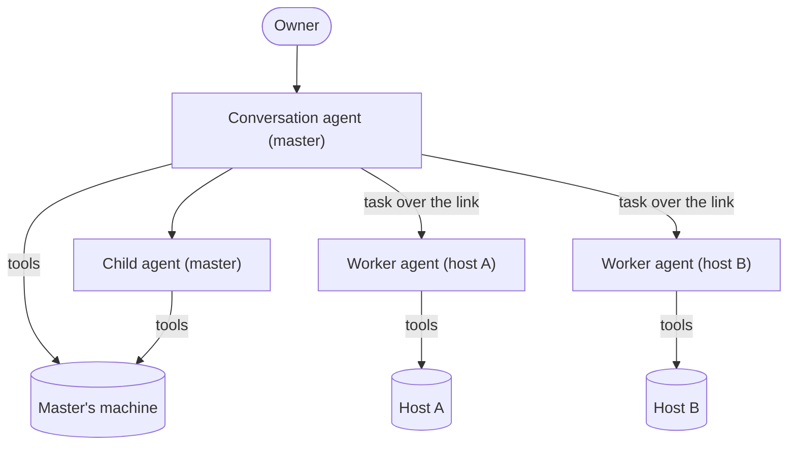
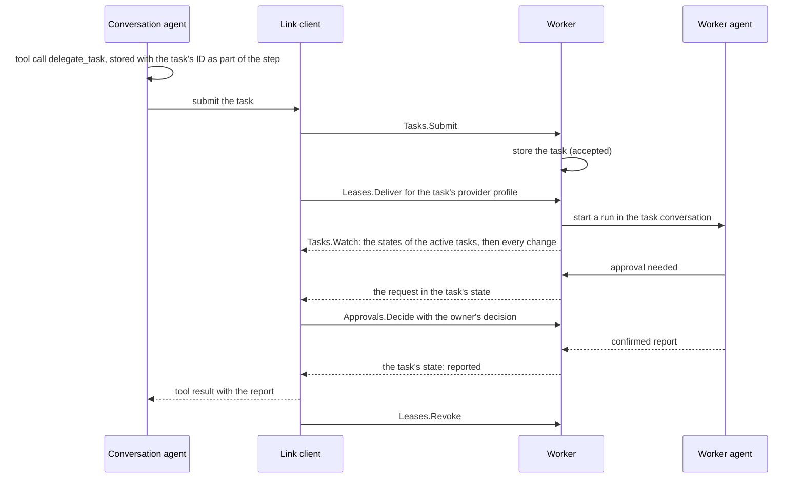
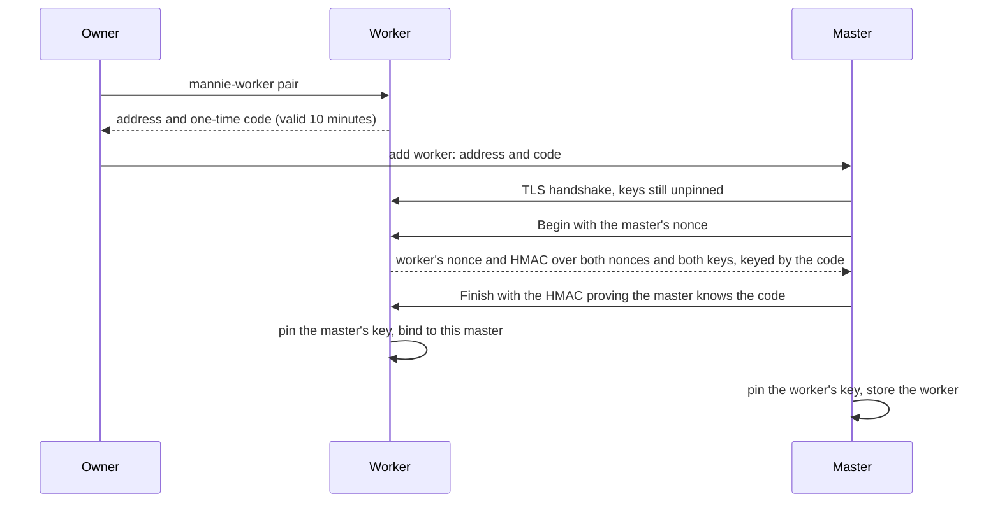
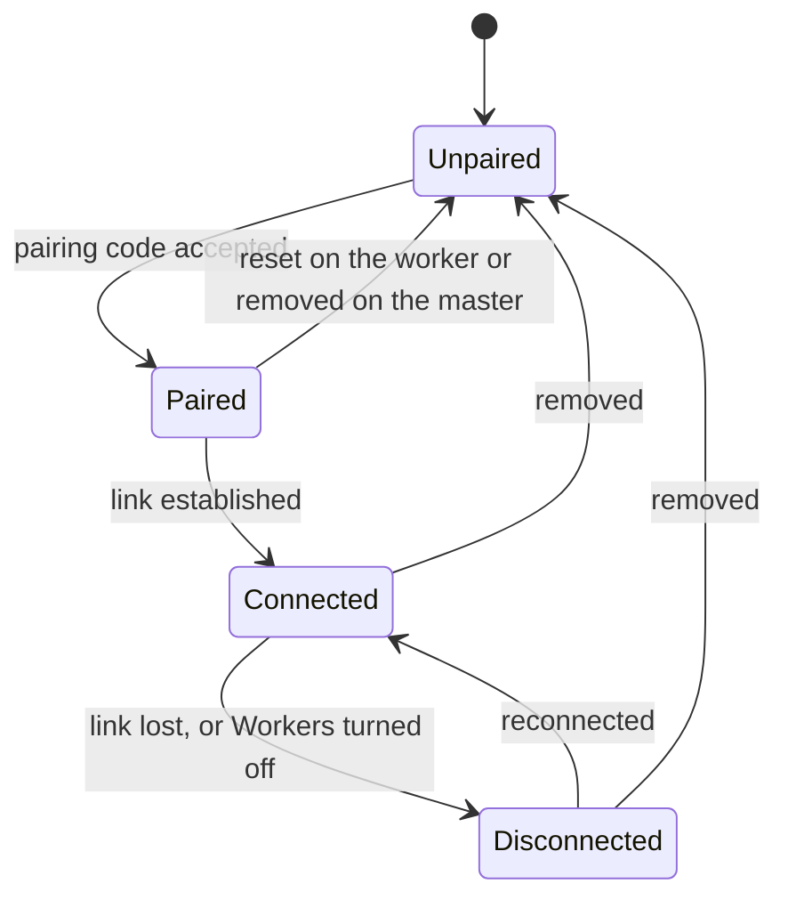

# Workers architecture

|              |                                                                                                                                                                                                                                                                                                                                                                                                                       |
| ------------ | --------------------------------------------------------------------------------------------------------------------------------------------------------------------------------------------------------------------------------------------------------------------------------------------------------------------------------------------------------------------------------------------------------------------- |
| Status       | Building                                                                                                                                                                                                                                                                                                                                                                                                              |
| Milestone    | M4                                                                                                                                                                                                                                                                                                                                                                                                                    |
| Last updated | 2026-10-16                                                                                                                                                                                                                                                                                                                                                                                                            |
| Part of      | [Workers](README.md)                                                                                                                                                                                                                                                                                                                                                                                                  |
| Related      | [ADR-0015](../../adr/0015-run-an-agent-runtime-on-every-machine.md), [ADR-0016](../../adr/0016-link-machines-over-pinned-mtls-grpc.md), [ADR-0010](../../adr/0010-keep-provider-credentials-on-the-master.md), [ADR-0027](../../adr/0027-delegate-tasks-to-workers-through-a-runtime-port.md), [ADR-0031](../../adr/0031-move-workers-into-the-first-plugin.md), [Orchestration](../../architecture/orchestration.md) |

How the Workers plugin spreads work across machines: workers that own their hosts, delegation through the plugin's task executor, approvals and model access across the link, pairing, the link itself, and compatibility. The core's side of tasks and executors is in [orchestration](../../architecture/orchestration.md). Everything here runs only while Workers is on ([workers as a plugin](plugin.md)).

## Design

### The model

- The master's conversation agent delegates tasks to workers with `delegate_task`, the tool of the plugin's executor ([ADR-0015](../../adr/0015-run-an-agent-runtime-on-every-machine.md), [ADR-0031](../../adr/0031-move-workers-into-the-first-plugin.md)).
- A worker agent takes care of the master's request. It knows its host from the host facts and host instructions, and it decides how to do the task there. The master does not need to know how the host works.
- The master never runs tools on a worker's host, and workers do not delegate to other workers.

### Workers

A worker is the headless `mannie-worker` service on a host. It runs the same runtime as the master, with its own store and its own tools.

| Worker property    | Where it comes from                                                                                                                              |
| ------------------ | ------------------------------------------------------------------------------------------------------------------------------------------------ |
| Name and purpose   | The worker's configuration on its host, shown to the master and to the conversation agent                                                        |
| Host instructions  | A file on the host that the owner writes: conventions, constraints and what the host is for. The worker agent reads it with every task.          |
| Host facts         | Discovered by the worker: operating system and version, architecture, shells and installed tools. Reported to the master when the link connects. |
| Policy ceiling     | The worker's configuration on its host: read-only, ask, or autonomous within allowed folders and rules                                           |
| Task conversations | The worker's own database                                                                                                                        |

- The policy ceiling is the most the worker's tools may do. In read-only mode, only reads run, and every change and command is refused. In ask mode, every change and command goes to the owner for approval through the master. In autonomous mode, changes within the allowed folders and commands that the host's rules allow run without asking, and everything else asks. In every mode, reads inside the allowed folders run without asking, and reads and changes outside them ask, unless read-only refuses them ([decision D21](../../roadmap/milestones.md#5-decisions), [host and ceiling](host-and-ceiling.md#the-ceiling)).
- A task can narrow the ceiling, for example to read-only, but it cannot widen it. A worker enforces its ceiling even against instructions from the master.
- The conversation agent sees each worker's name, purpose, status and host facts, and chooses where a task should go. What a worker says about itself reaches the agent as data, shortened and cleaned.

### Delegation

- The master's runtime chooses the task's ID and stores it in the step's part before the executor submits the task, so a retry of the same step, or a submission whose answer was lost, finds the same task and the worker does not start a second one ([ADR-0027](../../adr/0027-delegate-tasks-to-workers-through-a-runtime-port.md)).
- The master follows the states of each worker's tasks through one watch: the active tasks first, then every change, in order. After a link drop it reconnects, watches again and asks the worker about each task that it still follows, so no ending is missed; a state older than the one stored changes nothing.
- Calls to different workers in one step run in parallel. Each worker runs several tasks at once, up to its configured limit.
- A follow-up can continue an earlier task's conversation on the same worker, so the worker agent keeps what it learned.
- The owner sees every task conversation live in the master's UI, and afterwards as part of the conversation that delegated it, while the worker can be reached. The master forwards each read of the conversation to the worker, which keeps it.
- Stopping the delegating reply cancels its worker tasks; quitting the master, or turning Workers off, leaves them running ([delegation](delegation.md#stop-quit-and-restart)).

### Approvals across the link

- A worker's approval request travels in its task's state to the master, with the host, the canonical paths or the full command, and the task it belongs to.
- The master shows the request in the conversation that delegated the task, inside the task's card. The owner's decision goes back to the worker, which continues the operation's lifecycle ([tools](../../architecture/tools.md#4-authorization)). A worker's request offers Allow once and Deny, so the master's answers never widen the worker's ceiling.
- While the master is offline, the link is down or Workers is off, the request waits on the worker, and the operation does not run. Mannie never treats a missing answer as approval.
- When a task is canceled, its pending approvals are canceled with it.

### Model access on workers

- The master holds the provider profiles and their credentials ([ADR-0010](../../adr/0010-keep-provider-credentials-on-the-master.md)). A worker never stores a provider credential.
- For each task, the plugin borrows the credential of the task's provider profile from the core's lender and leases it over the link. The worker keeps it in memory until the task ends, is canceled or the worker is unpaired, and then drops it.
- With a lease in memory, a worker finishes its task even when the master goes offline. A worker that restarts during a task interrupts the task, as any machine interrupts its runs; a follow-up gets a new lease, and a run that starts before its lease arrived waits for it.
- The worker calls the provider itself, so the provider's endpoint has to be reachable from the host.
- The documentation recommends provider keys with limited scope and spending limits for profiles that workers use.

### Pairing

- The HMAC binds both public keys, which each side takes from its own TLS session, and the code, so an attacker in the middle without the code cannot complete pairing or swap a key.
- The code has 100 bits, since one captured exchange lets an attacker test codes offline. A code allows 5 attempts, lasts 10 minutes and works once ([pairing and the link](pairing-and-link.md#pairing)).
- A worker accepts connections only from the master it paired with. `mannie-worker pair --reset` clears the binding.
- Both sides pin the hash of the other's public key. The link uses raw public keys, so there is no certificate to renew. The master's key lives in the operating system's credential store, in the entry that the plugin owns.

### The link

- The master connects to the worker's configured TCP port, 7445 by default. The worker never connects to the master.
- The link is gRPC over HTTP/2 with mutual TLS, built on tonic, prost and rustls with ring ([ADR-0016](../../adr/0016-link-machines-over-pinned-mtls-grpc.md)).
- There is one persistent connection per worker, with HTTP/2 keepalive, while Workers is on. The state of the connection is the worker's status in the UI.
- The contracts live in `plugins/workers/proto/mannie/link/<service>/v1/`, one package for each service. `buf lint` and `buf breaking` check every change.

A worker's life on the master, from pairing to removal:

- Pairing pins each side's public key. A worker accepts connections only from its pinned master, and the master only from the pinned worker key.
- On connect, both sides agree on a feature level for every link service.
- Unpairing revokes every active credential lease of that worker and cancels its tasks.
- The master shows a connected worker whose version it does not work with as incompatible, and gives it no tasks.

| Service   | Purpose                                                                                                              |
| --------- | -------------------------------------------------------------------------------------------------------------------- |
| Session   | Hello, feature levels, host facts, and unpairing                                                                     |
| Pairing   | Pair a worker with the master's key and a one-time code                                                              |
| Tasks     | Submit (idempotent) and continue tasks, look them up, cancel them, and follow their states                           |
| Events    | Subscribe to a task conversation's events from a cursor, and read its earlier turns, checkpoint and archived outputs |
| Approvals | The master answers the requests that it reads in the tasks' states                                                   |
| Leases    | Deliver and revoke credential leases                                                                                 |

### Compatibility and updates

- Each protobuf package has a feature level. On connect, the two sides agree on the highest level both support, and features check the agreed level before using a service.
- A master works with workers of its own minor version and one minor version behind, and shows any other worker as one to update. Contracts only grow, and removing something takes a deprecation release.
- The owner updates a worker on its host with `mannie-worker update` ([decision D20](../../roadmap/milestones.md#5-decisions)). It checks the Ed25519 signature against the release key built into the worker, runs the new program's self-check, keeps the previous program, switches to the new one and restarts the service. If the new program does not come up, it restores the previous program and the database ([compatibility and updates](compatibility-and-updates.md)).

### Failure behavior

| Failure                                         | Behavior                                                                                                                                                          |
| ----------------------------------------------- | ----------------------------------------------------------------------------------------------------------------------------------------------------------------- |
| The link drops during a task                    | The worker keeps working. The master reconnects, follows the task states from its version and receives the ones it missed. Approval requests wait.                |
| The master is offline, or Workers is off        | Tasks with a lease continue. Operations that need approval wait. When the master follows the worker again, it compares its tasks with the worker's.               |
| The worker crashes                              | Its active tasks become interrupted, and executing operations become uncertain. The conversation agent sees the interrupted task and decides what to do.          |
| The master retries a step that delegated a task | The same task ID reaches the worker, which returns the existing task instead of starting a new one.                                                               |
| A worker runs an older version                  | Feature levels limit the master to the services the worker supports. A worker more than one minor version behind gets no tasks, and the UI says to update it.     |
| The owner unpairs a worker                      | The worker cancels its tasks, drops its leases and refuses further connections from the old master; a worker that was offline needs `mannie-worker pair --reset`. |
| Workers cannot start                            | The Plugins page shows Workers as failed with what failed and "Try again", and the rest of Mannie keeps working.                                                  |

## Acceptance

- The parts' acceptance holds: [pairing and the link](pairing-and-link.md#acceptance), [delegation](delegation.md#acceptance), [credential leases](credential-leases.md#acceptance), [compatibility and updates](compatibility-and-updates.md#acceptance) and [workers as a plugin](plugin.md).
- The diagrams and tables here match the plugin's code and contracts in `plugins/workers/`.
