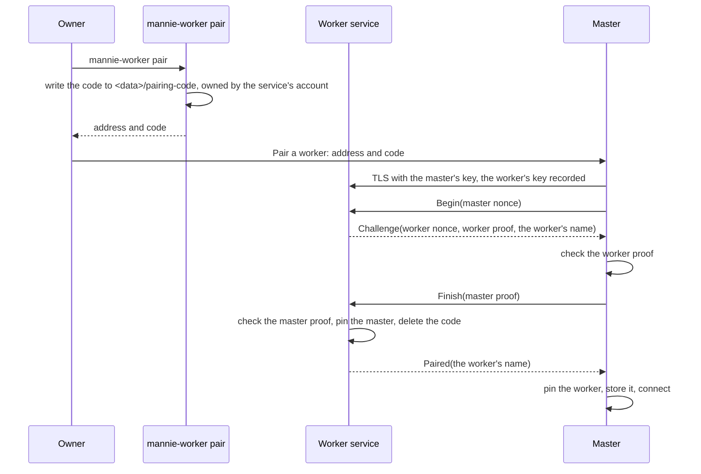

# Pairing and the link

|              |                                                                                                                                                                                                                                                        |
| ------------ | ------------------------------------------------------------------------------------------------------------------------------------------------------------------------------------------------------------------------------------------------------ |
| Status       | Building                                                                                                                                                                                                                                               |
| Milestone    | M4                                                                                                                                                                                                                                                     |
| Last updated | 2026-10-16                                                                                                                                                                                                                                             |
| Part of      | [Workers](README.md)                                                                                                                                                                                                                                   |
| Related      | [ADR-0016](../../adr/0016-link-machines-over-pinned-mtls-grpc.md), [Workers architecture](architecture.md#pairing), [Security](../../architecture/security.md), [Compatibility and updates](compatibility-and-updates.md), [Delegation](delegation.md) |

## Design

### Keys and pins

- Each side has a long-term Ed25519 key pair. The worker creates its key when it first starts and keeps it in `<data>/link-key`, readable only by its account. The master creates its key when it first pairs and keeps it in the operating system's credential store under `link/master-key`; without a credential store, pairing is refused with the reason, as saving a provider's key is.
- A key's pin is the SHA-256 of its SubjectPublicKeyInfo, written as 64 hexadecimal characters. The worker keeps the master's pin in `<data>/master-pin`, and the master keeps each worker's pin in its database. The pins are not secrets, and the owner can compare the first characters that `mannie-worker status` and the master's worker details show.

### TLS

- TLS 1.3 with rustls and ring, ALPN `h2`, and raw public keys (RFC 7250) in both directions: each side presents its public key, never a certificate.
- The master's verifier accepts only the pinned key of the worker it connects to. While pairing, it accepts any key and remembers it.
- The worker's verifier accepts only the pinned master. A connection with any other key, and every connection while the worker is not paired, reaches only the Pairing service.
- Both verifiers check the handshake's signature with the key they accept. A handshake has 10 seconds, and the worker handles at most 8 at once, so a flood of handshakes cannot exhaust it.

### Pairing

- The code is 20 characters of Crockford base32 (100 bits), shown as five groups of four, such as `7KQ2-M9XA-4DPE-W1TR-6HVZ`. Input ignores case, spaces and hyphens, and reads `I` and `L` as `1` and `O` as `0`. The length matters: whoever captures one exchange can test codes offline, so a code must be too long to guess.
- A code is valid for 10 minutes and allows 5 attempts; then the worker deletes it. A code works once.
- A proof is the HMAC-SHA256, keyed by the code, of a label (`mannie-pairing-v1 worker` or `mannie-pairing-v1 master`), the master's nonce, the worker's nonce, the master's pin and the worker's pin. Each side takes both pins from the TLS session it is in, never from a message, so a proof made for another session or another key never verifies. The worker proves first, and `Finish` must come on the connection that `Begin` came on.
- A worker that is paired refuses to pair again (`already_paired`); `mannie-worker pair --reset` on the host starts over.
- Unpairing: removing a worker in the master calls `Session.Unpair` when the worker is reachable. The worker cancels its tasks, drops its leases and forgets the master. A worker that was offline keeps its pin until `pair --reset`, and refuses every connection of the master, whose key is no longer pinned on the master's side either.

### The services

One protobuf package for each service, under `plugins/workers/proto/mannie/link/<service>/v1/`, each with its own feature level ([compatibility](compatibility-and-updates.md)):

| Package                    | Calls                                                                                                         | Level |
| -------------------------- | ------------------------------------------------------------------------------------------------------------- | ----- |
| `mannie.link.session.v1`   | `Hello`: versions, feature levels, name, purpose, host facts, ceiling and task limit. `Unpair`                | 1     |
| `mannie.link.pairing.v1`   | `Begin`, `Finish`                                                                                             | 1     |
| `mannie.link.tasks.v1`     | `Submit`, `Get`, `Cancel`, `Watch` (the states of the active tasks, then every change), `DeleteConversations` | 1     |
| `mannie.link.events.v1`    | `Subscribe` (a task conversation from a cursor), `EarlierTurns`, `Checkpoint`, `ToolOutput`                   | 1     |
| `mannie.link.approvals.v1` | `Decide`                                                                                                      | 1     |
| `mannie.link.leases.v1`    | `Deliver`, `Revoke`                                                                                           | 1     |

Documents of the runtime, such as a task's state, an update of a conversation or an approval choice, travel as their JSON in protobuf fields named `*_json`, the encoding that the desktop app's IPC already uses. A message is at most 32 MiB. A snapshot of a task conversation holds at most 50 turns and 400 parts, which stays far below that unless many parts are long; a snapshot over the limit is refused, and the master cannot show that conversation.

`Submit`, `Cancel`, `Deliver` and `Decide` run to their end on the worker even when the connection drops, so a call whose answer was lost has still happened once, and calling it again finds what it did.

### The connection

- The master keeps one connection to each worker, with HTTP/2 keepalive every 20 seconds and a timeout of 10 seconds. A lost connection is tried again after a delay with jitter, from 1 second up to 60.
- After connecting, the master says `Hello`, agrees on the feature levels, starts to watch the worker's tasks, asks `Get` about each task that it still follows, delivers the leases of tasks that wait for one, and sends the cancels and deletions that wait.

| Status         | Means                                                                                                    |
| -------------- | -------------------------------------------------------------------------------------------------------- |
| `connecting`   | The master is connecting                                                                                 |
| `connected`    | The link works                                                                                           |
| `offline`      | The worker cannot be reached; the master tries again                                                     |
| `incompatible` | The worker's version is too old or newer than the master ([compatibility](compatibility-and-updates.md)) |
| `key_changed`  | The worker presented another key: it was reset or reinstalled, or something impersonates it              |
| `unpaired`     | The worker no longer accepts this master                                                                 |

### Contracts

- IPC (`apps/desktop/src-tauri/src/commands/workers.rs`): `subscribe_workers` sends the list of workers and every change on a channel; `pair_worker` takes an address, a code and, optionally, the owner's name for the worker; `rename_worker` takes a worker's ID and the owner's name, where a blank name goes back to the configured one; `remove_worker` takes a worker's ID. A worker's view carries the name that Mannie uses, the configured name and the owner's name ([naming a worker](worker-activity.md#naming-a-worker)).
- Errors use `WorkersError`: `address_invalid`, `unreachable`, `not_a_worker`, `code_refused` (wrong, expired or used), `too_many_attempts`, `already_paired`, `already_added`, `key_changed`, `incompatible`, `worker_not_found`, `name_invalid` (over 64 characters), `name_taken` (another worker shows the name, ignoring case), `credential_store_unavailable`, `storage_failed`, `store_unavailable` and `shutting_down`.

### Data

- Migration `0019` creates `workers_paired` on the master: the worker's ID, name, address, pin (unique), last version, details as a versioned JSON document (purpose, host facts, ceiling, feature levels), and the times it was paired, last connected and updated.
- Migration `0022` adds the owner's name for a worker to `workers_paired`, empty until the owner names the worker. Every `Hello` updates only the configured name.
- On the worker, the key, the pin and the code are files in the data folder, so that `pair` never opens the database.

### Threat notes

- T-7: the pins on both sides and the handshake's signature stop impersonation once paired.
- T-8: a code allows 5 attempts in 10 minutes, works once, and has 100 bits against offline guessing. A proof binds both keys of its own TLS session, so a relay in the middle cannot pair either side with its own key.
- A flood of handshakes is cut at 10 seconds each, with 8 at a time. A host on the network that keeps 8 handshakes open delays the master's connection by up to 10 seconds at a time, and the master tries again.
- Logs record pairings and connections with the first 12 characters of the pins, never a code or a key.

## Acceptance

- Pairing refuses a wrong code, an expired code, a code used before, a sixth attempt and a key substituted by a relay in the middle, and both sides pin each other's keys (V6; `plugins/workers/crates/mannie-workers/tests/pairing.rs`).
- A paired worker refuses any other master, and an unpaired worker serves only pairing (link tests).
- A worker that presents another key than the pinned one shows `key_changed` and gets no work (`plugins/workers/crates/mannie-workers/tests/pairing.rs`).
- A handshake that stalls is cut after its time, and holds its place among the 8 only until then (`plugins/workers/crates/mannie-link/src/tls.rs`).
- A link that drops and comes back follows the tasks again, and the master learns every ending that happened meanwhile (link tests).
- Removing a reachable worker unpairs it, and `pair --reset` lets a worker pair with another master (link tests and the smoke tests).
