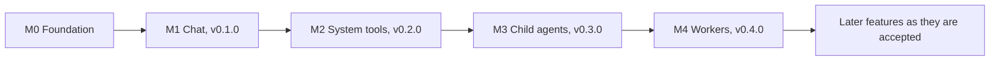

# Milestones and roadmap

|              |                                                                                                                                                                      |
| ------------ | -------------------------------------------------------------------------------------------------------------------------------------------------------------------- |
| Status       | Draft for review                                                                                                                                                     |
| Last updated | 2026-10-14                                                                                                                                                           |
| Related      | [Goals and scope](../product/goals-and-scope.md), [Feature protocol](../features/README.md), [Releasing](../engineering/releasing.md), [ADR index](../adr/README.md) |

## 1. Delivery approach

- There is no prototype and no MVP (D2). Every milestone delivers work that meets the [Definition of Done](../engineering/standards.md#1-definition-of-done), and only the scope grows from one to the next.
- Every milestone from M1 on ends with a release (D15).
- A Proposed ADR is validated before features depend on it. Each validation runs at the start of the first milestone that needs it, and its code stays in the repository as tests or benchmarks.
- The milestone that runs an ADR's last validation cannot exit while that ADR is still Proposed.
- New features arrive through the [feature protocol](../features/README.md). An accepted feature gets a line here, under the milestone that builds it.

## 2. Overview

| Milestone       | Goal                                                       | Features                                                                              | Release |
| --------------- | ---------------------------------------------------------- | ------------------------------------------------------------------------------------- | ------- |
| M0 Foundation   | The engineering platform and the validations features need | None                                                                                  | Dry run |
| M1 Chat         | Chat with OpenAI models and the owner's own model servers  | [Chat](../features/chat/README.md), [window and tray](../features/window-and-tray.md) | v0.1.0  |
| M2 System tools | The model works safely on the master's machine             | [System tools](../features/system-tools.md)                                           | v0.2.0  |
| M3 Child agents | Agents split work on their own machine                     | [Child agents](../features/child-agents.md)                                           | v0.3.0  |
| M4 Workers      | Workers own their hosts and take tasks from the master     | [Workers](../features/workers/README.md)                                              | v0.4.0  |

## 3. Milestones

### M0: Foundation

Goal: the engineering platform and the validations the first features build on. No feature ships in M0, and its release is a dry run.

Scope:

1. Repository and toolchains: the Cargo workspace and crates from [repository](../engineering/repository.md), a pinned Rust toolchain, the desktop app's pnpm package, and the Taskfile tasks that M0 adds.
2. Quality gates in CI for every pull request, on Windows and Linux: rustfmt, clippy, Prettier, ESLint, svelte-check, Vitest, cargo-deny and the documentation checks. The worker is cross-built for FreeBSD on every pull request and tested in a FreeBSD virtual machine every night.
3. The desktop shell: Tauri 2 with the security baseline of [ADR-0004](../adr/0004-keep-system-access-in-the-rust-core.md), SvelteKit as a static single-page app, shadcn-svelte initialized through its CLI, the shell and its slots built from CLI-added components, the single-instance plugin, and light and dark themes.
4. Typed IPC: generated bindings, with one command and one channel stream working end to end.
5. The store: SQLite with migrations, a copy of the database before each migration, and refusal of a newer schema.
6. Credentials: keyring-core on Windows and Linux.
7. Logging: tracing to rotating local files, with redaction.
8. The worker skeleton: a headless binary that starts, logs, opens its store and installs as a service on Windows, Linux and FreeBSD. It has no link yet.
9. The release pipeline: `release:prepare`, builds from a tag, checksums, signatures, an SBOM and a draft release.
10. Agent tooling: the shadcn-svelte skill and the Svelte MCP server configured for the repository, and AGENTS.md updated with the new commands.
11. Visible text: Paraglide message catalogs with English as the base locale, the locale setting in the core, and the pseudo-locale check ([ADR-0019](../adr/0019-keep-visible-text-in-message-catalogs.md)).

Validations: V1, V2, V3, V5, V7, V9, V10 and V11.

Exit criteria:

- `task ci` passes from a fresh clone on Windows 11 and on Linux, and the worker cross-builds for FreeBSD.
- The desktop shell, built only from CLI-added components, passes the axe and keyboard checks on WebView2 and on WebKitGTK.
- A typed command and a channel stream work through the generated bindings, and no generated file is committed.
- The store copies the database before migrating and refuses a newer schema. A planted test secret appears in no log, database or crash file.
- The release dry run (V10) installs every artifact on clean machines.
- Every visible string in the shell comes from the message catalog, and the end-to-end checks pass in the pseudo-locale.
- ADR-0004, ADR-0005, ADR-0007, ADR-0008, ADR-0009, ADR-0017, ADR-0018 and ADR-0019 are Accepted or superseded.

### M1: Chat

Goal: chat that the owner can use every day with OpenAI models and their own model servers. It ends with v0.1.0, the first release.

Features: [Chat](../features/chat/README.md) and [window and tray](../features/window-and-tray.md).

Scope: provider adapters for Responses and Chat Completions with quirk profiles; provider profiles with credentials in the credential store, and the provider test; runs as durable actors, with transcript events and channels that replay from a cursor; the conversation views with safe Markdown; stop, retry, interrupted replies and crash recovery; the context budget and compaction; the owner's global instructions; the choice between the system tray and quitting when the window closes. Archived outputs move to M2, which has the first tool results that need them (pending the owner's review, [chat](../features/chat/README.md#decisions)).

Validations: V8. M1 also completes the validation of [ADR-0012](../adr/0012-run-agents-as-durable-actors.md).

Exit criteria:

- V8 passes with recorded fixtures for every supported server, and nightly against live endpoints.
- Reloading the webview during a reply loses nothing. Killing the process leaves an intact transcript and a reply that can be retried.
- Retries honor `Retry-After`, failures name their cause, and Stop takes effect within one second.
- Budgets use the token counts the provider reports, and compaction is tested at each supported model's limit.
- Model output from the corpus of hostile Markdown and HTML runs no script and loads nothing remote.
- The first close asks between the tray and quitting, the answer persists, and quitting with active runs warns first.
- ADR-0011, ADR-0012, ADR-0020 and ADR-0021 are Accepted, and v0.1.0 is released through the pipeline.

### M2: System tools

Goal: the model works safely on the master's machine. It ends with v0.2.0.

Features: [System tools](../features/system-tools.md).

Scope: the tool registry with the file and command tools; the operation journal; approvals, grants and rules; workspace defaults; process containment; bounded results and archived outputs; handling of early stops during tool use; tool activity and approval requests in the UI.

Validations: V4 on Windows and Linux. M2 also validates [ADR-0013](../adr/0013-journal-every-side-effect.md).

Exit criteria:

- The tool conformance suite passes on Windows and Linux.
- Ending the process in every journal state never repeats an operation, and uncertain operations are reported.
- The prompt-injection corpus causes no side effect the owner did not allow, and a path changed between approval and execution sends the operation back to authorization.
- Stop and timeout end whole process trees (V4).
- Evaluations with an OpenAI model and one open-weight model reach the agreed pass rate.
- ADR-0013 is Accepted, and v0.2.0 is released.

### M3: Child agents

Goal: agents split work on their own machine. It ends with v0.3.0.

Features: [Child agents](../features/child-agents.md).

Scope: the task and report contract; the explore and general agent definitions; parallel slots; background tasks and waiting; follow-ups; the conversation view of a child; a child's approval requests in the parent conversation.

Exit criteria:

- Explore and general children run from the same runtime as the conversation agent, with their tool sets enforced.
- Parallel slots, background tasks, waiting and stopping one child all work, and the parent receives only confirmed reports.
- A follow-up keeps the child's context, and retrying the parent never repeats an operation that a child completed.
- An evaluation of a multi-step task split across children passes.
- v0.3.0 is released.

### M4: Workers

Goal: workers own their hosts and take tasks from the master. It ends with v0.4.0.

Features: [Workers](../features/workers/README.md).

Scope: the worker service and its setup on Windows, Linux and FreeBSD; pairing and the link; host facts, host instructions and purpose; the policy ceiling and approvals relayed to the master; delegation with live task conversations; credential leases; compatibility with workers one minor version behind; signed worker updates.

Validations: V6, and V4 on FreeBSD.

Exit criteria:

- Workers on Windows, Linux and FreeBSD pass the system tools suite on their own hosts, driven by delegated tasks.
- V6 passes.
- A worker's ceiling holds even against instructions from the master, and approval requests wait while the master is offline.
- The documented service setups pass smoke tests on each operating system.
- ADR-0010, ADR-0014 and ADR-0016 are Accepted, and v0.4.0 is released.

### Later

Accepted features go into new milestones as they arrive, and each of those milestones ends with a 0.x release. A later decision declares 1.0, with its own gate: desktop auto-update, a security review, user documentation, and another look at code signing (D16).

## 4. Validations

Each validation settles one or more Proposed ADRs. The validation code stays in the repository as tests or benchmarks. The [M0 validation results](m0-validation.md) and the [M1 validation results](m1-validation.md) record what each milestone's validations showed.

| V   | Proves                                                                                                                                                                                                                                                                                                                                                                                                                                 | ADRs               | Milestone |
| --- | -------------------------------------------------------------------------------------------------------------------------------------------------------------------------------------------------------------------------------------------------------------------------------------------------------------------------------------------------------------------------------------------------------------------------------------- | ------------------ | --------- |
| V1  | SvelteKit 3 as a static single-page app with Svelte 5 runes, components added with the shadcn-svelte CLI 1.7, and Tailwind CSS 4 run in Tauri 2.12 on WebView2 and on the WebKitGTK 4.1 of Ubuntu 22.04, under the Content Security Policy of ADR-0004. A command without a capability grant is refused. Model output from a corpus of hostile Markdown and HTML runs no script and loads nothing remote.                              | ADR-0004, ADR-0005 | M0        |
| V2  | tauri-specta 2.0.0-rc.25 generates TypeScript bindings for commands, typed errors, events and `Channel<T>` from types in a crate without Tauri. The bindings are generated before the frontend builds and are never committed.                                                                                                                                                                                                         | ADR-0007           | M0        |
| V3  | One SQLite writer keeps up with 8 concurrent runs that each stream 200 tokens per second, with batched deltas. Journal commits are durable before side effects. Killing the process and simulated power loss lose no committed data. Channels carry the same load to WebView2 and WebKitGTK in batches every 16 to 33 ms.                                                                                                              | ADR-0009, ADR-0012 | M0        |
| V4  | Stop and timeout end whole process trees, including children that call `setsid` or fork twice: with Job Objects, including nested jobs, on Windows, and with a process group and a subreaper on Linux. On FreeBSD, with `procctl`, in M4.                                                                                                                                                                                              | ADR-0014           | M2, M4    |
| V5  | The worker's dependency graph contains no tauri, GTK or WebKitGTK. Only `mannie-store` depends on rusqlite, and ring is the only crypto provider. Every pull request cross-builds the worker for FreeBSD, and its tests pass in a FreeBSD 14 virtual machine.                                                                                                                                                                          | ADR-0008           | M0        |
| V6  | Pairing refuses wrong, expired and reused codes and a substituted key, and both sides pin each other's keys. A link lost during an operation causes no duplicate side effect. A worker one minor version behind still works, and `buf breaking` guards the contracts. A signed update installs and rolls back. A leased credential never reaches a worker's disk or logs, and is dropped when its task ends or the worker is unpaired. | ADR-0016, ADR-0010 | M4        |
| V7  | keyring-core stores and reads credentials in Windows Credential Manager, GNOME Keyring and KWallet. Without a Secret Service, Mannie refuses to save a credential, explains why, and never falls back to a file.                                                                                                                                                                                                                       | ADR-0010           | M0        |
| V8  | Recorded fixtures pass for the OpenAI Responses API, with `store=false` and encrypted reasoning replayed only to its own profile, and for Chat Completions on vLLM, SGLang, LM Studio, Ollama and OpenRouter. Nightly runs against live endpoints pass.                                                                                                                                                                                | ADR-0011           | M1        |
| V9  | cargo-deny and the pnpm license check pass under the license policy, including Tauri's MPL-2.0 dependencies and the distribution's LGPL WebKitGTK.                                                                                                                                                                                                                                                                                     | ADR-0017           | M0        |
| V10 | A test tag runs the release pipeline end to end. Every artifact is built, checksummed and signed, and installs and starts on clean Windows 11, Ubuntu, Fedora and FreeBSD 14 machines. Nothing is published.                                                                                                                                                                                                                           | ADR-0018           | M0        |
| V11 | Paraglide JS compiles the message catalogs inside the SvelteKit 3 single-page app in Tauri. A custom strategy reads the locale from the core's settings, and changing the locale reloads the webview without affecting runs. The pseudo-locale transforms every message, and the end-to-end check flags a planted hard-coded string. Adding a test locale needs no code change.                                                        | ADR-0019           | M0        |

## 5. Decisions

No decision is open. New owner decisions get the next number here, and architecture decisions also get an ADR.

| #   | Decision                          | Outcome                                                                                                                                                                                                                                                                                                           | Reflected in                                                                                                                                                                                      |
| --- | --------------------------------- | ----------------------------------------------------------------------------------------------------------------------------------------------------------------------------------------------------------------------------------------------------------------------------------------------------------------- | ------------------------------------------------------------------------------------------------------------------------------------------------------------------------------------------------- |
| D1  | Project name (2026-10-13)         | Mannie.                                                                                                                                                                                                                                                                                                           | [README](../../README.md)                                                                                                                                                                         |
| D2  | Quality bar (2026-10-13)          | Production quality from the first commit, with no prototype and no MVP stage. Every release meets the Definition of Done for its scope.                                                                                                                                                                           | [Vision](../product/vision.md), [standards](../engineering/standards.md)                                                                                                                          |
| D3  | Stack (2026-10-13)                | Tauri for the desktop app, Rust for the core, Svelte for the UI, and shadcn-svelte for components, added only through its CLI after reading its documentation.                                                                                                                                                    | [ADR-0003](../adr/0003-build-the-desktop-app-on-tauri-2.md), [ADR-0005](../adr/0005-build-the-ui-with-sveltekit-as-a-static-spa.md), [ADR-0006](../adr/0006-use-shadcn-svelte-through-its-cli.md) |
| D4  | First features (2026-10-13)       | Chat, system tools, and the master/worker system as child agents and workers. Later features arrive through the feature protocol, and the scope of each release is decided as the project goes.                                                                                                                   | [Goals and scope](../product/goals-and-scope.md)                                                                                                                                                  |
| D5  | Orchestration (2026-10-13)        | The master takes care of the owner's request and orchestrates. Workers are autonomous agents that each own a host, which may serve a purpose; they take care of the master's request and of their host's environment. The master never runs tools on a worker's host. Child agents run on their parent's machine. | [ADR-0015](../adr/0015-run-an-agent-runtime-on-every-machine.md), [orchestration](../architecture/orchestration.md)                                                                               |
| D6  | Platforms (2026-10-13)            | The desktop app runs on Windows and Linux. The worker runs on Windows, Linux and FreeBSD. macOS is not a target.                                                                                                                                                                                                  | [ADR-0008](../adr/0008-one-workspace-two-binaries.md)                                                                                                                                             |
| D7  | First providers (2026-10-13)      | The OpenAI Responses API and OpenAI-compatible Chat Completions servers. Other providers arrive as features.                                                                                                                                                                                                      | [ADR-0011](../adr/0011-own-the-provider-adapters.md), [chat](../features/chat/README.md)                                                                                                          |
| D8  | License (2026-10-13)              | Apache-2.0.                                                                                                                                                                                                                                                                                                       | [ADR-0017](../adr/0017-license-and-dependency-policy.md)                                                                                                                                          |
| D9  | Bundle identifier (2026-10-13)    | `io.github.limbon2.mannie`. It determines the data folder, the names of credential store entries and the WebView2 profile.                                                                                                                                                                                        | [ADR-0010](../adr/0010-keep-provider-credentials-on-the-master.md), [overview](../architecture/overview.md)                                                                                       |
| D10 | Interface language (2026-10-13)   | English first, with a way to add languages later without pain and without restructuring the project. Every piece of visible text comes from a message catalog from the first component on, so a new language is a new catalog file.                                                                               | [ADR-0019](../adr/0019-keep-visible-text-in-message-catalogs.md), [standards](../engineering/standards.md#4-ui-and-visible-text)                                                                  |
| D11 | Later UI libraries (2026-10-13)   | Terminal emulators, code editors and similar libraries get an ADR when a feature needs them.                                                                                                                                                                                                                      | [Feature protocol](../features/README.md)                                                                                                                                                         |
| D12 | Documentation (2026-10-13)        | AGENTS.md is the single source of agent rules. ADRs record architecture decisions, feature documents describe features, and this page holds the decision record and the risk register.                                                                                                                            | [ADR-0001](../adr/0001-record-architecture-decisions.md), [AGENTS.md](../../AGENTS.md)                                                                                                            |
| D13 | Closing the window (2026-10-13)   | On the first close, Mannie asks whether to keep running in the system tray or to close entirely, and records the answer as a setting that the owner can change later. If the owner chose to close entirely, every later close while runs are active warns first.                                                  | [Window and tray](../features/window-and-tray.md), [desktop app](../architecture/desktop-app.md#7-window-and-lifecycle)                                                                           |
| D14 | Feature protocol (2026-10-13)     | Rough requests become features with one document each, or a folder for a big feature. Features plug into extension points. There is no up-front feature inventory and no specification ceremony.                                                                                                                  | [ADR-0002](../adr/0002-grow-through-extension-points.md), [feature protocol](../features/README.md)                                                                                               |
| D15 | Release model (2026-10-13)        | Every milestone from M1 on ends with a 0.x release, and M1 ships v0.1.0, the first build. A later decision declares 1.0.                                                                                                                                                                                          | [ADR-0018](../adr/0018-release-from-tagged-builds.md), [releasing](../engineering/releasing.md)                                                                                                   |
| D16 | Windows code signing (2026-10-13) | None for now. Installers are unsigned, and Windows SmartScreen warns when they first run. Signing is considered again before 1.0.                                                                                                                                                                                 | [Releasing](../engineering/releasing.md#6-signing)                                                                                                                                                |
| D17 | Release hosting (2026-10-13)      | GitHub. The repository and its releases are hosted on GitHub.                                                                                                                                                                                                                                                     | [Releasing](../engineering/releasing.md)                                                                                                                                                          |

## 6. Risk register

| ID  | Risk                                                                                                     | Likelihood | Impact | Mitigation                                                                                                                                                         | When           |
| --- | -------------------------------------------------------------------------------------------------------- | ---------- | ------ | ------------------------------------------------------------------------------------------------------------------------------------------------------------------ | -------------- |
| R1  | Tauri 3, now in alpha, changes APIs that Mannie uses                                                     | Medium     | Medium | Tauri stays inside `mannie-desktop` ([ADR-0003](../adr/0003-build-the-desktop-app-on-tauri-2.md)); follow the betas; migrate as planned work                       | Continuous     |
| R2  | tauri-specta stays a release candidate or stops being maintained                                         | Medium     | Medium | Exact pins, types in a crate without Tauri, and ts-rs as the fallback ([ADR-0007](../adr/0007-generate-ipc-bindings-from-rust.md))                                 | M0             |
| R3  | SvelteKit 3 is new, and its ecosystem (shadcn-svelte, bits-ui, adapter-static, svelte-check) lags behind | Medium     | Medium | V1, exact pins, and upgrades in dedicated changes                                                                                                                  | M0             |
| R4  | WebKitGTK differs from WebView2 in rendering, performance and driver issues                              | High       | Medium | V1 and V3 on both webviews, end-to-end tests on both, documented workarounds                                                                                       | M0, continuous |
| R5  | Provider APIs change, and open-weight models stop early or misplace tool calls                           | High       | Medium | Own adapters, quirk profiles, recorded fixtures and nightly live conformance ([ADR-0011](../adr/0011-own-the-provider-adapters.md))                                | M1, continuous |
| R6  | A prompt injection makes an agent attempt a destructive action on the master or a worker                 | High       | High   | Journaled operations with approvals, policy ceilings, no permissions from content, and an injection corpus ([ADR-0013](../adr/0013-journal-every-side-effect.md))  | M2, M4         |
| R7  | A compromised worker host misuses a leased credential                                                    | Medium     | Medium | Leases per task and in memory only, scoped keys, revocation when a task ends and on unpairing ([ADR-0010](../adr/0010-keep-provider-credentials-on-the-master.md)) | M4             |
| R8  | Features are bolted on without extension points, and the code tangles                                    | High       | High   | The feature protocol, extension points, and an ADR for every missing extension point ([ADR-0002](../adr/0002-grow-through-extension-points.md))                    | Continuous     |
| R9  | Code written by agents drifts in style and structure                                                     | High       | Medium | AGENTS.md, formatters and linters as gates, review against the ADRs                                                                                                | Continuous     |
| R10 | FreeBSD builds and tests are slow and costly, and FreeBSD 14.4 reaches its end of life on 2026-12-31     | Medium     | Medium | Build on the oldest supported 14.x, cross-build on every pull request, test in a VM nightly, review the baseline with each FreeBSD release                         | M0, continuous |
| R11 | Some Linux desktops have no Secret Service                                                               | Medium     | Low    | Refuse to store credentials and explain how to enable a Secret Service (V7)                                                                                        | M0             |
| R12 | Token estimates drift from the provider's counts, which causes overflows or early compaction             | Medium     | Medium | Provider-reported counts as the truth, conservative estimates only before the first response, tests at each model's limit                                          | M1             |
| R13 | Antivirus products flag a worker that runs commands and updates itself                                   | Medium     | Medium | Signed artifacts, no encoded shell commands, documented exclusions                                                                                                 | M4             |
| R14 | SmartScreen warns about unsigned installers                                                              | High       | Low    | The warning and how to proceed are documented; signing is considered again before 1.0 (D16)                                                                        | 1.0            |
| R15 | Version differences between the master and workers break delegation                                      | Medium     | High   | Protobuf contracts, feature levels, `buf breaking` and tests with workers one version behind ([ADR-0016](../adr/0016-link-machines-over-pinned-mtls-grpc.md))      | M4             |
| R16 | The release pipeline breaks late                                                                         | Medium     | Medium | The dry run in M0 (V10), and the pipeline runs on every tag                                                                                                        | M0             |
| R17 | Hard-coded text slips into the UI and makes adding a language expensive                                  | Medium     | Medium | Message catalogs from the first component, and end-to-end checks in the pseudo-locale ([ADR-0019](../adr/0019-keep-visible-text-in-message-catalogs.md))           | M0, continuous |
| R18 | Linux desktops without tray support hide the tray icon                                                   | Medium     | Low    | Starting Mannie again brings the window back; the behavior is documented and tested on GNOME without the AppIndicator extension                                    | M1             |
