# Milestones and roadmap

|              |                                                                                                                                                                      |
| ------------ | -------------------------------------------------------------------------------------------------------------------------------------------------------------------- |
| Status       | Draft for review                                                                                                                                                     |
| Last updated | 2026-10-24                                                                                                                                                           |
| Related      | [Goals and scope](../product/goals-and-scope.md), [Feature protocol](../features/README.md), [Releasing](../engineering/releasing.md), [ADR index](../adr/README.md) |

## 1. Delivery approach

- There is no prototype and no MVP (D2). Every milestone delivers work that meets the [Definition of Done](../engineering/standards.md#1-definition-of-done), and only the scope grows from one to the next.
- Every milestone from M1 on ends with a release (D15).
- A Proposed ADR is validated before features depend on it. Each validation runs at the start of the first milestone that needs it, and its code stays in the repository as tests or benchmarks.
- The milestone that runs an ADR's last validation cannot exit while that ADR is still Proposed.
- New features arrive through the [feature protocol](../features/README.md). An accepted feature gets a line here, under the milestone that builds it.

## 2. Overview

| Milestone               | Goal                                                                                                                         | Features                                                                                                                 | Release      |
| ----------------------- | ---------------------------------------------------------------------------------------------------------------------------- | ------------------------------------------------------------------------------------------------------------------------ | ------------ |
| M0 Foundation           | The engineering platform and the validations features need                                                                   | None                                                                                                                     | Dry run      |
| M1 Chat                 | Chat with OpenAI models and the owner's own model servers                                                                    | [Chat](../features/chat/README.md), [window and tray](../features/window-and-tray.md)                                    | v0.1.0       |
| M2 System tools         | The model works safely on the master's machine                                                                               | [System tools](../features/system-tools/README.md)                                                                       | v0.2.0       |
| M3 Child agents         | Agents split work on their own machine                                                                                       | [Child agents](../features/child-agents/README.md)                                                                       | v0.2.0       |
| M4 Workers              | Workers own their hosts and take tasks from the master                                                                       | [Workers](../../plugins/workers/docs/README.md)                                                                          | v0.2.0       |
| M5 Plugins              | A core that every owner gets, and plugins that each owner turns on                                                           | [Plugins](../features/plugins.md), [workers as a plugin](../../plugins/workers/docs/plugin.md)                           | v0.3.0       |
| M6 Mentions             | The owner mentions a project's files and folders in a message, and features and plugins can add more kinds of mentions       | [Mentions](../features/chat/mentions.md)                                                                                 | v0.3.0       |
| M7 Images               | The owner sends images in a message, through the Images plugin                                                               | [Images](../../plugins/images/docs/README.md)                                                                            | v0.3.0       |
| M8 SSH hosts            | Agents run commands on computers without Mannie that the owner registered, through the SSH plugin                            | [SSH hosts](../../plugins/ssh/docs/README.md)                                                                            | v0.4.0       |
| M9 Git                  | Agents work with the owner's git repositories through tools of the Git plugin, and the transcript and a side panel show them | The plugin Git in `plugins/git/`                                                                                         | v0.4.0       |
| M10 Conversation export | The owner saves a conversation and its children as Markdown, with stored images and complete archived outputs                | [Conversation export](../features/conversation-export.md)                                                                | Next release |
| M11 Background commands | Agents run commands in the background, read their output later, and wake when one ends on its own                            | [Background commands](../features/system-tools/background-commands.md), [wake-ups](../features/system-tools/wake-ups.md) | Next release |
| M12 MCP                 | Agents use the tools, resources and images of MCP servers that the owner registered, through the plugin MCP                  | The plugin MCP in `plugins/mcp/`                                                                                         | Next release |

```mermaid
flowchart LR
  M0[M0 Foundation] --> M1[M1 Chat, v0.1.0]
  M1 --> M2[M2 System tools, v0.2.0]
  M2 --> M3[M3 Child agents, v0.2.0]
  M3 --> M4[M4 Workers, v0.2.0]
  M4 --> M5[M5 Plugins, v0.3.0]
  M5 --> M6[M6 Mentions, v0.3.0]
  M6 --> M7[M7 Images, v0.3.0]
  M7 --> M8[M8 SSH hosts, v0.4.0]
  M8 --> M9[M9 Git, v0.4.0]
  M9 --> M10[M10 Conversation export]
  M10 --> M11[M11 Background commands]
  M11 --> M12[M12 MCP]
  M12 --> Later[Later features as they are accepted]
```

## 3. Milestones

### M0: Foundation

Goal: the engineering platform and the validations the first features build on. No feature ships in M0, and its release is a dry run.

Scope:

1. Repository and toolchains: the Cargo workspace and crates from [repository](../engineering/repository.md), a pinned Rust toolchain, the desktop app's pnpm package, and the Taskfile tasks that M0 adds.
2. Quality checks in CI for every pull request, on Windows and Linux: rustfmt, clippy, Prettier, ESLint, svelte-check, Vitest, cargo-deny and the documentation checks. The worker is cross-built for FreeBSD on every pull request and tested in a FreeBSD virtual machine every night.
3. The desktop shell: Tauri 2 with the security baseline of [ADR-0004](../adr/0004-keep-system-access-in-the-rust-core.md), SvelteKit as a static single-page app, shadcn-svelte initialized through its CLI, the shell and its slots built from CLI-added components, the single-instance plugin, and light and dark themes.
4. Typed IPC: generated bindings, with one command and one channel stream working end to end.
5. The store: SQLite with migrations, a copy of the database before each migration, and refusal of a newer schema.
6. Credentials: keyring-core on Windows and Linux.
7. Logging: tracing to rotating local files, with redaction.
8. The worker skeleton: a headless binary that starts, logs, opens its store and installs as a service on Windows, Linux and FreeBSD. It has no link yet.
9. The release pipeline: `release:prepare`, builds from a tag, checksums, signatures, an SBOM and a draft release.
10. Agent tooling: the shadcn-svelte skill and the Svelte MCP server configured for the repository, and AGENTS.md updated with the new commands.
11. Visible text: Paraglide message catalogs with English as the base locale, the locale setting in the core, and the pseudo-locale check ([ADR-0019](../adr/0019-keep-visible-text-in-message-catalogs.md)).

Validations: V1, V2, V3, V5, V7, V9, V10 and V11.

Exit criteria:

- `task ci` passes from a fresh clone on Windows 11 and on Linux, and the worker cross-builds for FreeBSD.
- The desktop shell, built only from CLI-added components, passes the axe and keyboard checks on WebView2 and on WebKitGTK.
- A typed command and a channel stream work through the generated bindings, and no generated file is committed.
- The store copies the database before migrating and refuses a newer schema. A planted test secret appears in no log, database or crash file.
- The release dry run (V10) installs every artifact on clean machines.
- Every visible string in the shell comes from the message catalog, and the end-to-end checks pass in the pseudo-locale.
- ADR-0004, ADR-0005, ADR-0007, ADR-0008, ADR-0009, ADR-0017, ADR-0018 and ADR-0019 are Accepted or superseded.

### M1: Chat

Goal: chat that the owner can use every day with OpenAI models and their own model servers. It ends with v0.1.0, the first release.

Features: [Chat](../features/chat/README.md) and [window and tray](../features/window-and-tray.md).

Scope: provider adapters for Responses and Chat Completions with quirk profiles; provider profiles with credentials in the credential store, and the provider test; runs as durable actors, with transcript events and channels that replay from a cursor; the conversation views with safe Markdown; stop, retry, interrupted replies and crash recovery; the context budget and compaction; the owner's global instructions; the choice between the system tray and quitting when the window closes. Archived outputs move to M2, which has the first tool results that need them (pending the owner's review, [chat](../features/chat/README.md#decisions)).

Validations: V8. M1 also completes the validation of [ADR-0012](../adr/0012-run-agents-as-durable-actors.md).

Exit criteria:

- V8 passes with recorded fixtures for every supported server, and nightly against live endpoints.
- Reloading the webview during a reply loses nothing. Killing the process leaves an intact transcript and a reply that can be retried.
- Retries honor `Retry-After`, failures name their cause, and Stop takes effect within one second.
- Budgets use the token counts the provider reports, and compaction is tested at each supported model's limit.
- Model output from the corpus of hostile Markdown and HTML runs no script and loads nothing remote.
- The first close asks between the tray and quitting, the answer persists, and quitting with active runs warns first.
- ADR-0011, ADR-0012, ADR-0020 and ADR-0021 are Accepted, and v0.1.0 is released through the pipeline.

### M2: System tools

Goal: the model works safely on the master's machine. It ends with v0.2.0, together with M3 and M4 (D23).

Features: [System tools](../features/system-tools/README.md), and [projects](../features/chat/projects.md) of chat.

Scope: the tool registry with the file and command tools; the operation journal; approvals, grants and rules; projects, whose folders are the workspaces; process containment; bounded results and archived outputs; handling of early stops during tool use; tool activity and approval requests in the UI.

Validations: V4 on Windows and Linux. M2 also validates [ADR-0013](../adr/0013-journal-every-side-effect.md) and [ADR-0023](../adr/0023-organize-conversations-into-projects.md), which supersedes ADR-0022.

Exit criteria:

- The tool conformance suite passes on Windows and Linux.
- Ending the process in every journal state never repeats an operation, and uncertain operations are reported.
- The prompt-injection corpus causes no side effect the owner did not allow, and a path changed between approval and execution sends the operation back to authorization.
- Stop and timeout end whole process trees (V4).
- Evaluations with an OpenAI model and one open-weight model pass at least 90% of their tasks, and every injection task passes.
- ADR-0013 and ADR-0023 are Accepted, and v0.2.0 is released.

### M3: Child agents

Goal: agents split work on their own machine. It ends with v0.2.0, together with M2 and M4 (D23).

Features: [Child agents](../features/child-agents/README.md).

Scope: the task and report contract; the explore and general agent definitions; parallel slots; background tasks and waiting; follow-ups; the conversation view of a child; a child's approval requests in the parent conversation.

Exit criteria:

- Explore and general children run from the same runtime as the conversation agent, with their tool sets enforced.
- Parallel slots, background tasks, waiting and stopping one child all work, and the parent receives only confirmed reports.
- A follow-up keeps the child's context, and retrying the parent never repeats an operation that a child completed.
- An evaluation of a multi-step task split across children passes.
- v0.2.0 is released.

### M4: Workers

Goal: workers own their hosts and take tasks from the master. It ends with v0.2.0, together with M2 and M3 (D23).

Features: [Workers](../../plugins/workers/docs/README.md).

Scope: the worker service and its setup on Windows, Linux and FreeBSD; pairing and the link; host facts, host instructions and purpose; the policy ceiling (D21) and approvals relayed to the master; delegation with live task conversations; credential leases; compatibility with workers one minor version behind; signed worker updates that the owner applies on the host (D20).

Validations: V6, and V4 on FreeBSD.

Exit criteria:

- Workers on Windows, Linux and FreeBSD pass the system tools suite on their own hosts, driven by delegated tasks.
- V6 passes.
- A worker's ceiling holds even against instructions from the master, and approval requests wait while the master is offline.
- The documented service setups pass smoke tests on each operating system.
- ADR-0010, ADR-0014, ADR-0016, ADR-0027, ADR-0028 and ADR-0029 are Accepted, and v0.2.0 is released.

### M5: Plugins

Goal: a core that every owner gets, and plugins that each owner turns on and off, with the worker system as the first plugin (D26). It ends with v0.3.0, together with M6 (D29) and M7 (D31).

Features: [Plugins](../features/plugins.md), and [workers as a plugin](../../plugins/workers/docs/plugin.md).

Scope: the `mannie-plugins` crate and the plugin host; registries and UI slots that take and drop a plugin's contributions while Mannie runs; the Plugins settings page; the extension points of [ADR-0031](../adr/0031-move-workers-into-the-first-plugin.md) that the core gains so that it no longer knows workers; the worker's code, link contracts and service in `plugins/workers/`; the workers' data out of the core's columns, into the executors' fields and the plugin's own tables; and the documents of the core without workers, with the workers' documents as the plugin's. Before v0.3.0, the plugin SDK becomes plugins' way into the core, with `mannie-host-kit` for the programs they ship ([ADR-0034](../adr/0034-build-plugins-on-a-plugin-sdk.md)), plugins are found at build time in folders of their own ([ADR-0035](../adr/0035-find-plugins-at-build-time-in-folders-of-their-own.md)), and Workers and Images move onto the SDK (D32).

Exit criteria:

- The core's tests pass with no plugin in the build, and cargo-deny and the lint rule refuse a dependency of the core on a plugin.
- Turning Workers off and on from the Plugins page takes effect without a restart while a delegated task runs, no operation runs twice, and the task's report still reaches its conversation.
- With Workers on, the workers' tests and end-to-end tests pass as they did in M4.
- The update from the 0.2.0 fixture database keeps Workers on when a worker is paired, and every conversation and task stays readable.
- The library crates of Workers and Images depend only on the SDK, their tests also on `mannie-plugin-harness` and the worker also on `mannie-host-kit`, and a plugin copied into `plugins/` of a scratch clone shows on the Plugins page after `task gen`, with `git status` listing only its folder.
- ADR-0030, ADR-0031, ADR-0034 and ADR-0035 are Accepted, and v0.3.0 is released.

### M6: Mentions

Goal: the owner mentions the files and folders of a project in a message with "@", and features and plugins can add more kinds of mentions ([ADR-0032](../adr/0032-let-features-and-plugins-add-kinds-of-mentions.md)). It ends with v0.3.0, together with M5 (D29) and M7 (D31).

Features: [Mentions](../features/chat/mentions.md).

Scope: mention providers and the slot of mention kinds; the core's `files` provider, with its index of a project's folder, its suggestions and what the model reads; the "@" list and the chips of the message box; the part `mention` in the transcript; and the mentions of `send_message` and `start_conversation`.

Exit criteria:

- A message in a project's conversation mentions a file and a folder, and the model's request holds their text within the room of one `read_file` result.
- A fake provider and a fake kind pass the tests of the extension point, and a plugin's provider leaves with its plugin.
- A key outside the workspace, a provider that is not there and a 21st mention are refused, and a mentioned file never lets `move_to_project` run without asking.
- Axe finds no WCAG 2.1 AA violation with the list open, on WebView2 and WebKitGTK.
- ADR-0032 is Accepted, and v0.3.0 is released.

### M7: Images

Goal: the owner sends images in a message, which Mannie shrinks before the model reads them, through the plugin Images ([ADR-0033](../adr/0033-let-plugins-attach-images-to-the-owners-messages.md)). It ends with v0.3.0, together with M5 and M6 (D31).

Features: [Images](../../plugins/images/docs/README.md).

Scope: image content in the provider adapters; the part `image` and its table of bytes; image sources; `images` on `send_message` and `start_conversation`, and `read_image`; the slot of image sources in the message box, with its chips, paste and drop; the transcript's thumbnails and the full image; and the plugin `images` in `plugins/images/`, with the file dialog and the processing of images.

Exit criteria:

- An image from the button, a paste and a drop reaches the model's request, shrunk to at most 2048 pixels and without metadata, for the Responses API and Chat Completions.
- A fake source passes the tests of the extension point, and stored images still reach the model and show in the transcript while Images is off.
- Hostile files, an 11th image and a refused key are refused, and deleting a conversation leaves none of its images' bytes in the database.
- Axe finds no WCAG 2.1 AA violation with the chips and the full image open, on WebView2 and WebKitGTK.
- ADR-0033 is Accepted, and v0.3.0 is released.

### M8: SSH hosts

Goal: agents run commands on computers that do not run Mannie, which the owner registered with the plugin SSH, under the master's policy and journal ([ADR-0036](../adr/0036-let-plugins-run-commands-on-remote-hosts.md)). It ends with v0.4.0, a release that also carries M9 (D35, D37).

Features: [SSH hosts](../../plugins/ssh/docs/README.md), the plugin SSH in `plugins/ssh/`.

Scope: commands on remote hosts as accesses of the plugin SDK and the core, with their policy, grants, rules, journal and approval UI; plugin tools with side effects, their archives, and the wait for their executions when a plugin turns off; keyed secret families and `delete` in the secrets service; and the plugin `ssh` in `plugins/ssh/`, with its hosts, their pinned keys, their passwords in the credential store, the tool `run_ssh_command`, its instruction section, its mentions and its settings.

Exit criteria:

- A conversation runs a command on a registered host after the owner allows it, a grant for the conversation runs the same command on that host again without asking, and the same command on another host still asks.
- A host whose key changed fails before the password is sent, and a host whose only key is RSA is refused.
- A host's password appears in no log, no table of the database, no IPC output and no tool result.
- Stop and the timeout end `sleep 600` on a Linux host, and turning SSH off while a command runs leaves the call uncertain within 6 seconds.
- The plugin's checks pass against OpenSSH on Linux, on FreeBSD with keyboard-interactive login, and on Windows.
- Axe finds no WCAG 2.1 AA violation in the SSH settings and their dialogs, on WebView2 and WebKitGTK.
- ADR-0036 is Accepted, and v0.4.0 is released.

### M9: Git

Goal: agents work with the owner's git repositories through the plugin Git. They read and search history, stage, commit and branch, resolve the conflicts of merges, rebases, cherry-picks and reverts, edit commits and reach remotes, through the owner's installed git under the master's policy and journal ([ADR-0038](../adr/0038-let-plugins-run-installed-programs-in-the-owners-projects.md)), and the transcript and a side panel show what they did ([ADR-0039](../adr/0039-let-plugins-describe-their-tool-calls-in-the-transcript.md)). It ends with v0.4.0, together with M8 (D37).

Features: the plugin Git in `plugins/git/`.

Scope: runs of installed programs as accesses and a service of the plugin SDK, with their policy, grants, rules, journal and approval UI, and the supervisor's program mode; plugin tools that read the owner's files, know the conversation's workspace and are offered where a marker lies; the slot of tool kinds and the data of a plugin tool's card; and the plugin `git` in `plugins/git/`, with its tools for status, history, diffs, blame, search, branches, commits, stashes, merges, rebases, cherry-picks, reverts, conflicts, history edits, fetch, pull and push, its instruction section, its mentions, its tool cards and its side panel.

Exit criteria:

- A conversation in a repository reads its status, history and diffs without asking, and a commit runs without asking when the settings allow changes in the workspace.
- A commit that runs a hook asks and lists the hook, a push asks and names the endpoint, and a grant or a rule runs the same again without asking; full access runs both without asking.
- A merge, a rebase, a cherry-pick and a revert that conflict stop with their conflicts named by side and commit, and finish once the agent resolved them; a history edit that would conflict changes nothing.
- A credential in a remote's URL appears in no tool result, card, log or table of the database, and reads start no program that the repository's own configuration names.
- The plugin's checks pass against git 2.40 and the newest git on Windows and Linux.
- Axe finds no WCAG 2.1 AA violation in the tool cards and the side panel, on WebView2 and WebKitGTK.
- ADR-0038 and ADR-0039 are Accepted, and v0.4.0 is released.

### M10: Conversation export

- Status: Building. The owner requested implementation on 2026-10-20.
- Feature: [Conversation export](../features/conversation-export.md).
- Exit: complete local and online worker records export as linked Markdown and assets; missing content is explicit; writes are exclusive, journaled and never repeated after interruption; the feature's acceptance checks pass.
- The owner accepted [ADR-0040](../adr/0040-export-complete-conversation-records.md) on 2026-10-20 (D38).

### M11: Background commands

Goal: agents start commands in the background, keep working with other tools, read the commands' output later and stop them, and an idle agent wakes when one of its commands ends on its own ([ADR-0041](../adr/0041-let-agents-run-commands-in-the-background.md)). It covers the owner's conversations, general child agents, worker tasks and SSH hosts, and it ends with the next release (D40).

Features: [background commands](../features/system-tools/background-commands.md) and [wake-ups](../features/system-tools/wake-ups.md), parts of [system tools](../features/system-tools/README.md); the tool `start_ssh_command` of the plugin SSH; background commands in the tasks of the plugin Workers.

Scope: the tools `start_command`, `read_command_output` and `stop_command`; the supervisor's background commands with their log of lines; the registry of each machine with its table, events, limits and recovery; the notes and wake-ups with their setting and limits; the toolbar control, the output panel, the tool cards and the quit warning; the SDK's service `background-commands` and the tool `start_ssh_command`; the tools of the worker agent.

Exit criteria:

- A conversation starts a command in the background after the owner allows it, reads its new output after other tool calls, and stops it, and nothing it started stays alive, on Windows, Linux and FreeBSD.
- A watcher or `journalctl -f` keeps running across replies, the toolbar lists it with its output, and the owner stops it there.
- A command that ends on its own in an idle conversation starts one wake-up reply; ends within 2 seconds share it, at most 6 wake-ups an hour run, Stop pauses them, and the setting turns them off.
- Quitting warns and ends every command; after a crash, the next start marks them interrupted and ends leftover trees on Linux and FreeBSD.
- A child agent's and a worker task's commands end with their task, and the master shows a worker task's commands.
- `start_ssh_command` follows `journalctl -f` on a host, the host's password never shows in its output, and Stop ends it.
- Axe finds no WCAG 2.1 AA violation in the control, the panel and the cards, on WebView2 and WebKitGTK.
- ADR-0041 is Accepted (D40), and the next release is published.

### M12: MCP

Goal: agents use the tools of MCP servers that the owner registered with the plugin MCP, local servers that Mannie starts and remote servers over HTTP with secret headers or OAuth, under the master's policy and journal ([ADR-0043](../adr/0043-let-plugins-offer-the-tools-of-tool-servers.md)). The owner mentions the servers' resources with "@", agents read them with a tool, and the images that tools return reach the model ([ADR-0044](../adr/0044-let-tool-results-carry-images-to-the-model.md)). It ends with the next release (D42).

Features: the plugin MCP in `plugins/mcp/`.

Scope: tool sources, loose schemas and the external-tool access of the SDK and the core, with their policy, grants, journal and approval UI; the service `local-servers` with the supervisor's server mode and the providers' release; images in tool results, with their table, their placement in both provider adapters, the transcript and the export; links and a catch-all tool kind in the TypeScript SDK; and the plugin `mcp` in `plugins/mcp/`, with its servers, their secrets and OAuth tokens in the credential store, the connections of both protocol eras through rmcp, its published tools, its resources, its mentions, its instruction section and its settings.

Exit criteria:

- A conversation calls a tool of a local server and of a remote server after the owner allows it, a grant for the conversation runs the same tool again with other arguments without asking, and the same tool on another server still asks.
- Servers of the protocol eras 2026-07-28 and 2025-11-25 connect over stdio and Streamable HTTP, and OAuth signs in to the fake authorization server and to one real server, whose refresh needs no new sign-in.
- A secret variable reaches only its server's process and a secret header only its server, and neither appears in a log, a table of the database, an IPC output or a tool result.
- An image that a tool returns reaches the model through the Responses API and Chat Completions without its metadata, and shows in the call and in the export.
- Stop, the timeout and a server that crashes end calls as the plugin's documents say, turning MCP off during a call leaves it uncertain within 6 seconds, and no server's process outlives the plugin or Mannie.
- Axe finds no WCAG 2.1 AA violation in the MCP settings and their dialogs, the approval of an external tool and the tool cards, on WebView2 and WebKitGTK.
- ADR-0043 and ADR-0044 are Accepted (D42), and the next release is published.

### Later

Accepted features go into new milestones as they arrive, and each of those milestones ends with a 0.x release. A later decision declares 1.0, with its own gate: desktop auto-update, a security review, user documentation, and another look at code signing (D16).

## 4. Validations

Each validation settles one or more Proposed ADRs. The validation code stays in the repository as tests or benchmarks. The [M0 validation results](m0-validation.md), the [M1 validation results](m1-validation.md), the [M2 validation results](m2-validation.md), the [M3 validation results](m3-validation.md), the [M4 validation results](m4-validation.md), the [M5 validation results](m5-validation.md), the [M9 validation results](m9-validation.md) and the [M12 validation results](m12-validation.md) record what each milestone's validations showed.

| V   | Proves                                                                                                                                                                                                                                                                                                                                                                                                                                                                               | ADRs               | Milestone |
| --- | ------------------------------------------------------------------------------------------------------------------------------------------------------------------------------------------------------------------------------------------------------------------------------------------------------------------------------------------------------------------------------------------------------------------------------------------------------------------------------------ | ------------------ | --------- |
| V1  | SvelteKit 3 as a static single-page app with Svelte 5 runes, components added with the shadcn-svelte CLI 1.7, and Tailwind CSS 4 run in Tauri 2.12 on WebView2 and on the WebKitGTK 4.1 of Ubuntu 22.04, under the Content Security Policy of ADR-0004. A command without a capability grant is refused. Model output from a corpus of hostile Markdown and HTML runs no script and loads nothing remote.                                                                            | ADR-0004, ADR-0005 | M0        |
| V2  | tauri-specta 2.0.0-rc.25 generates TypeScript bindings for commands, typed errors, events and `Channel<T>` from types in a crate without Tauri. The bindings are generated before the frontend builds and are never committed.                                                                                                                                                                                                                                                       | ADR-0007           | M0        |
| V3  | One SQLite writer keeps up with 8 concurrent runs that each stream 200 tokens per second, with batched deltas. Journal commits are durable before side effects. Killing the process and simulated power loss lose no committed data. Channels carry the same load to WebView2 and WebKitGTK in batches every 16 to 33 ms.                                                                                                                                                            | ADR-0009, ADR-0012 | M0        |
| V4  | Stop and timeout end whole process trees, including children that call `setsid` or fork twice: with Job Objects, including nested jobs, on Windows, and with a process group and a subreaper on Linux. On FreeBSD, with `procctl`, in M4.                                                                                                                                                                                                                                            | ADR-0014           | M2, M4    |
| V5  | The worker's dependency graph contains no tauri, GTK or WebKitGTK. Only `mannie-store` depends on rusqlite, and ring is the only crypto provider. Every pull request cross-builds the worker for FreeBSD, and its tests pass in a FreeBSD 14 virtual machine.                                                                                                                                                                                                                        | ADR-0008           | M0        |
| V6  | Pairing refuses wrong, expired and reused codes and a substituted key, and both sides pin each other's keys. A link lost during an operation causes no duplicate side effect. A worker one minor version behind still works, and `buf breaking` guards the contracts. `mannie-worker update` installs a signed build and rolls back one that does not start. A leased credential never reaches a worker's disk or logs, and is dropped when its task ends or the worker is unpaired. | ADR-0016, ADR-0010 | M4        |
| V7  | keyring-core stores and reads credentials in Windows Credential Manager, GNOME Keyring and KWallet. Without a Secret Service, Mannie refuses to save a credential, explains why, and never falls back to a file.                                                                                                                                                                                                                                                                     | ADR-0010           | M0        |
| V8  | Recorded fixtures pass for the OpenAI Responses API, with `store=false` and encrypted reasoning replayed only to its own profile, and for Chat Completions on vLLM, SGLang, LM Studio, Ollama and OpenRouter. Nightly runs against live endpoints pass.                                                                                                                                                                                                                              | ADR-0011           | M1        |
| V9  | cargo-deny and the pnpm license check pass under the license policy, including Tauri's MPL-2.0 dependencies and the distribution's LGPL WebKitGTK.                                                                                                                                                                                                                                                                                                                                   | ADR-0017           | M0        |
| V10 | A test tag runs the release pipeline end to end. Every artifact is built, checksummed and signed, and installs and starts on clean Windows 11, Ubuntu, Fedora and FreeBSD 14 machines. Nothing is published.                                                                                                                                                                                                                                                                         | ADR-0018           | M0        |
| V11 | Paraglide JS compiles the message catalogs inside the SvelteKit 3 single-page app in Tauri. A custom strategy reads the locale from the core's settings, and changing the locale reloads the webview without affecting runs. The pseudo-locale transforms every message, and the end-to-end check flags a planted hard-coded string. Adding a test locale needs no code change.                                                                                                      | ADR-0019           | M0        |

## 5. Decisions

No decision is open. New owner decisions get the next number here, and architecture decisions also get an ADR.

| #   | Decision                                                | Outcome                                                                                                                                                                                                                                                                                                                                                                                                                                                                                                                                                                                                                                                                                                                                                                                                                                                                                                                                                                                                                                                                                                                                                | Reflected in                                                                                                                                                                                                |
| --- | ------------------------------------------------------- | ------------------------------------------------------------------------------------------------------------------------------------------------------------------------------------------------------------------------------------------------------------------------------------------------------------------------------------------------------------------------------------------------------------------------------------------------------------------------------------------------------------------------------------------------------------------------------------------------------------------------------------------------------------------------------------------------------------------------------------------------------------------------------------------------------------------------------------------------------------------------------------------------------------------------------------------------------------------------------------------------------------------------------------------------------------------------------------------------------------------------------------------------------ | ----------------------------------------------------------------------------------------------------------------------------------------------------------------------------------------------------------- |
| D1  | Project name (2026-10-13)                               | Mannie.                                                                                                                                                                                                                                                                                                                                                                                                                                                                                                                                                                                                                                                                                                                                                                                                                                                                                                                                                                                                                                                                                                                                                | [README](../../README.md)                                                                                                                                                                                   |
| D2  | Quality bar (2026-10-13)                                | Production quality from the first commit, with no prototype and no MVP stage. Every release meets the Definition of Done for its scope.                                                                                                                                                                                                                                                                                                                                                                                                                                                                                                                                                                                                                                                                                                                                                                                                                                                                                                                                                                                                                | [Vision](../product/vision.md), [standards](../engineering/standards.md)                                                                                                                                    |
| D3  | Stack (2026-10-13)                                      | Tauri for the desktop app, Rust for the core, Svelte for the UI, and shadcn-svelte for components, added only through its CLI after reading its documentation.                                                                                                                                                                                                                                                                                                                                                                                                                                                                                                                                                                                                                                                                                                                                                                                                                                                                                                                                                                                         | [ADR-0003](../adr/0003-build-the-desktop-app-on-tauri-2.md), [ADR-0005](../adr/0005-build-the-ui-with-sveltekit-as-a-static-spa.md), [ADR-0006](../adr/0006-use-shadcn-svelte-through-its-cli.md)           |
| D4  | First features (2026-10-13)                             | Chat, system tools, and the master/worker system as child agents and workers. Later features arrive through the feature protocol, and the scope of each release is decided as the project goes.                                                                                                                                                                                                                                                                                                                                                                                                                                                                                                                                                                                                                                                                                                                                                                                                                                                                                                                                                        | [Goals and scope](../product/goals-and-scope.md)                                                                                                                                                            |
| D5  | Orchestration (2026-10-13)                              | The master takes care of the owner's request and orchestrates. Workers are autonomous agents that each own a host, which may serve a purpose; they take care of the master's request and of their host's environment. The master never runs tools on a worker's host. Child agents run on their parent's machine.                                                                                                                                                                                                                                                                                                                                                                                                                                                                                                                                                                                                                                                                                                                                                                                                                                      | [ADR-0015](../adr/0015-run-an-agent-runtime-on-every-machine.md), [orchestration](../architecture/orchestration.md)                                                                                         |
| D6  | Platforms (2026-10-13)                                  | The desktop app runs on Windows and Linux. The worker runs on Windows, Linux and FreeBSD. macOS is not a target.                                                                                                                                                                                                                                                                                                                                                                                                                                                                                                                                                                                                                                                                                                                                                                                                                                                                                                                                                                                                                                       | [ADR-0008](../adr/0008-one-workspace-two-binaries.md)                                                                                                                                                       |
| D7  | First providers (2026-10-13)                            | The OpenAI Responses API and OpenAI-compatible Chat Completions servers. Other providers arrive as features.                                                                                                                                                                                                                                                                                                                                                                                                                                                                                                                                                                                                                                                                                                                                                                                                                                                                                                                                                                                                                                           | [ADR-0011](../adr/0011-own-the-provider-adapters.md), [chat](../features/chat/README.md)                                                                                                                    |
| D8  | License (2026-10-13)                                    | Apache-2.0.                                                                                                                                                                                                                                                                                                                                                                                                                                                                                                                                                                                                                                                                                                                                                                                                                                                                                                                                                                                                                                                                                                                                            | [ADR-0017](../adr/0017-license-and-dependency-policy.md)                                                                                                                                                    |
| D9  | Bundle identifier (2026-10-13)                          | `io.github.limbon2.mannie`. It determines the data folder, the names of credential store entries and the WebView2 profile.                                                                                                                                                                                                                                                                                                                                                                                                                                                                                                                                                                                                                                                                                                                                                                                                                                                                                                                                                                                                                             | [ADR-0010](../adr/0010-keep-provider-credentials-on-the-master.md), [overview](../architecture/overview.md)                                                                                                 |
| D10 | Interface language (2026-10-13)                         | English first, with a way to add languages later without pain and without restructuring the project. Every piece of visible text comes from a message catalog from the first component on, so a new language is a new catalog file.                                                                                                                                                                                                                                                                                                                                                                                                                                                                                                                                                                                                                                                                                                                                                                                                                                                                                                                    | [ADR-0019](../adr/0019-keep-visible-text-in-message-catalogs.md), [standards](../engineering/standards.md#4-ui-and-visible-text)                                                                            |
| D11 | Later UI libraries (2026-10-13)                         | Terminal emulators, code editors and similar libraries get an ADR when a feature needs them.                                                                                                                                                                                                                                                                                                                                                                                                                                                                                                                                                                                                                                                                                                                                                                                                                                                                                                                                                                                                                                                           | [Feature protocol](../features/README.md)                                                                                                                                                                   |
| D12 | Documentation (2026-10-13)                              | AGENTS.md is the single source of agent rules. ADRs record architecture decisions, feature documents describe features, and this page holds the decision record and the risk register.                                                                                                                                                                                                                                                                                                                                                                                                                                                                                                                                                                                                                                                                                                                                                                                                                                                                                                                                                                 | [ADR-0001](../adr/0001-record-architecture-decisions.md), [AGENTS.md](../../AGENTS.md)                                                                                                                      |
| D13 | Closing the window (2026-10-13)                         | On the first close, Mannie asks whether to keep running in the system tray or to close entirely, and records the answer as a setting that the owner can change later. If the owner chose to close entirely, every later close while runs are active warns first.                                                                                                                                                                                                                                                                                                                                                                                                                                                                                                                                                                                                                                                                                                                                                                                                                                                                                       | [Window and tray](../features/window-and-tray.md), [desktop app](../architecture/desktop-app.md#7-window-and-lifecycle)                                                                                     |
| D14 | Feature protocol (2026-10-13)                           | Rough requests become features with one document each, or a folder for a big feature. Features plug into extension points. There is no up-front feature inventory and no specification ceremony.                                                                                                                                                                                                                                                                                                                                                                                                                                                                                                                                                                                                                                                                                                                                                                                                                                                                                                                                                       | [ADR-0002](../adr/0002-grow-through-extension-points.md), [feature protocol](../features/README.md)                                                                                                         |
| D15 | Release model (2026-10-13)                              | Every milestone from M1 on ends with a 0.x release, and M1 ships v0.1.0, the first build. A later decision declares 1.0.                                                                                                                                                                                                                                                                                                                                                                                                                                                                                                                                                                                                                                                                                                                                                                                                                                                                                                                                                                                                                               | [ADR-0018](../adr/0018-release-from-tagged-builds.md), [releasing](../engineering/releasing.md)                                                                                                             |
| D16 | Windows code signing (2026-10-13)                       | None for now. Installers are unsigned, and Windows SmartScreen warns when they first run. Signing is considered again before 1.0.                                                                                                                                                                                                                                                                                                                                                                                                                                                                                                                                                                                                                                                                                                                                                                                                                                                                                                                                                                                                                      | [Releasing](../engineering/releasing.md#6-signing)                                                                                                                                                          |
| D17 | Release hosting (2026-10-13)                            | GitHub. The repository and its releases are hosted on GitHub.                                                                                                                                                                                                                                                                                                                                                                                                                                                                                                                                                                                                                                                                                                                                                                                                                                                                                                                                                                                                                                                                                          | [Releasing](../engineering/releasing.md)                                                                                                                                                                    |
| D18 | Side panels (2026-10-15)                                | Content beside the main view opens in side panels docked beside it, which features register, as in the Claude app and Codex; side panels will grow. Open panels show as tabs and belong to the conversation that opened them. The first shows a child agent's conversation.                                                                                                                                                                                                                                                                                                                                                                                                                                                                                                                                                                                                                                                                                                                                                                                                                                                                            | [ADR-0025](../adr/0025-add-side-panels-to-the-shell.md), [child agents](../features/child-agents/README.md)                                                                                                 |
| D19 | Conversation controls (2026-10-15)                      | A conversation's toolbar gets a slot for the controls of other features again, and child agents add a button there that lists the conversation's child agents, says how many work, and opens a child's conversation in a side panel.                                                                                                                                                                                                                                                                                                                                                                                                                                                                                                                                                                                                                                                                                                                                                                                                                                                                                                                   | [ADR-0026](../adr/0026-add-conversation-controls-back-for-child-agents.md), [child agents](../features/child-agents/child-agent-activity.md)                                                                |
| D20 | Worker updates (2026-10-15)                             | The master pushes no worker builds. The owner downloads a new release on the host and applies it with `mannie-worker update`, which checks the release signature, keeps the previous program and restores it when the new one does not start. The link has no Update service.                                                                                                                                                                                                                                                                                                                                                                                                                                                                                                                                                                                                                                                                                                                                                                                                                                                                          | [ADR-0016](../adr/0016-link-machines-over-pinned-mtls-grpc.md), [workers](../../plugins/workers/docs/compatibility-and-updates.md)                                                                          |
| D21 | Policy ceiling outside the allowed folders (2026-10-15) | On a worker, reads and changes outside the allowed folders ask the owner through the master, in every mode but read-only, which refuses every change and command. The allowed folders limit what runs without asking.                                                                                                                                                                                                                                                                                                                                                                                                                                                                                                                                                                                                                                                                                                                                                                                                                                                                                                                                  | [Workers](../../plugins/workers/docs/host-and-ceiling.md), [workers architecture](../../plugins/workers/docs/architecture.md#workers)                                                                       |
| D22 | Full access (2026-10-16)                                | A mode like Claude Code's `--dangerously-skip-permissions` or Codex's full access, on the master and on workers. On the master, a default in the Tools settings for new conversations and a switch on each conversation that overrides it. Nothing stays protected: every operation runs without asking, Mannie's own folders included. On a worker, a ceiling mode `full_access` that the host sets, and a conversation in full access also allows the requests of its worker tasks.                                                                                                                                                                                                                                                                                                                                                                                                                                                                                                                                                                                                                                                                  | [ADR-0029](../adr/0029-let-the-owner-give-conversations-and-hosts-full-access.md)                                                                                                                           |
| D23 | Releases of M2 to M4 (2026-10-16)                       | M2, M3 and M4 ship together in one release, v0.2.0, the next after v0.1.0. M3 and M4 have no releases of their own.                                                                                                                                                                                                                                                                                                                                                                                                                                                                                                                                                                                                                                                                                                                                                                                                                                                                                                                                                                                                                                    | [Releasing](../engineering/releasing.md), [milestones](#3-milestones)                                                                                                                                       |
| D24 | Checks and CI (2026-10-16)                              | A change, a milestone or a release is done when it compiles, builds, runs without runtime errors and its tests pass on the owner's machines. CI repeats the checks on GitHub's runners, and a failed, blocked or missing CI run holds nothing back.                                                                                                                                                                                                                                                                                                                                                                                                                                                                                                                                                                                                                                                                                                                                                                                                                                                                                                    | [AGENTS.md](../../AGENTS.md#verification), [releasing](../engineering/releasing.md#3-steps)                                                                                                                 |
| D25 | Proposed ADRs (2026-10-16)                              | The owner accepts every ADR that was Proposed, on the validations that ran in M0 to M4: ADR-0004, ADR-0005, ADR-0007 to ADR-0014, ADR-0016 to ADR-0021, ADR-0024 and ADR-0027 to ADR-0029.                                                                                                                                                                                                                                                                                                                                                                                                                                                                                                                                                                                                                                                                                                                                                                                                                                                                                                                                                             | [ADR index](../adr/README.md), [M4 validation results](m4-validation.md)                                                                                                                                    |
| D26 | Core and plugins (2026-10-16)                           | Mannie consists of a core, which holds what every agent harness needs, such as chat, tool use and child agents, and plugins, which each owner turns on and off: later integrations such as Jira, git, a code editor, a terminal, databases and log viewers, and first the worker system, which not every owner needs. Plugins are internal for now, built from this repository and shipped with Mannie, and an API or SDK for third-party plugins may come later. Turning a plugin on or off takes effect at once, without restarting Mannie. Each plugin's code lives in a folder of its own, `plugins/<id>/`.                                                                                                                                                                                                                                                                                                                                                                                                                                                                                                                                        | [ADR-0030](../adr/0030-split-mannie-into-a-core-and-plugins.md), [ADR-0031](../adr/0031-move-workers-into-the-first-plugin.md), [plugins](../features/plugins.md)                                           |
| D27 | CI runners (2026-10-16)                                 | CI's jobs, the live provider tests and the evaluations run on the owner's self-hosted runners, virtual machines that are reset after each job, because GitHub bills the minutes of its hosted runners in a private repository. The FreeBSD virtual machine jobs and the release's own jobs stay on GitHub's runners.                                                                                                                                                                                                                                                                                                                                                                                                                                                                                                                                                                                                                                                                                                                                                                                                                                   | [CI runners](../engineering/ci-runners.md), [releasing](../engineering/releasing.md#3-steps)                                                                                                                |
| D28 | Plugins in M5 (2026-10-16)                              | The owner accepts ADR-0030 and ADR-0031 and the defaults that the plugins feature documents chose: a plugin is on or off for the whole of Mannie; a new installation starts with every plugin off, and the update from 0.2.0 turns Workers on when a worker is paired; turning a plugin off keeps its data; and turning off a plugin with work in progress asks first. Building M5 starts.                                                                                                                                                                                                                                                                                                                                                                                                                                                                                                                                                                                                                                                                                                                                                             | [ADR-0030](../adr/0030-split-mannie-into-a-core-and-plugins.md), [ADR-0031](../adr/0031-move-workers-into-the-first-plugin.md), [plugins](../features/plugins.md#decisions)                                 |
| D29 | Releases of M5 and M6 (2026-10-16)                      | M6 ships together with M5 in one release, v0.3.0, because M5 was mostly a refactoring. M6 has no release of its own.                                                                                                                                                                                                                                                                                                                                                                                                                                                                                                                                                                                                                                                                                                                                                                                                                                                                                                                                                                                                                                   | [Milestones](#3-milestones), [mentions](../features/chat/mentions.md)                                                                                                                                       |
| D30 | Mentions in M6 (2026-10-17)                             | The owner accepts ADR-0032 and the defaults that the mentions feature document chose: a message has at most 20 mentions; the mentions of one message share the room of one `read_file` result; the list shows at most 50 files and folders, and a folder's listing at most 50 entries for each folder; the index of a project holds at most 100,000 entries and is kept for 15 seconds; the names of the files that may hold secrets; and a typed token counts when the list showed it. Building M6 starts.                                                                                                                                                                                                                                                                                                                                                                                                                                                                                                                                                                                                                                            | [ADR-0032](../adr/0032-let-features-and-plugins-add-kinds-of-mentions.md), [mentions](../features/chat/mentions.md#decisions)                                                                               |
| D31 | Images in M7 (2026-10-17)                               | The owner accepts ADR-0033: images are a plugin, Images, that adds them to a message through a button with the file dialog, a paste and a drop; Mannie shrinks them before sending; every model receives them, and a model that cannot read them fails with the provider's error; the model never reads an image's name; Images starts off, like every plugin. M7 ships together with M5 and M6 in v0.3.0. Building M7 starts with the defaults that the images feature document chose, for the owner's review.                                                                                                                                                                                                                                                                                                                                                                                                                                                                                                                                                                                                                                        | [ADR-0033](../adr/0033-let-plugins-attach-images-to-the-owners-messages.md), [images](../../plugins/images/docs/README.md#decisions)                                                                        |
| D32 | Plugin SDK (2026-10-17)                                 | Plugins become self-contained. A plugin depends on a plugin SDK, the SDK is the bridge between plugins and the core, and when a plugin needs something that the SDK lacks, the SDK changes. Adding a plugin needs nothing in the core, as if a third party had written it: third-party plugins stay deferred, but the system works as it would for them. The SDK lands in M5, before v0.3.0, and Workers and Images move onto it.                                                                                                                                                                                                                                                                                                                                                                                                                                                                                                                                                                                                                                                                                                                      | [ADR-0034](../adr/0034-build-plugins-on-a-plugin-sdk.md), [ADR-0035](../adr/0035-find-plugins-at-build-time-in-folders-of-their-own.md), [plugins](../features/plugins.md#plugin-sdk)                       |
| D33 | Plugin SDK ADRs (2026-10-17)                            | The owner accepts ADR-0034 and ADR-0035 and answers their four questions: each plugin gets a Cargo workspace and a lock of its own, with a generated launcher for the desktop binary and `task deps:align` to keep plugin locks on the core's versions; `mannie-desktop-core` and `mannie-desktop` both use Tauri; a plugin's feature document and its own ADRs live in its folder, with no link from the roadmap and no row in the core's ADR index; and a plugin's manifest grants it its services, sensitive ones included, with the review of the manifest as the gate. Building starts with the spikes of step 0.                                                                                                                                                                                                                                                                                                                                                                                                                                                                                                                                 | [ADR-0034](../adr/0034-build-plugins-on-a-plugin-sdk.md), [ADR-0035](../adr/0035-find-plugins-at-build-time-in-folders-of-their-own.md), [plugins](../features/plugins.md#decisions)                        |
| D34 | Linux checks of the plugin SDK (2026-10-19)             | The owner defers the Linux, WebKitGTK and FreeBSD parts of the plugin SDK's migration, spike S1 included. Step 3 and the steps after it land with their checks on Windows, and the Linux and FreeBSD runs come later. Workers keep working as before: the worker builds from its plugin's workspace for Windows, Linux and FreeBSD, the link's contracts and its v0.2 fixtures stay as they are, and Workers' M4 suites and end-to-end tests pass.                                                                                                                                                                                                                                                                                                                                                                                                                                                                                                                                                                                                                                                                                                     | [ADR-0035](../adr/0035-find-plugins-at-build-time-in-folders-of-their-own.md), [plugins](../features/plugins.md#plugin-sdk)                                                                                 |
| D35 | SSH hosts (2026-10-19)                                  | The owner accepts ADR-0036 and the first ADR of the plugin SSH, which speaks SSH through russh with pinned host keys. Agents run commands on hosts that the owner registers by hand, with an address, a port, a user name and a password. Every conversation and the `general` child agent can use every registered host, and "@" points an agent at one. Commands on a host get the same approval choices as the commands of the master's machine, with grants and rules bound to the host, and full access runs them without asking. Version 1 only runs commands, and file transfer and SSH keys are ideas for later. Hosts whose only key is RSA are refused, because the `rsa` crate has an advisory without a fixed release (RUSTSEC-2023-0071). M8 ships in v0.4.0, a release of its own.                                                                                                                                                                                                                                                                                                                                                       | [ADR-0036](../adr/0036-let-plugins-run-commands-on-remote-hosts.md), [SSH hosts](../../plugins/ssh/docs/README.md#decisions), [tools](../architecture/tools.md)                                             |
| D36 | Faster `task ci` (2026-10-20)                           | The owner accepts ADR-0037, so that `task ci` stays fast as plugins are added: it runs its checks side by side within limits that keep the workstation usable, Clippy builds into a target folder of its own, the Rust tests run with cargo-nextest, dev builds keep line tables and no debug information for other crates, and Windows builds link with rust-lld. The CI workflow stays as it is, apart from installing cargo-nextest.                                                                                                                                                                                                                                                                                                                                                                                                                                                                                                                                                                                                                                                                                                                | [ADR-0037](../adr/0037-run-the-checks-of-task-ci-side-by-side.md), [repository](../engineering/repository.md#7-tasks)                                                                                       |
| D37 | Git (2026-10-20)                                        | The owner accepts ADR-0038, ADR-0039 and the first two ADRs of the plugin Git, which run the owner's installed git and edit history in memory. Agents work with git through tools of the plugin that run the installed git program, 2.40 or later, without a shell, under the process supervisor. Reads never ask inside the workspace; local changes follow the setting that allows changes in the workspace; running hooks, discarding uncommitted work, rewriting commits that a remote-tracking branch already holds and reaching a remote always ask, and grants and saved rules can allow them, also after a hook's content changed; full access runs all of it without asking. Hooks run as git runs them, and an operation that runs hooks asks first and lists them. A repository's git folder outside the project asks once, and a grant for the project covers the later calls. Version 1 also has fetch, pull and push, "@" mentions of commits, branches and uncommitted changes, tool cards with a diff view, and a side panel that only reads. M9 ships together with M8 in v0.4.0, so v0.4.0 is no longer a release of M8 alone (D35). | [ADR-0038](../adr/0038-let-plugins-run-installed-programs-in-the-owners-projects.md), [ADR-0039](../adr/0039-let-plugins-describe-their-tool-calls-in-the-transcript.md), [tools](../architecture/tools.md) |
| D38 | Conversation export (2026-10-20)                        | The owner accepts the written ADR-0040: core chat exports complete current records as Markdown and assets, an optional read-only executor method and a level-2 events RPC read complete worker records in bounded chunks, and a dedicated export journal records owner-initiated writes. Unavailable data is explicit, and interrupted exports never repeat automatically. M10 builds the feature.                                                                                                                                                                                                                                                                                                                                                                                                                                                                                                                                                                                                                                                                                                                                                     | [ADR-0040](../adr/0040-export-complete-conversation-records.md), [conversation export](../features/conversation-export.md)                                                                                  |
| D39 | Hosted CI (2026-10-21)                                  | The owner permits a public repository and chooses free standard GitHub-hosted builds for Windows, Linux and FreeBSD. This replaces D27's self-hosted runners. The Release workflow builds and installs all artifacts; tagged builds also sign them and draft the release.                                                                                                                                                                                                                                                                                                                                                                                                                                                                                                                                                                                                                                                                                                                                                                                                                                                                              | [CI runners](../engineering/ci-runners.md), [releasing](../engineering/releasing.md)                                                                                                                        |
| D40 | Background commands (2026-10-21)                        | The owner accepts ADR-0041 by approving the plan of the feature. Agents start commands in the background with `start_command`, read their output with `read_command_output` and stop them with `stop_command`. A command outlives the reply that started it, until it exits, the agent or the owner stops it, its conversation is deleted, its task ends or Mannie quits. When a command ends on its own while its conversation has no active reply, Mannie wakes the agent with a reply of its own. The owner's conversations, general child agents, worker tasks and SSH hosts get them. A grant or a rule covers a command in the background only when it was given or saved from the approval of a command in the background, and then it covers both modes; existing grants and rules keep asking before a command runs in the background. Building M11 starts with the defaults that the feature documents chose, for the owner's review.                                                                                                                                                                                                        | [ADR-0041](../adr/0041-let-agents-run-commands-in-the-background.md), [background commands](../features/system-tools/background-commands.md), [wake-ups](../features/system-tools/wake-ups.md)              |
| D41 | Conversation controls (2026-10-22)                      | The owner accepts ADR-0042 after a review of the conversation view, with one change: "git stays where it stays". "Child agents", "Commands" and the export move into a menu behind a button with vertical dots at the end of the toolbar, whose button counts running commands and working child agents; full access and the context meter move into the message box, which becomes one framed field after ChatGPT's composer; the Git plugin's button stays in the toolbar. The header's menu of Rename, Compact now and Delete goes away, since the conversation list and the context meter offer them.                                                                                                                                                                                                                                                                                                                                                                                                                                                                                                                                              | [ADR-0042](../adr/0042-place-conversation-controls-in-a-menu-and-the-message-box.md), [conversation view](../features/chat/conversation-view.md)                                                            |
| D42 | MCP (2026-10-24)                                        | The owner asked for MCP support as a plugin and accepts ADR-0043, ADR-0044 and the first two ADRs of the plugin MCP by approving the plan. Version 1 gives agents the tools of local servers that Mannie starts and of remote servers over Streamable HTTP, with secret headers and OAuth sign-in; the owner mentions the servers' resources with "@" and agents read them with a tool; the images that tools return reach the model. A secret that the owner enters for a local server goes into that server's environment and nowhere else, an exception to NFR-SEC-05. Every call asks; a grant for the conversation, the project or every conversation covers one tool on one server with any arguments, full access runs every call, and the servers' hints decide nothing. External tools get no rules, since a rule would cover what the grant for every conversation covers. Prompts, elicitation, sampling, roots, per-project servers and the deprecated HTTP+SSE transport come later. M12 ships with the next release. Building starts with the spikes of step 0.                                                                          | [ADR-0043](../adr/0043-let-plugins-offer-the-tools-of-tool-servers.md), [ADR-0044](../adr/0044-let-tool-results-carry-images-to-the-model.md), [M12 validation results](m12-validation.md)                  |

## 6. Risk register

| ID  | Risk                                                                                                                                                     | Likelihood | Impact | Mitigation                                                                                                                                                                                                                                                              | When           |
| --- | -------------------------------------------------------------------------------------------------------------------------------------------------------- | ---------- | ------ | ----------------------------------------------------------------------------------------------------------------------------------------------------------------------------------------------------------------------------------------------------------------------- | -------------- |
| R1  | Tauri 3, now in alpha, changes APIs that Mannie uses                                                                                                     | Medium     | Medium | Tauri stays inside `mannie-desktop-core` and `mannie-desktop` ([ADR-0003](../adr/0003-build-the-desktop-app-on-tauri-2.md), [ADR-0035](../adr/0035-find-plugins-at-build-time-in-folders-of-their-own.md) decision 4); follow the betas; migrate as planned work        | Continuous     |
| R2  | tauri-specta stays a release candidate or stops being maintained                                                                                         | Medium     | Medium | Exact pins, types in a crate without Tauri, and ts-rs as the fallback ([ADR-0007](../adr/0007-generate-ipc-bindings-from-rust.md))                                                                                                                                      | M0             |
| R3  | SvelteKit 3 is new, and its ecosystem (shadcn-svelte, bits-ui, adapter-static, svelte-check) lags behind                                                 | Medium     | Medium | V1, exact pins, and upgrades in dedicated changes                                                                                                                                                                                                                       | M0             |
| R4  | WebKitGTK differs from WebView2 in rendering, performance and driver issues                                                                              | High       | Medium | V1 and V3 on both webviews, end-to-end tests on both, documented workarounds                                                                                                                                                                                            | M0, continuous |
| R5  | Provider APIs change, and open-weight models stop early or misplace tool calls                                                                           | High       | Medium | Own adapters, quirk profiles, recorded fixtures and nightly live conformance ([ADR-0011](../adr/0011-own-the-provider-adapters.md))                                                                                                                                     | M1, continuous |
| R6  | A prompt injection makes an agent attempt a destructive action on the master or a worker                                                                 | High       | High   | Journaled operations with approvals, policy ceilings, no permissions from content, and an injection corpus ([ADR-0013](../adr/0013-journal-every-side-effect.md))                                                                                                       | M2, M4         |
| R7  | A compromised worker host misuses a leased credential                                                                                                    | Medium     | Medium | Leases per task and in memory only, scoped keys, revocation when a task ends and on unpairing ([ADR-0010](../adr/0010-keep-provider-credentials-on-the-master.md))                                                                                                      | M4             |
| R8  | Features are bolted on without extension points, and the code tangles                                                                                    | High       | High   | The feature protocol, extension points, and an ADR for every missing extension point ([ADR-0002](../adr/0002-grow-through-extension-points.md))                                                                                                                         | Continuous     |
| R9  | Code written by agents drifts in style and structure                                                                                                     | High       | Medium | AGENTS.md, formatters and linters as gates, review against the ADRs                                                                                                                                                                                                     | Continuous     |
| R10 | FreeBSD builds and tests are slow and costly, and FreeBSD 14.4 reaches its end of life on 2026-12-31                                                     | Medium     | Medium | Build on the oldest supported 14.x, cross-build on every pull request, test in a VM nightly, review the baseline with each FreeBSD release                                                                                                                              | M0, continuous |
| R11 | Some Linux desktops have no Secret Service                                                                                                               | Medium     | Low    | Refuse to store credentials and explain how to enable a Secret Service (V7)                                                                                                                                                                                             | M0             |
| R12 | Token estimates drift from the provider's counts, which causes overflows or early compaction                                                             | Medium     | Medium | Provider-reported counts as the truth, conservative estimates only before the first response, tests at each model's limit                                                                                                                                               | M1             |
| R13 | Antivirus products flag a worker that runs commands and updates itself                                                                                   | Medium     | Medium | Signed artifacts, no encoded shell commands, documented exclusions                                                                                                                                                                                                      | M4             |
| R14 | SmartScreen warns about unsigned installers                                                                                                              | High       | Low    | The warning and how to proceed are documented; signing is considered again before 1.0 (D16)                                                                                                                                                                             | 1.0            |
| R15 | Version differences between the master and workers break delegation                                                                                      | Medium     | High   | Protobuf contracts, feature levels, `buf breaking` and tests with workers one version behind ([ADR-0016](../adr/0016-link-machines-over-pinned-mtls-grpc.md))                                                                                                           | M4             |
| R16 | The release pipeline breaks late                                                                                                                         | Medium     | Medium | The dry run in M0 (V10), and the pipeline runs on every tag                                                                                                                                                                                                             | M0             |
| R17 | Hard-coded text slips into the UI and makes adding a language expensive                                                                                  | Medium     | Medium | Message catalogs from the first component, and end-to-end checks in the pseudo-locale ([ADR-0019](../adr/0019-keep-visible-text-in-message-catalogs.md))                                                                                                                | M0, continuous |
| R18 | Linux desktops without tray support hide the tray icon                                                                                                   | Medium     | Low    | Starting Mannie again brings the window back; the behavior is documented and tested on GNOME without the AppIndicator extension                                                                                                                                         | M1             |
| R19 | The generated launcher layout of ADR-0035 fails on Linux with WebKitGTK                                                                                  | Medium     | High   | A spike on Linux before the layout lands; the fallback of ADR-0035 with the owner's ruling against D32                                                                                                                                                                  | M5             |
| R20 | SQLite's authorizer refuses migrations or admits statements other than ADR-0034 describes                                                                | Medium     | High   | Spike S4 on SQLite 3.53.2 corrected the rules for the statements that SQLite nests in DDL and added a schema check after each plugin migration; store tests run every module's migrations under the authorizer                                                          | M5             |
| R21 | The SDK migration delays v0.3.0                                                                                                                          | High       | Medium | Steps that each keep `task ci`, the end-to-end tests on both webviews and Workers' M4 suites passing                                                                                                                                                                    | M5             |
| R22 | Processes that a command on a remote host started keep running after Stop or the timeout                                                                 | Medium     | Medium | Stop and the timeout send TERM, then KILL, and close the channel; the result tells the model that processes may still run, and a stopped call becomes uncertain ([ADR-0036](../adr/0036-let-plugins-run-commands-on-remote-hosts.md))                                   | M8             |
| R23 | The owner trusts a changed host key without checking it, and an attacker between the hosts catches the password                                          | Low        | High   | The settings show the old and the new fingerprint side by side and never send the password to a key that is not pinned; the plugin's documents say how to read a fingerprint on the host; SSH keys, an idea for later, take the password out of the login               | M8             |
| R24 | SSH servers differ in how they log in and run commands, such as FreeBSD's keyboard-interactive login and the default shell of OpenSSH on Windows         | Medium     | Medium | Password login with keyboard-interactive as the fallback, tests against an SSH server in the test process, and the owner's checks against OpenSSH on Linux, FreeBSD and Windows                                                                                         | M8             |
| R25 | git's versions differ from 2.40 to the newest, and git 3.0 changes defaults such as SHA-256 object names and the reftable format                         | Medium     | Medium | The plugin reads only git's machine formats, never its files of references, accepts object names of 40 and 64 characters, and its tests run against 2.40 and the newest git                                                                                             | M9             |
| R26 | A git run that Stop, a timeout or a crash ended leaves a lock file, such as `index.lock`, and the next run fails                                         | Medium     | Low    | Stop and the timeout end git's whole tree; the plugin names the lock and what the owner can do, and never deletes a lock itself                                                                                                                                         | M9             |
| R27 | A hook framework runs files that the repository tracks, so a grant or a rule for a hook covers its content after an agent edited it                      | Medium     | High   | The owner's choice in D37; the request lists each hook with its source, full access and rules stay the owner's choices, and the threat is recorded as T-44                                                                                                              | M9             |
| R28 | The definitions of about 24 git tools take room in every request of a run that has them                                                                  | High       | Low    | The tools are offered only in a repository, a test keeps the size of their definitions within a budget, and the descriptions are reviewed like code                                                                                                                     | M9             |
| R29 | A credential helper or a signing program waits for the owner in a window of its own, and the run waits until its timeout                                 | Medium     | Low    | The timeout ends the run, the result names the program that waited, and the plugin's documents say how to sign in once outside Mannie                                                                                                                                   | M9             |
| R30 | Starting git costs tens of milliseconds on Windows, which adds up over a tool's runs and the side panel's refreshes                                      | Medium     | Low    | Measured before the tools land; a tool runs as few git commands as it can, and the panel refreshes after the plugin's own runs and every 15 seconds while it shows                                                                                                      | M9             |
| R31 | Wake-ups spend tokens and act while the owner is away, and in a conversation with full access their commands run without asking                          | Medium     | Medium | Only a command's own end wakes, at most 6 times an hour for each conversation; Stop pauses wake-ups until the owner's next message; a setting turns them off; approvals still wait for the owner ([ADR-0041](../adr/0041-let-agents-run-commands-in-the-background.md)) | M11            |
| R32 | rmcp changes its API between minor releases of its 3.x line, as it did weekly in 2026                                                                    | High       | Medium | The plugin pins rmcp exactly, only its connection modules use it, and an upgrade is a change of its own that runs the tests against servers of both protocol eras                                                                                                       | M12            |
| R33 | MCP servers differ in protocol era, schemas, tool names and the number of their tools, and a server that `npx` downloads on its first start answers late | High       | Medium | Tests against servers of both eras over stdio and HTTP, loose schemas with normalization, a cap on published tools, a stored era for each server with one retry of its first connection, and the owner's checks against real servers                                    | M12            |
| R34 | The definitions of many servers' tools take room in every request of a run that has them                                                                 | High       | Low    | Tools that a server adds later start off, at most 64 MCP tools are on, the settings show how many are on, and a run offers no more tools than its provider takes                                                                                                        | M12            |
| R35 | Authorization servers differ: some offer only Client ID Metadata Documents, some omit `iss` or PKCE in their metadata                                    | Medium     | Medium | A pre-registered client ID that the owner enters, errors that say what the server lacks, and CIMD as an idea for later                                                                                                                                                  | M12            |
| R36 | The Windows credential store keeps at most 1,280 characters for each entry, fewer than an OAuth token can have                                           | High       | Low    | The plugin splits a longer value across numbered entries of its family, which the spike of step 0 measured ([M12 validation results](m12-validation.md))                                                                                                                | M12            |
| R37 | Images from tools cost tokens and can carry text that tries to instruct the model                                                                        | Medium     | Medium | The limits of ADR-0044, the newest 3 results with images in a request, a switch for each server, and content grants nothing                                                                                                                                             | M12            |
| R38 | A server changes its tools' descriptions or adds tools after the owner trusted it, and steers the model                                                  | Medium     | High   | A tool that a server adds later starts off and is marked new, descriptions are content, and every call asks unless a grant or full access covers it (T-56)                                                                                                              | M12            |
