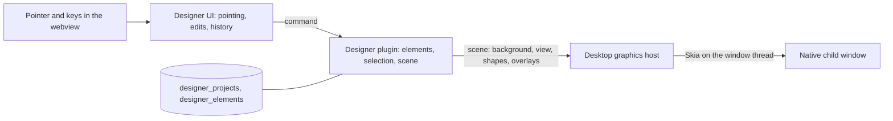

# Canvas controls

|              |                                                                                                                                                                                                                                                                                                                                                         |
| ------------ | ------------------------------------------------------------------------------------------------------------------------------------------------------------------------------------------------------------------------------------------------------------------------------------------------------------------------------------------------------- |
| Status       | Shaped                                                                                                                                                                                                                                                                                                                                                  |
| Last updated | 2026-11-19                                                                                                                                                                                                                                                                                                                                              |
| Part of      | [Designer](README.md)                                                                                                                                                                                                                                                                                                                                   |
| Related      | [Native graphics viewport](viewport.md), [Designer ADR-0001](adr/0001-keep-the-projects-of-the-designer-plugin-in-its-own-table.md), [ADR-0034](../../../docs/adr/0034-build-plugins-on-a-plugin-sdk.md), [ADR-0073](../../../docs/adr/0073-host-native-graphics-surfaces-for-desktop-plugins.md), [Feature protocol](../../../docs/features/README.md) |

## Intent

The owner wants to work with the elements of a project the way Figma works: click an element to select it, drag it to move it, pull a handle to resize it, nudge and delete it from the keyboard, and zoom around the canvas. The canvas keeps drawing natively, and the webview keeps telling it what to draw.

This document is the order in which those capabilities arrive. Each numbered row is one feature the owner can try, and it becomes a feature document of its own before its code starts. It merges the five drafts compared on 2026-11-19: the owner-facing order of one, the per-row checks of another, the decision gates of a third, and the scene contract, limits and migration of the one that could be built from directly. The task lists of those drafts belong to each row's feature document and are not repeated here.

## Behavior

The destination, in the owner's terms:

- A project's canvas holds elements. An element has a position, a size, a color and a place in the stacking order, and none of them depends on the size of the window.
- Clicking an element selects it. The selection draws on the native canvas as an outline with handles. Clicking empty canvas or pressing Escape clears it.
- Dragging a selected element moves it, and dragging a handle resizes it. Escape during a gesture puts the element back where it started, and a gesture writes the store once, when it ends.
- An arrow key nudges the selection by one unit, Shift with an arrow by ten, and Delete removes it.
- Undo and redo cover every edit of the canvas, with one entry per gesture, per project and for the current window only.
- The mouse wheel zooms at the pointer and Space with a drag pans. The view shows its zoom percentage, zooms in and out, and fits the drawing.
- Shift-click adds an element to the selection, and a drag from empty canvas draws a marquee. A drag moves the whole selection.
- The canvas is reachable and usable from the keyboard, and the sidebar lists the elements and reorders them.
- The selection's position, size and color are edited in fields beside the canvas.
- Elements persist per project and survive a reload and a restart.

## Fit

The pointer and the keyboard stay in the webview. The native surface accepts no input ([ADR-0073](../../../docs/adr/0073-host-native-graphics-surfaces-for-desktop-plugins.md), decision 4) and it paints above the webview, so nothing drawn in the DOM can appear over it. It is also click-through: the child window reports a transparent hit test and is created disabled, so the placeholder under it receives every click and key ([windows.rs](../../../apps/desktop/core/src/graphics/windows.rs)). Three consequences shape every feature:

1. Every gesture starts in the DOM and is computed in TypeScript: which element is under the pointer, where a drag has taken it, and how client pixels map to document units.
2. Every pixel inside the canvas is drawn by the desktop host from the scene: the elements and the chrome (selection outline, handles, marquee, guides) travel together, and the scene carries no element identities.
3. The store holds the elements, the plugin keeps them in memory, validates every mutation and builds the scene, and the UI mirrors them for pointing, keyboard edits and undo.



The SDK's `graphics` service is at major 1 and its scene is one normalized rectangle that must lie inside the viewport ([graphics.rs](../../../crates/mannie-plugin-sdk/src/services/graphics.rs)). Selection chrome, more than one element and geometry outside the viewport each need that contract to grow first, with an ADR that the owner approves ([ADR-0034](../../../docs/adr/0034-build-plugins-on-a-plugin-sdk.md)).

## How to use this plan

- Build the rows in the listed order, one feature at a time. Later rows build on earlier ones, and only one row is Building at a time.
- Before a row's code starts, write its feature document from the [template](../../../docs/features/template.md) with the row's behavior and check, and move it through Shaped, Accepted and Building under the [feature protocol](../../../docs/features/README.md). A row is not authorization to build the whole plan.
- A row is done when its check passes in the visible Windows desktop app, not when the code compiles. Each row also meets the [Definition of Done](../../../docs/engineering/standards.md#1-definition-of-done), including its tests, its document and its changelog line.
- Every feature includes its failure behavior, its loading and empty states, its catalog text in `plugins/designer/messages/en.json` under the `designer_` prefix, its keyboard path, its accessibility and its error messages. These are part of the feature, not later cleanup.
- A change that touches the SDK or the host writes its ADR first and waits for the owner. Scene data stays bounded and validated in the plugin's commands and again in the host.
- Keep the plugin authoritative for saved state. The webview may preview a gesture, but the plugin validates and commits every mutation, and a refused mutation restores the last confirmed document.
- Send complete bounded scene snapshots, and collapse rapid updates to the newest one. Incremental patches wait for a measurement that asks for them.
- Keep Windows as the platform with a native viewport. Project management and the unsupported-platform state keep working elsewhere.

## Decisions before the affected work

### The interactive scene

Rows 2 and 14 need the scene to carry an ordered list of shapes, an overlays list and a view transform. This changes the SDK service and the host, so it is a new ADR in `docs/adr/`, approved by the owner before code:

- an ordered and bounded list of axis-aligned rectangle primitives, painted in list order, which is the stacking order;
- native decorations for selection outlines, handles, marquees and guides, drawn above the shapes;
- document coordinates and a view transform, with limits for coordinates, shapes, overlays and scene bytes;
- whole-scene replacement, lease isolation, and validation by the desktop host;
- input that continues to pass through to the webview.

The shape change is not additive to a scene that holds one rectangle, so the service takes one major bump and `plugin.toml` names the new major; a host and a plugin that disagree refuse to bind. The host gains no editor state and no native input handling.

### The project's document

The owner accepted the storage decision on 2026-11-19. Designer keeps each project's elements in its own indexed table. The decision sets geometry bounds, defines the first-open seed and the revision check for a completed edit, and specifies how future deletion erases content. [Designer ADR-0002](adr/0002-store-each-projects-canvas-elements.md).

### Coordinates and the camera

Document coordinates are independent of the viewport: the document is bounded, drawing and hit testing use the same forward and inverse transforms, and pointer coordinates are CSS pixels, so the display scale enters only in the host. Rows 11 to 13 add the camera (an offset and a zoom, clamped) and settle whether the view survives a reload. Rows 2 to 10 assume the identity view, and their mapping functions are the ones the camera reuses.

### The input model

Ruled on 2026-11-19, because one draft proposed hiding the surface behind a transparent layer while a gesture ran. The host already passes pointer input through to the webview and the surface never takes focus, so no layer and no hide-show cycle is needed. The first build step confirms it with an end-to-end check that clicks the middle of the native rectangle and reads `document.activeElement` ([viewport.test.ts](../tests/e2e/viewport.test.ts)). If that check ever fails, the decision is reopened before any gesture is built, and the alternatives are forwarding the child's mouse messages or making the child the input owner.

## Phase 1: The stored document

| #   | Feature                                       | Owner-visible outcome                                                                                                                                                                                           | Check                                                                                                                                                                                                                       |
| --- | --------------------------------------------- | --------------------------------------------------------------------------------------------------------------------------------------------------------------------------------------------------------------- | --------------------------------------------------------------------------------------------------------------------------------------------------------------------------------------------------------------------------- |
| 1   | [A persisted document](persisted-document.md) | Each project keeps its rectangle's geometry and fill across a reload and a restart. Projects stay independent, and a failed read or write leaves the last confirmed rectangle visible with an actionable error. | A reload and a restart restore the same rectangle in two projects, a project created before this change opens with one seeded rectangle, and a forced store failure reports itself without losing the last confirmed value. |

The hue slider edits the seeded rectangle's fill until row 21 replaces it. Geometry lives in bounded document units, so resizing the viewport changes which part of the drawing is visible. [Persisted document](persisted-document.md).

## Phase 2: One rectangle, directly manipulated

| #   | Feature            | Owner-visible outcome                                                                                                                                                                                                   | Check                                                                                                                                                                                                  |
| --- | ------------------ | ----------------------------------------------------------------------------------------------------------------------------------------------------------------------------------------------------------------------- | ------------------------------------------------------------------------------------------------------------------------------------------------------------------------------------------------------ |
| 2   | Selection          | Clicking the rectangle selects it and draws an outline on the native canvas. Clicking the background or pressing Escape clears the selection, and the canvas is reachable and operated from the keyboard.               | Pointer and keyboard both select and clear, the outline is 2 device pixels at any zoom, an empty click clears, and a screen reader reads the element's name, position and size.                        |
| 3   | Geometry fields    | X, Y, width and height fields edit the selection in document units through the same validated path as a gesture. Incomplete input stays editable and invalid input is not committed.                                    | Typing moves and resizes the element on the native canvas, an invalid value is refused with a message and leaves the element unchanged, and the fields are the keyboard path from here on.             |
| 4   | Move               | Dragging the selected rectangle moves it live and commits one history entry on release. Arrow keys move it by one unit and Shift with an arrow by ten, and pointer capture keeps a drag coherent outside the rectangle. | A drag of 2 CSS pixels moves nothing, a drag past the bounds clamps, Escape and a lost capture restore the start, a run of arrow keys writes once, and one drag writes one row once.                   |
| 5   | Corner resize      | Four corner handles resize the selection around the opposite corner. The rectangle cannot invert or shrink below the documented minimum.                                                                                | Each of the four handles resizes from the right anchor at 0.5, 1 and 4 zoom, a drag past the anchor stops at the minimum, and a handle that overlaps another element wins over it.                     |
| 6   | Edge resize        | Four edge handles resize one axis at a time with the same bounds, rollback and history behavior as a corner.                                                                                                            | Each of the four edges resizes alone, the other axis keeps its value, and the invalid case is refused by the plugin rather than the host.                                                              |
| 7   | Constrained resize | Holding Shift during any resize keeps the aspect ratio.                                                                                                                                                                 | Every handle and both modifier states give the same ratio, including a pointer that crosses an axis, and the minimum size still holds.                                                                 |
| 8   | Centered resize    | Holding Alt during any resize keeps the center fixed, and Shift and Alt work together.                                                                                                                                  | Each handle resizes about the center, both modifiers combine, and the canvas bounds are respected.                                                                                                     |
| 9   | Undo and redo      | Undo restores the previous geometry or fill and redo reapplies it. One finished gesture is one entry, a canceled gesture adds none, and a new edit after undo clears the redo branch.                                   | Ten mixed edits undo and redo exactly, switching projects and returning keeps each history separate, a failed command adds no entry, and history is at most 100 entries and does not survive a reload. |
| 10  | Rotate             | A rotation handle and an angle field rotate the selection about its center. Shift snaps pointer rotation to fixed increments, and hit testing follows the transformed shape.                                            | The field and the handle agree with the drawn angle, the angle survives a restart and can be undone, and a rotated rectangle is hit where it is drawn rather than in its old bounds.                   |

Before these rows: the scene ADR above, since selection chrome and geometry outside the viewport need it. Keep the chrome as scene overlays with their own bounds, keep every tolerance in CSS pixels and every native stroke in device pixels, and put each gesture in a pure reducer over plain events so the threshold, clamp and cancel paths are tested without a DOM. A resize that a host cannot draw is refused by the plugin, not by the host.

## Phase 3: The camera

| #   | Feature         | Owner-visible outcome                                                                                                                                                                            | Check                                                                                                                                                                                         |
| --- | --------------- | ------------------------------------------------------------------------------------------------------------------------------------------------------------------------------------------------ | --------------------------------------------------------------------------------------------------------------------------------------------------------------------------------------------- |
| 11  | Zoom            | The wheel zooms at the pointer, controls zoom in and out, and the view shows its percentage and returns to 100 percent. Drawing, selection and hit testing stay aligned at every supported zoom. | The document point under the cursor stays still, the clamps at 0.05 and 64 hold, outlines and handles keep their on-screen size, and a 200 percent view samples an element at twice its size. |
| 12  | Pan             | Space with a drag and the middle button move the view, and a keyboard action does the same. Element coordinates do not change.                                                                   | Panning leaves stored geometry intact, a Space-drag pans without selecting, and hit testing agrees with what is drawn at the new position.                                                    |
| 13  | Fit the drawing | Fit brings every element into view with a margin, and on an empty canvas it restores the starting view.                                                                                          | Fit frames all elements, the controls and the keys reach the same views, and an empty document explains the action's state.                                                                   |

The view is clamped and validated like any other scene data, and partially visible elements are drawn where the view puts them. The feature document for row 11 decides whether the view survives a reload or lives for the window session.

## Phase 4: More than one element

| #   | Feature           | Owner-visible outcome                                                                                                                                                                         | Check                                                                                                                                                                                  |
| --- | ----------------- | --------------------------------------------------------------------------------------------------------------------------------------------------------------------------------------------- | -------------------------------------------------------------------------------------------------------------------------------------------------------------------------------------- |
| 14  | Add a rectangle   | An action creates, persists and selects a rectangle at a deterministic visible offset, with its own stable ID, and can be undone.                                                             | Both rectangles render after a restart with distinct IDs, one undo removes the new one, and the action works from the keyboard.                                                        |
| 15  | Draw a rectangle  | With the rectangle tool active, a drag from empty canvas previews a rectangle and commits it on release, at the top of the stacking order. The tool returns to selecting after one rectangle. | A drag creates exactly one element at the drag's rectangle, a click without a drag creates none, Escape creates none, and the new element is selected and persisted.                   |
| 16  | Layers list       | The Designer sidebar lists the project's elements in paint order, marks the selected ones and follows the selection both ways.                                                                | Canvas and list agree after every gesture, the rows work with the keyboard, a long list scrolls without touching the canvas's frame rate, and loading, empty and failure states exist. |
| 17  | Overlap selection | Clicking overlapping elements selects the topmost hit, using the same order that the renderer and the list use.                                                                               | Every overlap of three elements selects the topmost one, the list shows the same element, and an empty click still clears.                                                             |
| 18  | Delete            | Delete, Backspace and an action remove the selection as one change that can be undone, and deleting the last element leaves a usable empty document.                                          | Undo restores the element at its original stacking position, focus stays on the canvas or moves to the creation action, and a saved empty document opens empty.                        |
| 19  | Duplicate         | An action and a keyboard shortcut create a selected copy with a visible offset and a new ID, keeping the source geometry and fill.                                                            | Editing the copy leaves the original intact, one undo removes the copy, and both duplicate paths produce the same document.                                                            |
| 20  | Layer order       | Bring forward, send backward, bring to front and send to back change rendering, overlap hit testing and the list together.                                                                    | The stored order, the list and the painted result agree, one undo restores the previous order, and the order survives a restart.                                                       |
| 21  | Fill control      | A color control replaces the hue slider and every element keeps its own color.                                                                                                                | Two elements hold different colors across a reload, the control reaches the same validated path, and the old slider and its catalog text are gone.                                     |

Before these rows: the scene ADR's list limits, and the storage ADR's deletion rule. The layers list is the canvas's accessible representation, so it lands with the second element rather than later.

## Phase 5: Selections of several

| #   | Feature            | Owner-visible outcome                                                                                                                                                        | Check                                                                                                                                                         |
| --- | ------------------ | ---------------------------------------------------------------------------------------------------------------------------------------------------------------------------- | ------------------------------------------------------------------------------------------------------------------------------------------------------------- |
| 22  | Multiple selection | Shift-click and the layers list add or remove elements, the native scene draws each selected outline and one aggregate bounds box, and the accessible state names the count. | Shift-click adds and removes in both places, clearing changes no document data, and the aggregate box encloses the set.                                       |
| 23  | Marquee            | A drag from empty canvas draws a marquee and selects the elements it touches, with Shift adding to the current selection. A drag on an element still moves it.               | The marquee selects what it covers, a click without movement selects nothing and clears, Escape restores the previous selection, and partial overlaps behave. |
| 24  | Move a selection   | Dragging or nudging any selected element moves the whole selection, keeping relative positions, with one write per element and one history entry.                            | Three elements keep their spacing, one undo restores all three, a boundary does not silently drop a member, and a lost lease cancels the whole gesture.       |
| 25  | Resize a selection | Aggregate handles scale the selection about the opposite handle, with aggregate width and height fields as the keyboard path.                                                | Each aggregate handle scales every member, the minimum size holds, the fields produce the same result, and one gesture is one history entry.                  |
| 26  | Rotate a selection | The aggregate rotation handle and the angle control rotate the selection about its center, keeping the members' relative positions.                                          | One gesture is one history entry, the drawn result matches the field, and hit testing follows the rotated shapes.                                             |

## Phase 6: Precision

| #   | Feature                | Owner-visible outcome                                                                                                                                                             | Check                                                                                                                                                          |
| --- | ---------------------- | --------------------------------------------------------------------------------------------------------------------------------------------------------------------------------- | -------------------------------------------------------------------------------------------------------------------------------------------------------------- |
| 27  | Snapping and guides    | Move and resize snap to the canvas edges and centers and to other elements' edges and centers, native guides explain each snap, and a modifier bypasses snapping for the gesture. | Each kind of line snaps, a near miss does not, the modifier bypasses, the committed value is the snapped one, and a guide leaves nothing behind after release. |
| 28  | Align a selection      | Actions align selected elements to their left, horizontal center, right, top, vertical center or bottom.                                                                          | Unselected elements stay in place, every action has a keyboard path, and one undo restores all previous positions.                                             |
| 29  | Distribute a selection | Actions place three or more selected elements with equal gaps along a chosen axis.                                                                                                | Equal gaps result for unequal element sizes, a disabled action explains why, and one undo restores the previous positions.                                     |

Snapping and the guides are pure functions and overlays, so they also serve resizing.

## Rules for every change

1. **One contract per change.** A change alters the scene contract, or one set of plugin commands, or the store's schema, or the UI. When a contract is shared across layers, the change carries all of them: the scene type cannot move in the SDK alone, and a Rust store method that nothing calls fails `dead_code`.
2. **Vertical slices.** A change takes one behavior from the pointer to the pixels and tests it at each layer it touches. A one-layer change is allowed for a pure TypeScript module whose consumer is the next change in the same phase.
3. **No dead data.** A field that nothing draws and a command that nothing calls wait for their row.
4. **Gestures are pure.** Every gesture is a reducer over plain events in `ui/utils/`, with its own tests in `node`. The Svelte component only adapts DOM events and reads bounds.
5. **A gesture is one write and one history entry.** Never a write per frame. The store sees the result and the scene carries the draft.
6. **Every gesture can be cancelled.** An overlay, a project change, a minimize, a resize, a stale lease and a failure each end it cleanly, and the tests say so.
7. **Tests arrive with the code.** Vitest for geometry, hit testing and reducers, Rust for the scene, the store and the commands, and the end-to-end test for what the owner sees natively.
8. **One change, one changelog line.** At the end of a feature, in `plugins/designer/CHANGELOG.md`, with the documents updated in the same change.

## Verification shared by every feature

- Unit tests for document mutations, revisions, coordinate conversion, hit testing, bounds, transforms, modifiers and rollback.
- UI tests for pointer capture, focus, accessible state, catalog text, and the collapse of rapid scene updates.
- Rust tests for project and lease isolation, stale revisions, unknown IDs, invalid geometry, storage failures and the seeded document.
- The Windows end-to-end test over the visible window, comparing both the webview's control state and the pixels the native surface presents ([viewport.test.ts](../tests/e2e/viewport.test.ts)).
- Checks after a resize, a display-scale change, an overlay, a project switch, a plugin disable and a page reload, including that the unsupported-platform message and project management still work on Linux.
- For each pointer gesture: a release outside the viewport, Escape during the gesture, capture loss before release, a covering overlay and a project switch. A cancelled edit restores the last committed state, and a late preview never reaches another project.

## Checks

```sh
cargo nextest run --manifest-path plugins/designer/Cargo.toml --workspace --all-features --locked
cargo nextest run --manifest-path Cargo.toml --workspace --all-features --locked    # SDK and host
pnpm --dir apps/desktop exec vitest run                                            # includes plugins/*/tests/ui
MANNIE_E2E_SPEC=plugins/designer/tests/e2e/viewport.test.ts task e2e:run           # Windows, with MANNIE_E2E_SHOW_WINDOW=1 for pixels
task docs:check
```

`task ci` runs all of it. The native pixel checks need a Windows machine with a working OpenGL driver, as they do today.

## Risks

| Risk                                                              | Why it matters                                                     | What the plan does                                                                                                                     |
| ----------------------------------------------------------------- | ------------------------------------------------------------------ | -------------------------------------------------------------------------------------------------------------------------------------- |
| A frame takes so long that a drag trails the pointer              | Direct manipulation feels broken when it lags                      | The first feature measures pointer-to-pixel lag, gestures coalesce to one draw in flight, and the row's check includes the measurement |
| Two sources of truth for geometry (store, plugin memory, UI copy) | A drag that commits stale values, or a selection that hits nothing | One writer per gesture, snapshots from the plugin, and the UI's copy only feeds pointing                                               |
| Native chrome drifts from DOM hit testing                         | Clicks land a few pixels from what the owner aimed at              | Every conversion is one tested function, and tolerances stay in CSS pixels                                                             |
| The scene grows past what one draw can carry                      | Many elements, a marquee and guides on every frame                 | Caps in the contract, and guide and marquee overlays only exist during their gesture                                                   |
| Undo diverges from the store                                      | Edits that cannot be undone, or an undo applied twice              | Inverses go through the ordinary commands, one entry per completed gesture, failures leave none                                        |
| A canvas that screen readers cannot see                           | The whole surface is one opaque native window                      | The layers list is the accessible representation, the selection has a live region, and row 2 adds the focus outline                    |
| The surface shows stale pixels after a failed draw                | The owner acts on a picture that the store no longer matches       | A failed draw reaches the view as the existing retry, and no gesture commits while it fails                                            |

## Out of scope

Elements other than solid rectangles (text, images, groups and frames), gradients, opacity and strokes, corner radii, alignment to a grid, measure and comment tools, components and variants, copy and paste between projects, export, sharing a project across windows, history that survives a reload, and any input that the native surface would take itself. Linux keeps its availability message and its project management.

## Open questions

1. **One canvas or frames?** This plan gives each project one endless canvas whose origin starts at the viewport's top left. Frames would be a later feature that adds a rectangle to draw inside and to clip to.
2. **How should a drag feel at the boundaries?** The plan clamps an element inside the document's bounds rather than at the visible area, so panning away from an edge is how the owner finds an element dragged far off screen. Fit is the recovery.
3. **Does the view survive a reload?** The zoom feature settles whether to save the camera per project or keep it for the current window session.

## Decisions

| Date       | Decision                                                                                                                                                                                                     |
| ---------- | ------------------------------------------------------------------------------------------------------------------------------------------------------------------------------------------------------------ |
| 2026-11-19 | Pointer and keyboard stay in the webview, and the canvas chrome is drawn natively. The host already reports the surface as transparent to the pointer and creates it disabled, so no hiding layer is needed. |
| 2026-11-19 | Element identities stay out of the scene contract: the host draws shapes and overlays without knowing which element they belong to.                                                                          |
| 2026-11-19 | The scene carries document units and a view transform, and the `graphics` service takes one major bump with an owner-approved ADR rather than two incompatible contracts.                                    |
| 2026-11-19 | Each project owns one rectangle from the start, seeded when the document is first opened, so no row has to build an empty canvas first.                                                                      |
| 2026-11-19 | History is per project and lives for the window session. Durable history is a separate decision that waits for a feature that needs it.                                                                      |
| 2026-11-19 | This document replaces the five earlier drafts of the canvas controls.                                                                                                                                       |
